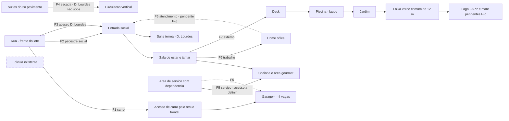

# Organograma funcional, caracterização e adiamento dos esquemas (PN-ARQ 5.2.1) — Ensaio Sombra 003 — v2

**Oscar, 12/10/2026.** Caso fictício. Esta peça é diagrama, texto e tabela. **Não há desenho de planta, volume, implantação ou layout** (proibido nesta etapa).

**Exigência da norma:** NBR 6492:2021, item 5.2.1, PDF p. 15 (cópia NBR 6492-2021 Representacao de Projetos de Arquitetura.pdf) [lido]:
- a) "organograma funcional com a relação entre os ambientes e destes com os fluxos pretendidos";
- b) "esquemas básicos em escalas convenientes que tratem da caracterização desses ambientes quanto à área, dimensões, mobiliário e demais exigências".

**Status:** 5.2.1 a) SIM (§1). 5.2.1 b) **PARCIAL** (§2 em texto; esquema em escala adiado por ADIE, §3).

---

## 1. Organograma funcional (5.2.1 a)

Nós: rua (frente); acesso de veículos pelo afastamento frontal; garagem (4 vagas); entrada de pedestres; zona social; zona íntima (suítes, inclusive a térrea); zona de trabalho (home office e escritório pendente); zona de serviço (área de serviço e dependência); zona externa (deck, piscina, jardim); fundos com faixa verde comum e lago.

**F8 Edícula existente:** fora do fluxo. Demolição recomendada (parecer Etapa 01, P2 [nv]). Decisão do cliente com Kelsen.

| Fluxo | De → para | Quem | Condição e fonte | Dono |
|---|---|---|---|---|
| F1 Carro | Rua → acesso frontal → garagem | Família, visitas | Acesso de carro atravessa o recuo frontal de 6,00 m (Regramento Art. 6). Rampa de até 10% e 0,50 m de altura: LC 270 p. 130, Art. 363 §3º (cópia LC270_2024_PlanoDiretorLUOS.pdf) [lido]. Vaga descoberta no recuo frontal: excluída na ZPP (Dec. 3.046 p. 4, Disp. Gerais XXII [lido]). Ipê e amendoeiras: locação pendente (T11). Sem subsolo (Regramento Art. 8) | Kelsen; topógrafo |
| F2 Pedestre social | Rua → entrada social → sala e jantar → cozinha e gourmet | Família, visitas | Ligação entre a entrada e a zona de serviço: a definir | EP (Etapa 05) |
| F3 Acesso de D. Lourdes | Rua → entrada → suíte térrea e banheiro | D. Lourdes (cadeira de rodas) | Desnível entre rua e soleira desconhecido (T2, T4). Soleira prevista +3,20 m (caso §5.2). Circulação acessível: dimensões a definir (ver 07, item 2) | Cliente; EP; topógrafo |
| F4 Vertical | Suítes do 2º pavimento → escada | Família | D. Lourdes não sobe escada (Rodrigo, 07/10). Por isso as suítes de uso dela ficam no térreo. Elevador não está no programa: a definir | Cliente |
| F5 Serviço | Área de serviço → cozinha → garagem | Funcionário, se houver (P-j) | **Acesso de serviço não definido no dossiê.** Caminho: a definir | Cliente |
| F6 Trabalho e atendimento | Home office e escritório → social, se houver atendimento | Helena, Rodrigo, clientes eventuais | Atendimento externo e porta própria: pendentes (P-g). Sem isso, o fluxo fica interno | Cliente; Kelsen |
| F7 Externo | Sala e gourmet → deck → piscina → jardim → faixa verde comum → lago | Família | Faixa verde de 12 m é comum: uso depende de autorização do condomínio (Etapa 03 v8, Peça 2 [nv]). APP e maré pendentes (P-c). Piscina: laudo | Kelsen; SMAC; condomínio |
| F8 Edícula existente | Fora do fluxo | — | Demolição recomendada (parecer Etapa 01, P2 [nv]). Decisão do cliente com Kelsen | Cliente |

---

## 2. Caracterização básica de cada ambiente (5.2.1 b, em texto)

Dimensões, áreas e mobiliário: nenhum está no dossiê. Onde há exigência, a fonte está na coluna. "Mobiliário" é a definir pelo cliente e pela equipe de interiores.

| Ambiente | Área | Dimensões | Mobiliário | Demais exigências (fonte) | Dono |
|---|---|---|---|---|---|
| Suíte térrea (D. Lourdes) | a definir | a definir | a definir (cama, armário, banheiro acessível) | Programa (caso §4). Não é exigência legal: COES p. 17, Art. 31 V [lido], com ressalva de lei federal (P-m). Acessibilidade interna: NBR 9050 não disponível no organismo e não lida (ver 07, item 2) | Cliente; EP |
| Suítes demais | a definir | a definir | a definir | Programa (caso §4). Pé-direito de permanência prolongada: Skill de COES, §1, linha 54 [nv] | Cliente |
| Banheiros e lavabo | a definir | a definir | a definir | Não listados no caso §4 | Cliente; EP |
| Home office | a definir | a definir | a definir (mesa, estante) | Programa. Se houver atendimento externo, o uso é a verificar (P-g; Skill de COES, linha 141) | Cliente; Kelsen |
| Escritório com porta própria (pendente) | a definir | a definir | a definir | Pedido de 09/10. Não é premissa (04, A-22) | Cliente; Kelsen |
| Home cinema | a definir | a definir | a definir (poltronas, tela) | Programa (caso §4). Acústica e iluminação: Etapa 05 e Complementares | Cliente; Tenreiro |
| Sala de estar e jantar | a definir | a definir | a definir | Programa (caso §4) | Cliente |
| Cozinha | a definir | a definir | a definir | Programa (caso §4) | Cliente |
| Área gourmet | a definir | a definir | a definir (churrasqueira, bancada) | Se fechada, computa na ATE e na TO. Se varanda com brise vazado: aeração de no mínimo 50% do vão, COES p. 5, Art. 8º §6º [lido] | Cliente; EP |
| Área de serviço com dependência | a definir | a definir | a definir | Programa (caso §4). Dimensão mínima: a definir. Quem usa a dependência: P-j | Cliente |
| Garagem (4 vagas) | 4 vagas; manobra a definir (02 §3) | vaga 2,50 × 5,00 m; manobra 2,50 × 5,00 m | não aplicável | COES p. 15, Art. 29 I e II [lidos]. Quantidade: decisão C1. Cobertura: P-e. Fora da ATE: LC 270 p. 124, Art. 347 II [lido] | Cliente; Kelsen |
| Piscina | a definir | fundo até 1,60 m (Regramento Art. 8); fundo a 0,70 m abaixo do NA (E-21) | não aplicável | Fora de H1. Laudo contra flutuação (Baumgart/Cardozo). Piscina descoberta fora da projeção (LC 270 p. 125, Art. 350, caput [lido]) | Cliente; Baumgart/Cardozo |
| Deck | a definir | a definir | a definir | Área descoberta impermeável: consome a folga permeável (E-28) | Cliente; Glaziou |
| Jardim | a definir | a definir | a definir | Área permeável (LC 270 p. 125, Art. 352 e p. 126, Art. 353 I [lidos]). Árvores: Regramento Art. 12 | Cliente; Glaziou |
| Varandas e sacadas, se houver | a definir | balanço ou reentrância | a definir | COES p. 5, Art. 8º §§1º, 2º e 4º [lido]. Sem balanço sobre o frontal (premissa conservadora; Dec. 3.046 p. 3, Disp. Gerais VII [lido em parte]) | Kelsen (P-f) |
| Edícula existente | área a definir | 0,80 m da divisa lateral direita (caso §5.2) | não aplicável | Sem uso no programa. Recuo: falta 1,70 m (Regramento Art. 6) e 0,70 m (COES p. 17, parágrafo único [lido]). Computa na ATE e na TO (Dec. 3.046 p. 3, Disp. Gerais XV [lido]) | Cliente; Kelsen |

---

## 3. Adiamento dos esquemas básicos em escala (5.2.1 b) — ADIE

**ADIE: adiamento por escrito de entrega obrigatória de documento gráfico.**

- **Item adiado:** esquemas básicos em escala, que tratam de área, dimensões, mobiliário e demais exigências de cada ambiente (NBR 6492:2021, 5.2.1 b).
- **Motivo:** o dossiê não fixa nenhuma dimensão. Todas estão "a definir" (02 §1). Um esquema em escala sem dimensão seria invenção. E a etapa veda planta, volume e layout (enunciado, "Não faça"). Os esquemas dependem de número que ainda não existe.
- **O que está entregue no lugar:** a caracterização em texto (§2) e a lista de dimensões pendentes com dono (02 §1).
- **Dono:** Oscar, com Lúcio. Prazo: Etapa 05 (Estudo Preliminar), depois que o programa e a permeável (P-h) estiverem fechados.
- **Registrado também em:** 07, item 5.
- **Status declarado: PARCIAL.** Nenhum esquema de planta foi feito nesta etapa.

---

## 4. Limites

- Esta peça não define área, dimensão nem layout de nenhum ambiente.
- A conexão F5 (serviço) e a circulação de D. Lourdes (F3) precisam de decisão do cliente antes do Estudo Preliminar.
- Os esquemas básicos em escala (5.2.1 b) estão adiados pelo ADIE (§3).
