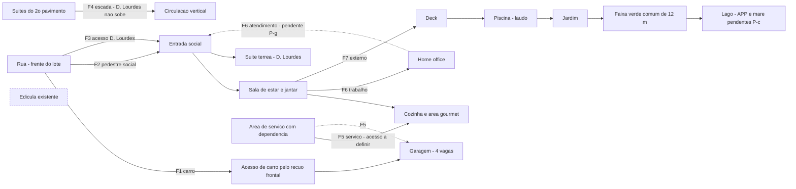

# Etapa 04 — Briefing — v2 — Ensaio Sombra 003 — CONSOLIDADO

**Consolidado em 14/10/2026 por Wallenberg, a pedido de Claudemberg.** Esta é a versão única da Etapa 04 (v2). Duas rodadas chamadas "v2" foram reunidas aqui, sem reescrever texto. Nenhuma das duas rodadas é cópia da outra: os 7 pares de arquivos diferem em conteúdo.

- **Parte 1, rodada de 13/10/2026 (`_v2`, mais recente):** base da consolidação.
- **Parte 2, rodada de 12/10/2026 (sem sufixo, anterior):** preservada na íntegra, para registro.

As duas rodadas não foram aprovadas por ninguém. Passam à auditoria de Lúcio e ao Gate.

---

## PARTE 1 — Rodada de 13/10/2026 (`_v2`)


### [Parte 1] 01_briefing_corpo_003_v2.md

# Etapa 04 — Briefing (corpo) — v2 — Ensaio Sombra 003

**Família Montenegro Prates** · Rua das Garças, Lote 17, Quadra C · Condomínio Reserva das Garças · Recreio (AP4, RA XXIV)
**Oscar, 12/10/2026 (rodada agendada da Drenagem Contínua).** Caso 100% fictício. Análise preliminar. Não é projeto: sem planta, volume, implantação ou layout.
**Esta v2 refaz a v1 de 09/10/2026** (`entrega/`, intacta) e resolve as 8 correções de 12/10. Não é aprovada por ninguém; passa à auditoria de Lúcio e ao Gate.
**Contagem de palavras: a fazer por Wallenberg com ferramenta. Não estimada.**

Anexos v2: `02_planilha_ambientes_003_v2.md`, `03_organograma_esquemas_003_v2.md`, `04_matriz_decisoes_cliente_003_v2.md`, `05_anexo_contas_briefing_003_v2.md`, `06_declaracao_leitura_003_v2.md`, `07_bloqueios_003_v2.md`, `08_auditoria_lucio_003_v2.md`, e a prova item a item em `checagem_oscar_v2.md`.

Legenda de fonte: **[lido v2]** = aberto nesta execução, com página. **[nv]** = não reaberto nesta execução; citação herdada da v1 ou de Skill/parecer. Nada marcado [nv] sustenta um "cabe". Forma de citação (regra da v2): COES p. N, Art. X (cópia COES_LeiComplementar198_2019_CONSOLIDADO_SMU.pdf); LC 270 p. N, Art. X (cópia LC270_2024_PlanoDiretorLUOS.pdf); Dec. 3.046 p. N (cópia Decreto3046_1981_PlanoPilotoBaixadaJacarepagua.pdf); LC 281 p. N (cópia LC281_2025_CondicoesEspeciais_CONSOLIDADO.pdf); LC 301 p. N (cópia LC301_2026_AEIUPracaOnze_AlteraLC270e281.pdf).

---

## 1. Conclusão

1. **O programa de cerca de 520 m² não fecha no lote.** Em H0 (sem APP nos fundos) cabe só se três condições forem atendidas ao mesmo tempo (§4). Sob a premissa vigente, em que tudo o que é coberto conta no teto, faltam **62,56 m²** (E-12). Em H1 (APP de 30 m) a construída máxima é **297,28 m²**, e faltam 222,72 m² (E-13).
2. **Nenhum pedido das mensagens de 07 a 09/10 entra como premissa.** Subsolo, rooftop, Mais-Valerá, edícula como suíte, remoção do ipê e das amendoeiras e "lago pequeno" ficam registrados com fonte, o que cabe, o que não cabe e o dono (§5 e 04).
3. **A suíte térrea para D. Lourdes é requisito de programa, não exigência do COES.** O COES, Art. 31 V, dispensa a unifamiliar das normas técnicas de acessibilidade, desde que mantidas salubridade e higiene (COES p. 17, cópia COES_LeiComplementar198_2019_CONSOLIDADO_SMU.pdf, **[lido v2]**). A lei federal de acessibilidade segue pendente (P-m).
4. **Não há OODC neste lote.** CAB = CAM = 1,0 (caso §5.3, RIU simulado). Onde CAB = CAM, não se aplica outorga onerosa (LC 270 Art. 345 §3º, p. 122, cópia LC270_2024_PlanoDiretorLUOS.pdf, **[lido v2]**). O Mais-Valerá (LC 281) não é premissa (§3, P12; 04, A-17).
5. **Nenhuma área de cômodo está fixada no dossiê.** Toda área por ambiente está "a definir", com dono (02).
6. **Garagem: a área total não é fechada.** Vaga 2,50 × 5,00 m e manobra 2,50 × 5,00 m são texto de lei (COES Art. 29 I e II, p. 15, cópia COES_LeiComplementar198_2019_CONSOLIDADO_SMU.pdf, **[lido v2]**). A lei não fixa m² por vaga. Nenhum valor de "a" é usado (P7).

## 2. Síntese do programa (sem redimensionar)

- **Família:** Rodrigo (52) e Helena (49), filhos de 16 e 19 anos, e D. Lourdes (81, cadeira de rodas), que vai morar com eles (caso §1).
- **Programa (caso §4):** 4 suítes (uma no térreo), home office, home cinema, sala de estar e jantar integrada, cozinha com área gourmet, área de serviço com dependência, piscina, deck e jardim.
- **Garagem:** 4 vagas (decisão C1 de Claudemberg, 08/10; aceita por Rodrigo, 07/10).
- **Pedido em aberto:** escritório com porta própria e atendimento eventual de clientes (Helena, 09/10). Não se sabe se é o mesmo home office do caso §4.
- **Metragem:** cerca de 520 m² construídos. Não se sabe se o número inclui a garagem (P-o).

## 3. Premissas fechadas

Fechada = dado do dossiê, norma lida no texto primário nesta execução ou premissa aprovada na etapa anterior.

- **P1. Área do lote: PERGUNTA ABERTA, NÃO FECHADA.** Dois valores, cada um com a fonte:
  - **571,80 m²**, área medida (caso §5.2, linha 52; enunciado da Etapa 04, linha 35).
  - **600,00 m²**, área de cadastro, matrícula e título (caso §5.1, linha 46; caso §5.3, linha 66, RIU, campo "Área do lote no cadastro").
  - **O próprio caso se contradiz:** caso §5.6 (linha 94, seção 5.6, estudo de massa do arquiteto anterior, agosto/2024) diz "Área do lote adotada: 600,00 m²". É valor de documento de 2024, não da medição de 09/2026.
  - Status: **NÃO FECHADA. Pergunta ao cliente e a Kelsen (P-a).** A Etapa 01 §2.1 usou 571,80 para o cálculo. Essa é decisão da Etapa 01, que não altero, e não é premissa deste Briefing.
  - As contas E-1 a E-28 (05) usam 571,80 só como base aritmética, não como escolha. Se a área for 600,00 m², o cenário título dá projeção 240,00 m², teto computável 480,00 m² e permeável 150,00 m² (parecer_legal_base_003.md da Etapa 01, §2.2, linhas 66-72, [nv]).
- **P2. TO 40%** (Regramento Art. 5, caso §5.4), mais restritiva que a TO de 50% do RIU (caso §5.3), pela regra de comparação de 03/09 (Etapa 01, §0). Projeção máxima: **228,72 m²** (E-1).
- **P3. Gabarito de 2 pavimentos e 8,50 m da soleira**, cobertura só técnica (Regramento Art. 7). Teto computável: **457,44 m²** (E-2). A fórmula do teto vem de LC 270 Art. 354 §7º **[nv]**.
- **P4. Afastamentos: 6,00 m frontal, 2,50 m laterais, 5,00 m fundos** (Regramento Art. 6). O COES fixa 1,50 m para unifamiliar (p. 17, cópia COES_LeiComplementar198_2019_CONSOLIDADO_SMU.pdf, parágrafo único, **[lido v2]**), menos restritivo. Vale o Regramento.
- **P5. Sem subsolo e sem escavação acima de 1,20 m**; piscina com até 1,60 m (Regramento Art. 8).
- **P6. Permeável: 142,95 m² (25%, RIU do dossiê) como número operacional**, por ser o mais restritivo. A SMD da LC 270 Art. 352 (20% da área livre resultante da TO máxima; cópia LC270_2024_PlanoDiretorLUOS.pdf, p. 125, [lido v2]) dá **57,18 m²** com TO 50%: 571,80 × (1 − 0,50) × 0,20. **TO 50% do RIU do dossiê, não conferida no Dec. 3.046 (lacuna); SMD em aberto para Kelsen.** Ver §7 e E-28.
- **P7. Garagem: 4 vagas (C1).** Vaga 2,50 × 5,00 m (COES Art. 29 I, p. 15, cópia COES_LeiComplementar198_2019_CONSOLIDADO_SMU.pdf, **[lido v2]**). Área de manobra 2,50 × 5,00 m, contígua à menor dimensão da vaga (Art. 29 II, p. 15, cópia COES_LeiComplementar198_2019_CONSOLIDADO_SMU.pdf, **[lido v2]**). **Total de garagem: NÃO FECHADO.** A Skill de vaga (v1.6, 10/10/2026) retirou a leitura de 25 m² por vaga, que não tem texto de lei (varredura de Hely e conferência de Kelsen; COES p. 15, cópia COES_LeiComplementar198_2019_CONSOLIDADO_SMU.pdf). Não somo vaga com manobra. "a" (m² por vaga coberta) **sem valor**. A quantidade de áreas de manobra é a definir.
- **P8. Uma vaga coberta fora da TO** (LC 270 Art. 350 III, p. 125, cópia LC270_2024_PlanoDiretorLUOS.pdf, **[lido v2]**). Garagem, acessos e áreas de manobra ficam fora da ATE (Art. 347 II, p. 124, cópia LC270_2024_PlanoDiretorLUOS.pdf, **[lido v2]**, com "áreas de manobras" no texto).
- **P9. Varandas não computam na ATE nem na TO** (COES Art. 8º §4º, p. 5, cópia COES_LeiComplementar198_2019_CONSOLIDADO_SMU.pdf, **[lido v2]**), com recuo de 1,00 m da testada (§1º) e 2,50 m das divisas laterais e de fundos (§2º), também em **[lido v2]**. Premissa conservadora: nenhum balanço sobre o frontal, pela regra da ZPP (Dec. 3.046, Disp. Gerais VII, pp. 2-3, cópia Decreto3046_1981_PlanoPilotoBaixadaJacarepagua.pdf, **[nv]**, cuja última frase remete ao XI). Tensão em aberto (P-f).
- **P10. Edícula existente computa na ATE e na TO** (Dec. 3.046 XV, p. 3, cópia Decreto3046_1981_PlanoPilotoBaixadaJacarepagua.pdf, **[nv]**). Conflito com LC 270 Art. 347 V e 350 IV, "nas condições do COES" (ambos lidos nas pp. 124-125, cópia LC270_2024_PlanoDiretorLUOS.pdf, **[lido v2]**). Premissa conservadora até decisão de Kelsen. Parecer de demolição total (Etapa 01, P2).
- **P11. Comissão de Obras do condomínio aprova antes do protocolo** (Regramento Art. 9).
- **P12. Sem OODC neste lote.** CAB = CAM = 1,0 (caso §5.3). LC 270 Art. 345 §3º, p. 122, cópia LC270_2024_PlanoDiretorLUOS.pdf, **[lido v2]**: "não se aplica Outorga Onerosa do Direito de Construir onde o CAB for igual ao CAM". Logo, nenhuma área por OODC. A isenção de 5 anos (LC 270 Art. 110) só age sobre a diferença CAM − CAB; com diferença zero, não muda nada **[nv]**.
  - **Ressalva de fonte:** a Skill `legal-oodc-mais-valera-mais-valia` diz, na linha 53, "Se CAB = CAM, não há OODC possível. Leitura do Hely, não conferida por Kelsen." A conclusão acima decorre do §3º, lido no primário. A frase da linha 53 é leitura do Hely e fica marcada assim.
  - Linha 30 da mesma Skill: o desconto de 30% em 60 cotas (LC 281 Art. 19 II) não alcança AP4. Confere com o parecer da Etapa 01, que a Kelsen auditou (LC 281 p. 7, cópia LC281_2025_CondicoesEspeciais_CONSOLIDADO.pdf, **[nv]** para mim nesta execução).

## 4. Cenários H0 e H1

**H0** (571,80 m² como base aritmética, ver P1; sem APP nos fundos)

- Envelope de implantação: **269,41 m²**, com folga de 40,69 m² (E-3, E-4). A projeção de 228,72 m² cabe no envelope.
- **Cabe:** programa computável de até 457,44 m² (teto de P3), com as vagas cobertas que a TO aceitar.
- **Não cabe:** 520 m² sob a premissa vigente (tudo o que é coberto conta no teto). Faltam **62,56 m²** (E-12). Ver §4-bis.
- **Cabe 520 m² só se as três condições forem atendidas ao mesmo tempo** (Etapa 03 v8, Anexo C-7, [nv] nesta execução):
  - (c1) o condomínio mede a TO como a Prefeitura (regime M-a), por escrito, e Kelsen confirma;
  - (c2) as varandas não computáveis somam V ≥ 62,56 − a, dentro do envelope, sem balanço frontal e com os recuos do COES Art. 8º §§1º e 2º (E-16);
  - (c3) o cliente aceita perder (n − 1)·a de área útil do térreo, onde n é o número de vagas cobertas (E-15).
- "a" não tem valor fixado. Sem as três condições, 520 m² não cabe em H0.

**H1** (APP de 30 m a partir da margem, contingente)

- Envelope de **148,64 m²**, sem folga (E-10). Construída máxima de **297,28 m²** (E-11).
- **Cabe:** programa de até 297,28 m² construídos. A garagem dentro do envelope só cabe se n·a ≤ 148,64 m² (E-17, condição de limiar, não valor).
- **Não cabe:** 520 m² (faltam 222,72 m²). Também não cabe a área de trabalho de 340–360 m² da Viabilidade v9 §2 (E-25; citação da v1, v9 não reaberta nesta execução).
- Permeável sem contar a APP: folga de 22,79 m². Acesso acima de 3,80 m esgota a folga (E-14).
- H1 depende de SMAC, INEA e SPU (P-c). Não é premissa.

## 4-bis. Programa de 520 m²: computável × não computável

Cada item com número, regra e artigo. Regimes: **computável** = conta na ATE e no teto volumétrico; **não computável** = excluído por lei, com o artigo.

| Linha | Item | Número (m²) | Regra e artigo | Status |
|---|---|---|---|---|
| L1 | Programa pedido | cerca de 520 | Caso §4 | Não fixado; regime a confirmar (P-o) |
| L2 | Teto computável de H0 (2 × projeção 228,72) | 457,44 | E-2; Etapa 01 §2.2 | **Computável** (teto) |
| L3 | Diferença L1 − L2 | 62,56 | E-12 | Não coberta por computável |
| L4 | Vagas (4 × 2,50 × 5,00) | 50,00 (só vagas) | COES Art. 29 I, p. 15, cópia COES_LeiComplementar198_2019_CONSOLIDADO_SMU.pdf [lido v2]; excluída da ATE: LC 270 Art. 347 II, p. 124, cópia LC270_2024_PlanoDiretorLUOS.pdf [lido v2]. Fora da TO só 1 vaga coberta: Art. 350 III, p. 125, cópia LC270_2024_PlanoDiretorLUOS.pdf [lido v2] | **Não computável na ATE**; na TO, só 1 vaga |
| L5 | Áreas de manobra (n × 2,50 × 5,00) | n × 12,50; n a definir | COES Art. 29 II, p. 15, cópia COES_LeiComplementar198_2019_CONSOLIDADO_SMU.pdf [lido v2]; "áreas de manobras" em LC 270 Art. 347 II [lido v2] | **Não computável na ATE**; n a definir |
| L6 | Varandas e sacadas, se houver | V; área a definir | COES Art. 8º §4º, p. 5, cópia COES_LeiComplementar198_2019_CONSOLIDADO_SMU.pdf [lido v2]; recuos §1º (1,00 m da testada) e §2º (2,50 m das divisas) [lido v2] | **Não computável** na ATE e na TO; V a definir |
| L7 | Edícula existente | não somada | Dec. 3.046 XV [nv]; LC 270 Art. 347 V e 350 IV [lido v2] | **Computa** (premissa conservadora, P10) |
| L8 | Subsolo | 0 | LC 270 Art. 347 VII e 350 V [lido v2]; Regramento Art. 8 | Excluído da ATE, mas **vedado** pelo condomínio |
| L9 | Soma fixada não computável | 50,00 (só L4) | — | **NÃO FECHADA**: faltam L5 e L6 |

Leitura da tabela:
- As parcelas não computáveis que a lei permite são garagem (L4 e L5) e varandas (L6). A soma só de vagas é 50,00 m². Não fecha: a manobra depende de n, e as varandas dependem de V.
- A tabela não fecha o 520 sozinha. A conta de H0 (E-15, E-16) segue a Etapa 03 v8 e depende de "a", que está sem valor. **Não re-derivei a conta de E-15 e E-16 nesta v2.**
- **Pergunta em aberto (P-o):** o caso §4 não diz se os cerca de 520 m² incluem a garagem. Se incluírem, a garagem entra na conta de L4 e L5. Se não incluírem, a diferença de L3 muda. Pergunta a Rodrigo e Helena, via Lúcio, e a Villaça.

## 5. Conflitos cliente × lei e condomínio, e tratamento

Cada item: pedido, fonte, o que cabe, o que não cabe, dono e tratamento. Prova em 04 e 05.

1. **Subsolo para 6 carros** (Rodrigo, 28/09 e 09/10). Vedado pelo Regramento Art. 8. Alterar exige 2/3 dos condôminos (31 de 46) em assembleia convocada para isso (Art. 21). Dentro da SMD, a LC 270 Art. 353 §4º veda subsolo (cópia LC270_2024_PlanoDiretorLUOS.pdf, p. 126 [nv]). **Cabe:** nada hoje. **Não cabe:** subsolo como premissa. Síndico não é fonte. Dono: condomínio (assembleia) e Kelsen. **Tratamento:** fora do Briefing. Rebaixar o lençol (NA a 0,90 m, argila mole até 9 m; caso §5.7) é risco extra.
2. **Rooftop gourmet com piscina** (Rodrigo, 28/09). Vedado pelo Regramento Art. 7. A contrapartida da LC 281 Art. 9 não altera o Regramento. **Cabe:** cobertura técnica. **Não cabe:** pavimento de uso sobre a laje. Dono: condomínio e Kelsen. **Tratamento:** fora.
3. **Mais-Valerá, 60x com 30% de desconto, "paga até o fim do ano"** (Rodrigo, 28/09 e 09/10). **Não confere.** Ver P12: não há OODC; no caso da LC 281, AP4 fica fora do parcelamento com desconto (LC 281 Art. 19 II, p. 7, cópia LC281_2025_CondicoesEspeciais_CONSOLIDADO.pdf [nv]; Skill legal-oodc, linha 30). O desconto de 30% é à vista, com requerimento até 01/12/2026 (LC 301 Art. 58, p. 38, cópia LC301_2026_AEIUPracaOnze_AlteraLC270e281.pdf [nv]). A licença depende da contrapartida quitada (LC 281 Art. 20, p. 8, cópia LC281_2025_CondicoesEspeciais_CONSOLIDADO.pdf [nv]). **Cabe:** nada previsto sem valor e fonte. **Não cabe:** "previsto, depois a gente ajeita". Dono: Kelsen (valor e prazo) e cliente.
4. **Manter a edícula como suíte da mãe, com banheiro novo** (Helena, 08/10). Não desenhar, não é premissa. Falta 1,70 m ao recuo do condomínio (Art. 6) e 0,70 m ao COES unifamiliar (p. 17, cópia COES_LeiComplementar198_2019_CONSOLIDADO_SMU.pdf, parágrafo único, [lido v2]). Edícula computa (P10). Não ocupar área de recuo é condição de legalização (LC 281 Art. 22 III [nv]). O pedido também muda o programa: um quarto vira escritório e a suíte da D. Lourdes iria para a edícula. Dono: cliente, Kelsen e Comissão de Obras. **Tratamento:** parecer de demolição mantido.
5. **Piscina existente mantida** ("economiza", caso §4). Cabe só com laudo: fundo a 0,70 m abaixo do NA de 0,90 m (E-21), fora de H1, com até 1,60 m, fora do envelope e com permeável suficiente (locações A e B, E-8 e E-9). Dono: cliente e Baumgart/Cardozo. **Tratamento:** em suspenso até o laudo.
6. **Lago "pequeno", "não atrapalha"** (Helena, 29/09; corretor, 09/10). Não confirmado. A LC 270 Art. 215 §2º dispensa a faixa só em superfície inferior a 10.000 m² (cópia LC270_2024_PlanoDiretorLUOS.pdf, pp. 79-80 [nv]). "Aproximadamente 1 ha" não prova isso. Relato de maré e manilha ligada ao canal (caso §5.9). **Cabe:** H0 como hipótese de estudo. **Não cabe:** o lago como "não atrapalha". Dono: SMAC, INEA e SPU via Kelsen; topógrafo (T13, T14, T19). **Tratamento:** os 18 m do fundo ficam em suspenso.
7. **Remover o ipê e as amendoeiras para a rampa** (Helena, 29/09 e 09/10). O motivo cai com o subsolo vedado (item 1). Remover exige licença (LC 270 Art. 278 XIV, p. 97, cópia LC270_2024_PlanoDiretorLUOS.pdf [nv]) e autorização do condomínio (Regramento Art. 12). Rampa de veículo no frontal: até 10% e 0,50 m de altura (LC 270 Art. 363 §3º, p. 130, cópia LC270_2024_PlanoDiretorLUOS.pdf [nv]). A Skill de remoção de árvores (ressalva R2) diz que a Lei Federal 15.299/2025 dá silêncio positivo em risco comprovado; não é autorização automática, e não se deve dizer ao cliente que a FPJ concede em 45 dias. **Cabe:** acesso de carro que preserve as árvores, sujeito à locação (T11). **Não cabe:** remoção como premissa. Vaga descoberta no frontal é ressalva (Dec. 3.046 XXII, p. 4, cópia Decreto3046_1981_PlanoPilotoBaixadaJacarepagua.pdf [lido v1, nv v2]; errata de Kelsen, 08/10). Dono: cliente, SMAC, condomínio e Glaziou (laudo).
8. **Escritório com porta própria e atendimento de clientes** (Helena, 09/10: "pode escrever como premissa?"). **Cabe:** escritório como ambiente da casa, na área computável. **Não cabe como premissa:** porta própria e atendimento externo. Uso não residencial não verificado: o Regramento (preâmbulo do Art. 5) fala em "residenciais unifamiliares" e o RIU diz "residencial unifamiliar permitido". Leitura a confirmar com Kelsen. Dono: cliente (programa), Kelsen (uso) e condomínio.
9. **Suíte no térreo para D. Lourdes** (Rodrigo, 07/10: "isso é exigência da lei, né?"). **Não é exigência do COES para esta casa**: Art. 31 V dispensa (COES p. 17, cópia COES_LeiComplementar198_2019_CONSOLIDADO_SMU.pdf, [lido v2]). Lei federal segue pendente (P-m). **Cabe:** suíte térrea no programa. Pressuposto: desnível entre rua e soleira, ainda desconhecido (T2, T4). Dono: cliente.
10. **Seis vagas** (Rodrigo, 28/09). Substituído por 4 vagas (C1; "fechado nas 4 vagas", 07/10). Seis ficam só como fórmula, fora do Briefing (E-15).
11. **"Cabem 590 m²" e "direito adquirido" da edícula** (estudo de 2024, caso §5.6). Não servem. 590 m² ficam 132,56 m² acima do teto de H0 (E-24). O artigo citado foi revogado (Etapa 01, P2).
12. **Licença até 30/06/2027 e obra em maio/2027** (caso §2). Possível com disciplina; maio de 2027 é de alto risco (Etapa 01, §3, P7). Prazo não é premissa de programa.

## 6. Premissas pendentes, com dono

- **P-a. Área do lote: NÃO FECHADA.** 571,80 m² (medida, caso §5.2) × 600,00 m² (cadastro, caso §5.1 e §5.3), e divisa com o Lote 16 (P1). Pergunta ao cliente e a Kelsen. Dono: cliente e advogado (divisa); Kelsen (qual área entra no cálculo).
- **P-b.** Regime de medição da TO pelo condomínio (M-a × M-b). Dono: condomínio, por escrito, e Kelsen.
- **P-c.** Lago: espelho d'água, maré, FMP, APP e marinha (H0 × H1). Dono: SMAC, INEA e SPU via Kelsen; topógrafo (T13, T14, T19).
- **P-d.** Valor de "a" (vaga e manobra; manobra individual ou compartilhada). Dono: Hely via Kelsen. **Sem valor fixado.** A lei não traz m² por vaga (Skill de vaga v1.6).
- **P-e.** Vaga coberta: LC 270 Art. 350 III e Art. 363 §2º XII × Dec. 3.046 XXIII a e b (pavimento-garagem). Dono: Kelsen, e Gate.
- **P-f.** Varanda frontal: COES Art. 8º §1º × Dec. 3.046 VII, cuja última frase remete ao XI. Dono: Kelsen, e Gate.
- **P-g.** Uso do escritório e atendimento externo. Dono: Kelsen e condomínio.
- **P-h.** Permeável: RIU 25% (142,95 m²) × SMD da LC 270 Art. 352 (20% da área livre da TO máxima, 57,18 m² com TO 50%). Rótulo: "TO 50% do RIU do dossiê, não conferida no Dec. 3.046 (lacuna); SMD em aberto para Kelsen". Dono: Kelsen. Ver §7.
- **P-i.** Responsável técnico (PRPA): não definido (Etapa 01, §5.3). Lúcio sinaliza; não decido.
- **P-j.** Acesso de serviço e funcionário doméstico. Dono: cliente.
- **P-k.** Cota de soleira (+3,20 m, prevista) e desnível rua × soleira. Dono: topógrafo e Kelsen.
- **P-l.** Área de cada ambiente. Dono: cliente, com o Estudo Preliminar (Etapa 05).
- **P-m.** Se a lei federal de acessibilidade alcança a casa privada, o que muda na suíte térrea. Dono: Kelsen. Texto da lei não lido (07, item 1).
- **P-n.** Texto integral da NBR 9050 para as dimensões de acessibilidade interna da suíte térrea. Dono: Lúcio, com Tenreiro na Etapa 05. Ver 07, item 3.
- **P-o.** O programa de 520 m² inclui ou não a garagem? Dono: cliente (pergunta via Lúcio) e Villaça.

## 7. Divergências de fonte

- **SMD (LC 270 Art. 352), lacuna real, não divergência.** A TO de 50% do RIU do dossiê não foi conferida no Dec. 3.046 (cópia Decreto3046_1981_PlanoPilotoBaixadaJacarepagua.pdf) nem no Anexo XXI da LC 270 (não lido). Pelo texto do Art. 352 (cópia LC270_2024_PlanoDiretorLUOS.pdf, p. 125, [lido v2]), a SMD é 20% da área livre resultante da TO máxima. Com TO 50%: área livre = 571,80 × (1 − 0,50) = 285,90 m²; SMD = 20% × 285,90 = **57,18 m²** (E-28). Consistente com a Etapa 01, §1, quadro, parâmetro 14 ("daria 10%", linha 36 do parecer_legal_base_003.md): 20% × 50% = 10% = 57,18 m². **Kelsen decide (P-h).** Rótulo: "TO 50% do RIU do dossiê, não conferida no Dec. 3.046 (lacuna); SMD em aberto para Kelsen".
- **Viabilidade v9 §2 (S3/H1, 340–360 m²) × máximo de H1 (297,28 m²).** Dono: Villaça, via Lúcio. Citação da v1; v9 não reaberta nesta execução.
- **NBR 9050.** A Skill cita a edição de 2020. O acervo local só tem a de 2015, com o nome "DESATUALIZADA - vigente 2020". Edição 2020 não conferida (07, item 3).
- **Skill de vaga.** A v1 deste Briefing citava "R6 reprovada". A Skill está em v1.6 (10/10): a leitura de 25 m² foi retirada. Esta v2 segue a versão atual.
- **Edícula.** COES Glossário e Art. 26 × Dec. 3.046 XV × LC 270 Art. 347 V e 350 IV: tensão já registrada (P10).
- **Varanda na ZPP.** Dec. 3.046 VII × COES Art. 8º §1º (P-f).

## 8. Correções desta v2 em relação à v1 (12/10/2026)

1. Dez Skills do enunciado declaradas, uma a uma, com aplicação ou justificativa de exclusão (05, seção S). Aplicadas com a fonte da própria Skill: `legal-oodc-mais-valera-mais-valia` (P12) e `legal-base-legislativa-bairro` (CAB e CAM vêm do RIU por lote; zoneamento por lote e não por subzona; RIU simulado tratado como oficial pelo enunciado).
2. Isca 3 incluída: CAB = CAM = 1,0 e a consequência, sem OODC possível (P12; 05, V-OODC). Ressalva: a linha 53 da Skill é leitura do Hely, não conferida por Kelsen.
3. NBR 9050: edição 2020 marcada como **NÃO conferida** (fora do organismo). Não invento o texto (07, item 3; 05, V-40).
4. Organograma em diagrama (03, §1, em texto e ASCII). Esquemas em escala (PN-ARQ 5.2.1 b) **adiados para a Etapa 05**, sem dimensão fixada (03, §3; 07, item 5). Fonte: NBR 6492:2021, item 5.2.1 a e b (PDF p. 15 **[nv]** nesta execução, citação da v1).
5. Programa de 520 m²: tabela computável × não computável com números e artigos (§4-bis; 05, E-27). Números conferidos: 520 − 457,44 = 62,56; 4 × 12,50 = 50,00.
6. SMD com TO 50%: 571,80 × (1 − 0,50) = 285,90 m²; 20% × 285,90 = 57,18 m². Rotulada "TO 50% do RIU do dossiê, não conferida no Dec. 3.046 (lacuna); SMD em aberto para Kelsen". Consistente com a Etapa 01 (parâmetro 14, "daria 10%"), registrado em §7, não resolvido (05, E-28).
7. Citações do COES com a cópia usada (05, seção V). A referência de trabalho é a cópia consolidada SMU, que a Kelsen indicou como referência; estas citações estão no arquivo `COES_LeiComplementar198_2019_CONSOLIDADO_SMU.pdf` da pasta `Fontes_Legislacao` do Hely.
8. Prova item a item em `checagem_oscar_v2.md`.

## 9. Limites desta entrega

- Não desenhei planta, volume, implantação nem layout. Envelope e faixas são contas de área.
- Não reinterpretei lei. Onde a conclusão depende de leitura, está marcada.
- Nenhum valor de "a" foi fixado. Nenhuma área por ambiente foi fixada.
- Revit não usado nesta rodada: a Etapa 04 não exige desenho.
- Contagem de palavras: a fazer por Wallenberg com ferramenta.


### [Parte 1] 02_planilha_ambientes_003_v2.md

# Planilha de ambientes (PN-ARQ 5.2.2) — Ensaio Sombra 003 — Etapa 04 — v2

**Oscar, 12/10/2026.** Caso fictício. Nenhuma área ou dimensão por ambiente existe no dossiê: tudo sem número está como **"a definir"**, com dono e fonte. Não há planta. "a" é o m² de projeção por vaga coberta, **sem valor** (corpo, P7).

**Exigência da norma (NBR 6492:2021, 5.2.2, PDF p. 15 [nv nesta execução; citação da v1]):** "Planilha com a identificação e quantificação dos ambientes, respectivas dimensões e áreas mínimas, descrição dos usuários e atividades, além de outras exigências que o projeto deva suprir."

---

## 1. Ambientes

Fonte do programa: caso §4 e mensagens do cliente (07 a 09/10). Ver 04 para cada pedido.

| ID | Ambiente | Qtd | Pavimento | Dimensões | Área | Usuários | Atividades | Outras exigências (fonte) | Dono |
|---|---|---|---|---|---|---|---|---|---|
| A01 | Suíte da D. Lourdes (térrea) | 1 | térreo (programa) | a definir | a definir | D. Lourdes | dormir, higiene; sem escada | Requisito de programa, não lei: COES Art. 31 V, p. 17, cópia COES_LeiComplementar198_2019_CONSOLIDADO_SMU.pdf [lido v2]. Acesso sem degrau: T2, T4 | Cliente; EP |
| A02 | Suítes demais | 3 | a definir | a definir | a definir | Rodrigo, Helena, filhos (16 e 19) | dormir, higiene | Programa (caso §4) | Cliente |
| A03 | Home office | 1 | a definir | a definir | a definir | Rodrigo (médico), Helena (advogada) | trabalho | Programa. Uso externo: P-g | Cliente |
| A04 | Escritório com porta própria (pedido de 09/10) | a definir (0 ou 1) | a definir | a definir | a definir | Helena, Rodrigo; clientes eventuais | trabalho; atendimento | Pendente: é o mesmo que A03? Uso e acesso: P-g | Cliente; Kelsen |
| A05 | Home cinema | 1 | a definir | a definir | a definir | família | lazer | Programa (caso §4) | Cliente |
| A06 | Sala de estar e jantar integrada | 1 | a definir | a definir | a definir | família, visitas | convívio, refeição | Programa (caso §4) | Cliente |
| A07 | Cozinha | 1 | a definir | a definir | a definir | família | preparo | Programa (caso §4) | Cliente |
| A08 | Área gourmet | 1 | a definir | a definir | a definir | família, visitas | refeição, lazer | Se fechada, computa. Se varanda vazada, COES Art. 8º §6º (aeração de no mínimo 50% do vão, p. 5, cópia COES_LeiComplementar198_2019_CONSOLIDADO_SMU.pdf [lido v2]) | Cliente; EP |
| A09 | Área de serviço com dependência | 1 | a definir | a definir | a definir | a definir (P-j) | serviço | Programa (caso §4) | Cliente |
| A10 | Circulação, lavabo e sanitários comuns | a definir | a definir | a definir | a definir | família | circulação | Não listado no caso §4. Dimensão: a definir | Cliente; EP |
| A11 | Piscina (existente ou nova) | 1 | externo | a definir; fundo até 1,60 m | a definir | família | banho, lazer | Regramento Art. 8 (1,60 m). NA a 0,90 m (caso §5.7). Fora de H1; laudo | Cliente; Baumgart/Cardozo |
| A12 | Deck | 1 | externo | a definir | a definir | família | estar externo | Área descoberta impermeável consome a folga permeável (E-7) | Cliente; Glaziou |
| A13 | Jardim | 1 | externo | a definir | a definir | família | paisagismo | Área permeável. Árvores: Regramento Art. 12 | Cliente; Glaziou |
| A14 | Edícula existente | 1 (existente) | — | 0,80 m da divisa lateral (caso §5.2) | a definir | — (fora do programa) | — | Demolição recomendada (Etapa 01, P2). Falta 1,70 m (E-22) | Cliente; Kelsen |
| A15 | Garagem | 4 vagas | térreo ou a definir (cobertas: P-e) | vaga 2,50 × 5,00 m; manobra 2,50 × 5,00 m | ver §3 | 4 carros | estacionar, manobrar | COES Art. 29 I e II, p. 15, cópia COES_LeiComplementar198_2019_CONSOLIDADO_SMU.pdf [lido v2]. Quantidade não obrigatória para unifamiliar: Art. 31 III, p. 17, cópia COES_LeiComplementar198_2019_CONSOLIDADO_SMU.pdf [lido v2] | Cliente (quantidade); Kelsen (cobertura) |

---

## 2. Soma por classe (cada parcela mostrada)

### 2.1 Computável (na conta M-b, tudo o que é coberto)

- Parcelas fixadas: 0 de 10 (A01 a A10 não têm área). Soma fixada: **0**. Pendente: a definir.
- Teto computável de H0: **457,44 m²** (E-2).
- Programa pedido: cerca de 520 m² construídos (caso §4). Diferença sobre o teto: 520 − 457,44 = **62,56 m²** (E-12). Ver 01, §4-bis, e a pergunta P-o sobre a garagem.

### 2.2 Não computável (com o artigo que a exclui)

| Item | Regra | Artigo (p.) | Área fixada |
|---|---|---|---|
| Varandas e sacadas, se houver | Não computam ATE e TO, em balanço ou reentrância. Recuo de 1,00 m da testada (§1º) e 2,50 m das divisas laterais e de fundos (§2º) | COES Art. 8º §4º, §1º, §2º (p. 5, cópia COES_LeiComplementar198_2019_CONSOLIDADO_SMU.pdf [lido v2]) | 0 (V a definir) |
| Garagem: vagas, manobras e acessos, fora da ATE | Locais cobertos e descobertos de vagas, inclusive acessos e áreas de manobras | LC 270 Art. 347 II (p. 124, cópia LC270_2024_PlanoDiretorLUOS.pdf [lido v2]) | 0 (ver §3) |
| Uma vaga coberta, fora da TO | Estacionamento coberto "nos termos do COES", limitado a uma vaga em uni e bifamiliar | LC 270 Art. 350 III (p. 125, cópia LC270_2024_PlanoDiretorLUOS.pdf [lido v2]) | 0 (ver §3) |
| Subsolo | Excluído da ATE e da projeção, mas vedado pelo Regramento | LC 270 Art. 347 VII (p. 124, cópia LC270_2024_PlanoDiretorLUOS.pdf [lido v2]); Art. 350 V (p. 125, cópia LC270_2024_PlanoDiretorLUOS.pdf [lido v2]); Regramento Art. 8 | 0 |
| Edícula | **Não tratada como não computável.** Conflito: Dec. 3.046 XV (p. 3, cópia Decreto3046_1981_PlanoPilotoBaixadaJacarepagua.pdf [nv]) computa; LC 270 Art. 347 V e 350 IV excluem "nas condições do COES" (pp. 124-125, cópia LC270_2024_PlanoDiretorLUOS.pdf [lido v2]). Conservador: computa | — | 0 |
| Piscina, deck, jardim | Não são área coberta: a projeção inclui "toda a área coberta" (LC 270 Art. 350, caput, p. 125, cópia LC270_2024_PlanoDiretorLUOS.pdf [lido v2]). Consomem permeável | Art. 350 caput; SMD Art. 352 (p. 125, cópia LC270_2024_PlanoDiretorLUOS.pdf [lido v2]) | 0 |

- Soma fixada não computável: **0**. Necessário para 520 m² em H0, na conta M-a: V ≥ 62,56 − a (E-16). "a" sem valor.

### 2.3 Garagem, separada

- **Vaga:** 2,50 × 5,00 = 12,50 m² por vaga (COES Art. 29 I, p. 15, cópia COES_LeiComplementar198_2019_CONSOLIDADO_SMU.pdf [lido v2]). Quatro vagas: 4 × 12,50 = **50,00 m²** (E-18). Esta soma é só das vagas.
- **Área de manobra:** 2,50 × 5,00 = 12,50 m² por área (COES Art. 29 II, p. 15, cópia COES_LeiComplementar198_2019_CONSOLIDADO_SMU.pdf [lido v2]). Quantidade de áreas de manobra: **a definir**. Individual ou compartilhada é leitura, sem texto (P-d).
- **Total de garagem: NÃO FECHADO.** Não somo vaga e manobra. A lei não fixa m² de garagem por vaga (Skill de vaga v1.6, 10/10/2026). Quem fecha: Hely via Kelsen.
- **Cobertura:** quantas vagas cobertas, a definir. Referências: LC 270 Art. 350 III (uma fora da TO); Dec. 3.046 XXIII a e b (pavimento-garagem, [nv]; XXIII b não lido, Skill R12); COES Art. 31 III (unifamiliar dispensada de vagas, p. 17, cópia COES_LeiComplementar198_2019_CONSOLIDADO_SMU.pdf [lido v2]).

### 2.4 Áreas externas e permeável

- Piscina, deck e jardim: **a definir**.
- **Permeável, dois números com regime próprio:**
  - RIU do dossiê, 25% do lote: **142,95 m²** (E-6). Número operacional por ser o mais restritivo.
  - SMD da LC 270 Art. 352 (20% da área livre resultante da TO máxima; cópia LC270_2024_PlanoDiretorLUOS.pdf, p. 125, [lido v2]), com TO 50%: 571,80 × (1 − 0,50) = 285,90 m²; 20% × 285,90 = **57,18 m²** (E-28). **Rótulo: "TO 50% do RIU do dossiê, não conferida no Dec. 3.046 (lacuna); SMD em aberto para Kelsen".** Consistente com a Etapa 01 ("daria 10%"): 20% × 50% = 10% = 57,18 m² (01, §7).
- Área fora do envelope em H0: 85,74 + 72,50 + 72,50 + 71,45 = **302,19 m²** (E-5). Folga permeável sobre 142,95: 302,19 − 142,95 = **159,24 m²** (E-7).

---

## 3. Garagem com artigo de cada item

| Item | Medida ou regra | Artigo (p.) | Status |
|---|---|---|---|
| Vaga perpendicular | 2,50 × 5,00 m | COES Art. 29 I (p. 15, cópia COES_LeiComplementar198_2019_CONSOLIDADO_SMU.pdf [lido v2]) | Texto |
| Vaga paralela ao eixo | 2,50 × 6,00 m | COES Art. 29 I (p. 15, cópia COES_LeiComplementar198_2019_CONSOLIDADO_SMU.pdf [lido v2]) | Texto. Não usada |
| Área de manobra | 2,50 × 5,00 m, livre de obstáculos, contígua à menor dimensão demarcada | COES Art. 29 II (p. 15, cópia COES_LeiComplementar198_2019_CONSOLIDADO_SMU.pdf [lido v2]) | Texto. Individual ou compartilhada: leitura |
| Demarcação | Obrigatória, salvo proporção mínima de 25 m² de área de estacionamento por vaga (limiar, descontadas áreas inúteis) | COES Art. 29 III (p. 15, cópia COES_LeiComplementar198_2019_CONSOLIDADO_SMU.pdf [lido v2]) | Texto. É limiar de dispensa de demarcação, não tamanho de garagem |
| Acesso às faixas de circulação | Acesso direto e desimpedido, mínimo 2,50 m de largura | COES Art. 29 IV (p. 15, cópia COES_LeiComplementar198_2019_CONSOLIDADO_SMU.pdf [lido v2]) | Texto |
| Vagas para PcD | "Prevista em Lei Federal", com normas da ABNT | COES Art. 29 V (p. 15, cópia COES_LeiComplementar198_2019_CONSOLIDADO_SMU.pdf [lido v2]) | Remissão não lida (P-m) |
| Dispensa de vagas, unifamiliar | "vagas de estacionamento" | COES Art. 31 III (p. 17, cópia COES_LeiComplementar198_2019_CONSOLIDADO_SMU.pdf [lido v2]) | Texto. Se a vaga for projetada, vale o Art. 29 (leitura da Skill, R1) |
| Garagem fora da ATE | Acessos e áreas de manobras incluídos | LC 270 Art. 347 II (p. 124, cópia LC270_2024_PlanoDiretorLUOS.pdf [lido v2]) | Texto |
| Uma vaga coberta fora da TO | "nos termos do COES", limitado a uma | LC 270 Art. 350 III (p. 125, cópia LC270_2024_PlanoDiretorLUOS.pdf [lido v2]) | Texto |
| Vaga descoberta no afastamento frontal | Dec. 3.046 XXII: "excetuada aquela do afastamento frontal mínimo" | Dec. 3.046 XXII (p. 4, cópia Decreto3046_1981_PlanoPilotoBaixadaJacarepagua.pdf [nv nesta execução]) | Leitura mais restritiva na ZPP. Errata de Kelsen (08/10) |
| Garagem coberta | Dec. 3.046 XXIII a: subsolo, "com exclusão das áreas de afastamento mínimo frontal" | Dec. 3.046 XXIII a (p. 4, cópia Decreto3046_1981_PlanoPilotoBaixadaJacarepagua.pdf [nv]) | Conflito com LC 270 Art. 363 §2º XII ("nos termos do COES"). Gate (P-e) |
| Rampa de veículo no frontal | Até 10% de inclinação e 0,50 m de altura | LC 270 Art. 363 §3º (p. 130, cópia LC270_2024_PlanoDiretorLUOS.pdf [nv]) | Texto |

---

## 4. Resumo por classe

| Classe | Parcelas fixadas | Soma fixada | Pendente |
|---|---|---|---|
| Computável | 0 de 10 | 0 m² | a definir; teto de H0 = 457,44 m² (E-2) |
| Não computável | 0 | 0 m² | 62,56 − a, para 520 m² em H0 (E-16); garagem e varandas, ver 01 §4-bis |
| Garagem: vagas | 4 vagas | 50,00 m² (só vagas) | manobra; total não fechado |
| Áreas externas | 0 de 3 | 0 m² | a definir; permeável: 142,95 m² (RIU) ou 57,18 m² (SMD). Rótulo: "TO 50% do RIU do dossiê, não conferida no Dec. 3.046 (lacuna); SMD em aberto para Kelsen" |


### [Parte 1] 03_organograma_esquemas_003_v2.md

# Organograma funcional e caracterização básica dos ambientes (PN-ARQ 5.2.1) — Ensaio Sombra 003 — v2

**Oscar, 12/10/2026.** Caso fictício. Esta peça é texto, tabela e diagrama simples. **Não há planta, volume, implantação ou layout** (proibido nesta etapa).

**Exigência da norma (NBR 6492:2021, 5.2.1, PDF p. 15 [nv nesta execução; citação da v1]):**
- a) "organograma funcional com a relação entre os ambientes e destes com os fluxos pretendidos";
- b) "esquemas básicos em escalas convenientes que tratem da caracterização desses ambientes quanto à área, dimensões, mobiliário e demais exigências".

**Adiamento registrado:** o item 5.2.1 b pede esquemas em escala. Nesta etapa **nenhuma escala é adotada e nenhuma dimensão é fixada**. Os esquemas gráficos ficam para a Etapa 05 (Estudo Preliminar), com dono Oscar e Lúcio (§3 e 07, item 5). A caracterização em texto (§2) cobre o conteúdo pedido, sem substituir o desenho.

---

## 1. Organograma funcional (5.2.1 a)

### 1.1 Diagrama simplificado (relação entre ambientes e fluxos; não é desenho de planta)

```
                          RUA (frente)
                               |
            F1 carro: acesso frontal (recuo 6,00 m)
            F2 pedestre: entrada social
                               |
        +----------------------+----------------------+
        |                                             |
   GARAGEM (4 vagas)                          ZONA SOCIAL
   (vagas e manobra: a definir)               sala e jantar, cozinha, gourmet
        |                                             |
   F5 serviço (a definir) ---> ZONA DE SERVIÇO        |  F4 vertical (escada)
                               área de serviço,        |
                               dependência              v
                                              ZONA ÍNTIMA: suítes do 2º pav.
                                              SUÍTE TÉRREA (D. Lourdes) <--- F3 acesso acessível
                                                       |
                                              ZONA DE TRABALHO
                                              home office; escritório (F6, pendente)
                                                       |
                                                       v
        FUNDOS  <--- F7 ---  ZONA EXTERNA: deck, piscina, jardim
                              |
                              v
                  faixa verde comum (12 m, condomínio) --> lago (H0 ou H1, P-c)

        F8 (fora do fluxo): EDÍCULA existente, demolição recomendada
```

Leitura do diagrama:
- A entrada de carro (F1) e a de pedestre (F2) passam pelo recuo frontal de 6,00 m. A garagem fica à frente da casa (Regramento Art. 6). Sem subsolo (Regramento Art. 8).
- A suíte térrea (F3) e a escada (F4) são fluxos separados. D. Lourdes não sobe escada (Rodrigo, 07/10).
- O serviço (F5) não tem caminho definido no dossiê (P-j).
- O externo (F7) passa pela faixa verde comum, que exige autorização do condomínio.

### 1.2 Fluxos em tabela

| Fluxo | De → para | Quem | Condição e fonte | Dono |
|---|---|---|---|---|
| F1 Carro | Rua → acesso frontal → garagem | Família, visitas | Acesso de carro atravessa o recuo frontal de 6,00 m (Regramento Art. 6). Rampa de até 10% e 0,50 m de altura (LC 270 Art. 363 §3º, p. 130, cópia LC270_2024_PlanoDiretorLUOS.pdf [nv]). Ipê e amendoeiras no frontal: locação pendente (T11). Sem subsolo (Regramento Art. 8) | Kelsen; topógrafo |
| F2 Pedestre social | Rua → entrada social → sala e jantar → cozinha e gourmet | Família, visitas | Ligação entre entrada e zona de serviço: a definir | EP |
| F3 Acesso de D. Lourdes (cadeira de rodas) | Rua → entrada → suíte térrea e banheiro acessível | D. Lourdes | Desnível entre rua e soleira desconhecido (T2, T4). Soleira prevista +3,20 m (caso §5.2). Dimensões de circulação acessível: a definir; texto da NBR 9050 não conferido (07, item 3) | Cliente; EP; topógrafo |
| F4 Vertical | Suítes do 2º pavimento → escada | Família | D. Lourdes não sobe escada (Rodrigo, 07/10). Elevador não está no programa: a definir | Cliente |
| F5 Serviço | Área de serviço → cozinha → garagem | Funcionário, se houver (P-j) | **Acesso de serviço não definido no dossiê** | Cliente |
| F6 Trabalho e atendimento | Home office e escritório → social, se houver atendimento | Helena, Rodrigo, clientes eventuais | Atendimento externo e porta própria: pendentes (P-g). Sem isso, o fluxo fica interno | Cliente; Kelsen |
| F7 Externo | Sala e gourmet → deck → piscina → jardim → faixa verde comum → lago | Família | Faixa verde de 12 m é comum: uso exige autorização do condomínio (Etapa 03 v8, Peça 2 §2 [nv]). APP e maré pendentes (P-c). Piscina: laudo | Kelsen; SMAC; condomínio |
| F8 Edícula existente | Fora do fluxo | — | Demolição recomendada (Etapa 01, P2). Decisão do cliente com Kelsen | Cliente |

---

## 2. Caracterização básica de cada ambiente (5.2.1 b, em texto)

Dimensões, áreas e mobiliário: nenhum está no dossiê. Onde houver exigência, a fonte está na coluna. "Mobiliário" é a definir pelo cliente e pela equipe de interiores. **Nenhuma escala é usada.**

| Ambiente | Área | Dimensões | Mobiliário | Demais exigências (fonte) | Dono |
|---|---|---|---|---|---|
| Suíte térrea (D. Lourdes) | a definir | a definir | a definir (cama, armário, banheiro acessível) | Programa (caso §4). Não é exigência legal: COES Art. 31 V (p. 17, cópia COES_LeiComplementar198_2019_CONSOLIDADO_SMU.pdf [lido v2]), com ressalva de lei federal (P-m). Acessibilidade interna: NBR 9050 não lida (07, item 3) | Cliente; EP |
| Suítes demais | a definir | a definir | a definir | Programa (caso §4) | Cliente |
| Banheiros e lavabo | a definir | a definir | a definir | Não listados no caso §4 | Cliente; EP |
| Home office | a definir | a definir | a definir (mesa, estante) | Programa. Se houver atendimento externo, uso a verificar (P-g) | Cliente; Kelsen |
| Escritório com porta própria (pendente) | a definir | a definir | a definir | Pedido de 09/10. Não é premissa (04, A-22) | Cliente; Kelsen |
| Home cinema | a definir | a definir | a definir (poltronas, tela) | Programa (caso §4). Acústica e iluminação: Etapa 05 e Complementares | Cliente; Tenreiro |
| Sala de estar e jantar | a definir | a definir | a definir | Programa (caso §4) | Cliente |
| Cozinha | a definir | a definir | a definir | Programa (caso §4) | Cliente |
| Área gourmet | a definir | a definir | a definir (churrasqueira, bancada) | Se fechada, computa na ATE e na TO. Se varanda com brise vazado: aeração de no mínimo 50% do vão (COES Art. 8º §6º, p. 5, cópia COES_LeiComplementar198_2019_CONSOLIDADO_SMU.pdf [lido v2]) | Cliente; EP |
| Área de serviço com dependência | a definir | a definir | a definir | Programa (caso §4). Quem usa a dependência: P-j | Cliente |
| Garagem (4 vagas) | 4 vagas; manobra a definir (02, §3) | vaga 2,50 × 5,00 m; manobra 2,50 × 5,00 m (COES Art. 29 I e II, p. 15, cópia COES_LeiComplementar198_2019_CONSOLIDADO_SMU.pdf [lido v2]) | não aplicável | Quantidade: decisão C1. Cobertura: P-e. Garagem fora da ATE: LC 270 Art. 347 II (p. 124, cópia LC270_2024_PlanoDiretorLUOS.pdf [lido v2]) | Cliente; Kelsen |
| Piscina | a definir | fundo até 1,60 m (Regramento Art. 8); fundo a 0,70 m abaixo do NA (E-21) | não aplicável | Fora de H1. Laudo contra flutuação (Baumgart/Cardozo) | Cliente; Baumgart/Cardozo |
| Deck | a definir | a definir | a definir | Área descoberta impermeável: consome folga permeável (E-7) | Cliente; Glaziou |
| Jardim | a definir | a definir | a definir | Área permeável (LC 270 Art. 353 [nv]). Árvores: Regramento Art. 12 | Cliente; Glaziou |
| Varandas e sacadas, se houver | a definir | balanço ou reentrância | a definir | COES Art. 8º §§1º, 2º, 4º (p. 5, cópia COES_LeiComplementar198_2019_CONSOLIDADO_SMU.pdf [lido v2]). Sem balanço sobre o frontal (premissa conservadora, Dec. 3.046 VII [nv]) | Kelsen (P-f) |
| Edícula existente | área a definir | 0,80 m da divisa lateral (caso §5.2) | não aplicável | Sem uso no programa. Recuo: falta 1,70 m (Regramento Art. 6) e 0,70 m (COES p. 17, cópia COES_LeiComplementar198_2019_CONSOLIDADO_SMU.pdf, parágrafo único [lido v2]). Computa na ATE e na TO (P10) | Cliente; Kelsen |

---

## 3. Limites e adiamento

- Esta peça não define área, dimensão nem layout de nenhum ambiente.
- **Esquemas gráficos do item 5.2.1 b: adiados para a Etapa 05**, sem escala e sem dimensão fixada. **Motivo:** a Etapa 04 proíbe desenho (sem planta, volume, implantação ou layout, conforme o cabeçalho desta peça); escala e dimensão exigem desenho, e nenhuma área de ambiente está fixada no dossiê. **Dono:** Oscar e Lúcio. Afeta a 01, §8, item 4, e a 07, item 5.
- A conexão F5 (serviço) e a circulação de D. Lourdes (F3) precisam de decisão do cliente antes do Estudo Preliminar.


### [Parte 1] 04_matriz_decisoes_cliente_003_v2.md

# Matriz de decisões com o cliente — Ensaio Sombra 003 — Etapa 04 — v2

**Oscar, 12/10/2026.** Caso fictício. Uma linha por pedido. Colunas: pedido (origem) | resposta | fonte (documento, seção, artigo, página) | dono da decisão. Nenhum pedido vira premissa só por ter sido pedido. Prova dos artigos em 05, seção V.

**Legenda de fonte:** "caso" = caso_sombra_003.md; "Regramento" = Regramento do condomínio (caso §5.4); "Etapa 01" = parecer legal de Hely, auditado por Kelsen; "Etapa 03 v8" = Matriz, Peça 2 e Anexo da Etapa 03 **[nv nesta execução]**; "[lido v2]" = aberto nesta execução com página; "[nv]" = não reaberto.

---

## Parte A. Pedidos do cliente (caso §1, §2, §4, §5.10 e mensagens do enunciado)

| # | Pedido (origem) | Resposta | Fonte | Dono |
|---|---|---|---|---|
| A-01 | ~520 m² construídos, 2 pavimentos (caso §4, reunião de 25/09) | Registrado, não redimensionado. Em H0 cabe só com as três condições (01 §4). Sob a premissa vigente faltam 62,56 m²; em H1 não cabe (297,28 m²). Não fecha a tabela de 01 §4-bis sem a resposta a P-o | caso §4; Etapa 03 v8 C-7 [nv]; 01 §4-bis; 05, E-12, E-13 | Cliente (programa); condomínio e Kelsen (medição da TO) |
| A-02 | 4 suítes, uma no térreo acessível para D. Lourdes (caso §1 e §4; Rodrigo, 07/10: "tem que ter suíte no térreo") | Requisito de programa. Não é exigência legal: COES Art. 31 V dispensa a unifamiliar das normas técnicas de acessibilidade, desde que mantidas salubridade e higiene. Ressalva: lei federal não lida (P-m) | COES p. 17, cópia COES_LeiComplementar198_2019_CONSOLIDADO_SMU.pdf, Art. 31 V e preâmbulo [lido v2]; 05, V-1 | Cliente; Kelsen (lei federal) |
| A-03 | "Isso é exigência da lei, né?" (Rodrigo, 07/10) | **Não.** Ver A-02. Ressalva de lei federal | COES p. 17, cópia COES_LeiComplementar198_2019_CONSOLIDADO_SMU.pdf, Art. 31 V [lido v2]; 05, V-1 | Kelsen; cliente |
| A-04 | Garagem para 4 carros; "fechado nas 4 vagas" (caso §4; Rodrigo, 07/10) | Aceito como decisão de programa (C1, Claudemberg, 08/10). Quantidade não é obrigatória para unifamiliar (Art. 31 III, leitura da Skill). Vaga 2,50 × 5,00 m; manobra 2,50 × 5,00 m. Cobertas ou não e onde: pendente. "a": sem valor (a lei não fixa m² por vaga) | COES p. 15, cópia COES_LeiComplementar198_2019_CONSOLIDADO_SMU.pdf, Art. 29 I, II [lido v2]; COES p. 17, cópia COES_LeiComplementar198_2019_CONSOLIDADO_SMU.pdf, Art. 31 III [lido v2]; LC 270 p. 124, cópia LC270_2024_PlanoDiretorLUOS.pdf, Art. 347 II [lido v2]; p. 125, cópia LC270_2024_PlanoDiretorLUOS.pdf, Art. 350 III [lido v2] | Cliente (quantidade); Kelsen (cobertura; Gate) |
| A-05 | Garagem para 6 carros, subsolo ou superfície (caso §5.10, Rodrigo, 28/09) | Fora do Briefing. Só como fórmula (E-15). Substituído por A-04 | Etapa 03 v8, Matriz 9 e Anexo C-5 [nv] | Cliente (confirmação) |
| A-06 | Home office (caso §4) | Cabe como ambiente residencial. Área a definir | caso §4; Regramento, preâmbulo do Art. 5 | Cliente |
| A-07 | Home cinema (caso §4) | Cabe como ambiente. Área a definir. Acústica fora deste Briefing | caso §4 | Cliente; Tenreiro (Etapa 05) |
| A-08 | Sala de estar e jantar integrada (caso §4) | Cabe. Área a definir | caso §4 | Cliente |
| A-09 | Cozinha com área gourmet (caso §4) | Cabe. Gourmet fechada computa. Varanda com brise vazado precisa de aeração de no mínimo 50% do vão | caso §4; COES p. 5, cópia COES_LeiComplementar198_2019_CONSOLIDADO_SMU.pdf, Art. 8º §6º [lido v2] | Cliente; EP |
| A-10 | Área de serviço com dependência (caso §4) | Cabe. Área a definir. Quem usa a dependência não está no dossiê | caso §4 | Cliente (P-j) |
| A-11 | Piscina, deck e jardim (caso §4) | Cabem como áreas externas. Piscina: até 1,60 m, fora de H1, com laudo. Deck impermeável consome a folga permeável (H0: 159,24 m²) | Regramento Art. 8; caso §5.7; 05, E-7, E-21 | Cliente; Baumgart/Cardozo (piscina); Glaziou (jardim) |
| A-12 | Manter a piscina existente: "já estão prontas, economiza" (caso §4) | Condicionada a: (i) fora de H1; (ii) até 1,60 m; (iii) laudo contra flutuação; (iv) fora do envelope e com permeável suficiente. Não é premissa | Etapa 03 v8, Peça 2 §5.2 [nv]; Regramento Art. 8; caso §5.7 | Cliente; Baumgart/Cardozo |
| A-13 | Manter a edícula: "já estão prontas, economiza" (caso §4); Helena, 08/10: suíte da mãe com banheiro novo | **Não cabe como premissa.** Parecer de demolição total. Falta 1,70 m ao recuo do condomínio e 0,70 m ao COES unifamiliar. Computa na ATE e na TO. Não ocupar área de recuo é condição de legalização. Sem Habite-se da edícula | Regramento Art. 6; COES p. 17, cópia COES_LeiComplementar198_2019_CONSOLIDADO_SMU.pdf, p.ú. [lido v2]; Dec. 3.046 p. 3, cópia Decreto3046_1981_PlanoPilotoBaixadaJacarepagua.pdf, XV [nv]; LC 281 p. 8, cópia LC281_2025_CondicoesEspeciais_CONSOLIDADO.pdf, Art. 22 III [nv]; caso §5.8; 05, E-22 | Cliente; Kelsen e Comissão de Obras (Regramento Art. 9) |
| A-14 | Edícula como suíte da mãe; "casa principal fica com um quarto a menos e um escritório a mais. Pode desenhar assim?" (Helena, 08/10) | **Não.** Não desenhar. Não é premissa. Muda o programa (um quarto vira escritório; a suíte da D. Lourdes iria para a edícula). A economia não é critério legal: a edícula computa (A-13) | idem A-13; caso §4 | Cliente; Kelsen (rito) |
| A-15 | Subsolo para 6 carros: "a assembleia de dezembro vai liberar" (Rodrigo, 28/09); "coloca no briefing como previsto" (Rodrigo, 09/10) | **Não.** Vedado pelo Regramento Art. 8. Alterar exige 2/3 de 46 = 31 condôminos em assembleia convocada para isso (Art. 21). Síndico não é fonte. Dentro da SMD, subsolo é vedado (LC 270 Art. 353 §4º [nv]). Fora dela, leitura: LC 270 Art. 347 VII e 350 V excluem da ATE e da projeção (pp. 124-125, cópia LC270_2024_PlanoDiretorLUOS.pdf [lido v2]) | Regramento Arts. 8 e 21 (caso §5.4); LC 270 pp. 124-125, cópia LC270_2024_PlanoDiretorLUOS.pdf [lido v2]; 05, V-27 | Condomínio (assembleia); Kelsen; cliente |
| A-16 | Rooftop gourmet com piscina (Rodrigo, 28/09) | **Não cabe.** Vedado pelo Regramento Art. 7. A contrapartida da Prefeitura (LC 281 Art. 9) não altera o Regramento | Regramento Art. 7 (caso §5.4); LC 281 pp. 2-3, cópia LC281_2025_CondicoesEspeciais_CONSOLIDADO.pdf, Art. 9 [nv]; Dec. 3.046 p. 5, cópia Decreto3046_1981_PlanoPilotoBaixadaJacarepagua.pdf, XXVIII [nv] | Condomínio; Kelsen |
| A-17 | Rooftop pela Mais-Valerá, 60x com 30% de desconto (Rodrigo, 28/09 e 09/10: "a gente paga até o fim do ano") | **Não confere.** (i) Não há OODC: CAB = CAM = 1,0 (LC 270 Art. 345 §3º, p. 122 [lido v2]; 01, P12). (ii) AP4 (RA XXIV) não consta no parcelamento com 30% (LC 281 Art. 19 II [nv]; Skill legal-oodc, linha 30). (iii) O desconto de 30% é à vista, com requerimento até 01/12/2026 (LC 301 Art. 58 [nv]). (iv) Licença só com a contrapartida paga por inteiro (LC 281 Art. 20 [nv]). (v) Não altera o Regramento Art. 7 | Skill legal-oodc, linhas 30 e 53; LC 270 p. 122, cópia LC270_2024_PlanoDiretorLUOS.pdf [lido v2]; LC 281 p. 7 e p. 8, cópia LC281_2025_CondicoesEspeciais_CONSOLIDADO.pdf [nv]; LC 301 p. 38, cópia LC301_2026_AEIUPracaOnze_AlteraLC270e281.pdf [nv]; 05, V-OODC | Kelsen (valor, fórmula, prazo); cliente |
| A-18 | Mais-Valerá: "coloca no briefing como previsto, depois a gente ajeita" (Rodrigo, 09/10) | **Não.** Nada previsto sem valor e fonte. Contrapartida não entra como premissa | LC 281 p. 8, cópia LC281_2025_CondicoesEspeciais_CONSOLIDADO.pdf, Art. 20 [nv] | Cliente; Kelsen |
| A-19 | Lago "é pequeno e não atrapalha" (Helena, 29/09; corretor, 09/10) | **Não confirmado.** Dispensa de faixa só para superfície inferior a 10.000 m² (LC 270 Art. 215 §2º, pp. 79-80, cópia LC270_2024_PlanoDiretorLUOS.pdf [nv]). "Aproximadamente 1 ha" não prova isso. Relato de maré e manilha (caso §5.9). Fundos (18 m) em suspenso. H0 × H1 aberto | LC 270 pp. 79-80, cópia LC270_2024_PlanoDiretorLUOS.pdf [nv]; caso §5.5 e §5.9; 05, V-31 | SMAC, INEA e SPU via Kelsen; topógrafo (T13, T14, T19); cliente |
| A-20 | "Pode escrever como premissa?" o lago (Helena, 09/10) | **Não.** Ver A-19 | idem | Kelsen; topógrafo |
| A-21 | Tirar o ipê e as amendoeiras para a rampa da garagem (Helena, 29/09; "dá pra tirar", 09/10) | **Não como premissa.** O motivo cai com o subsolo vedado (A-15). Remoção exige licença e autorização do condomínio. Acesso de carro frontal: rampa até 10% e 0,50 m; vaga descoberta no frontal fica como ressalva. Skill de remoção (R2): silêncio positivo em risco comprovado, não autorização automática | LC 270 p. 97, cópia LC270_2024_PlanoDiretorLUOS.pdf, Art. 278 XIV [nv]; p. 130, cópia LC270_2024_PlanoDiretorLUOS.pdf, Art. 363 §3º [nv]; Dec. 3.046 p. 4, cópia Decreto3046_1981_PlanoPilotoBaixadaJacarepagua.pdf, XXII [nv]; Regramento Art. 12; errata de Kelsen (08/10) | Cliente; SMAC; condomínio; Glaziou (laudo) |
| A-22 | Escritório separado com porta própria; atendimento de clientes em casa (Helena, 09/10) | Escritório como ambiente cabe, na área computável. **Porta própria e atendimento externo não são premissa.** Uso não residencial não verificado | Regramento, preâmbulo do Art. 5 ("residenciais unifamiliares"); caso §5.3, Uso | Cliente (programa); Kelsen (uso); condomínio |
| A-23 | "Pode escrever como premissa?" o escritório e as árvores (Helena, 09/10) | **Não.** Ver A-21 e A-22 | idem | Kelsen; condomínio |
| A-24 | Licença até 30/06/2027; obra em maio/2027; mudança até dez/2028 (caso §2) | Registro de prazo. Maio de 2027 é de alto risco; prazo não é premissa de programa | caso §2; Etapa 01 §3, P7 | Cliente; Kelsen (licença) |
| A-25 | Orçamento-teto de R$ 4,2 mi (caso §2) | Registro. Custo fora deste Briefing | caso §2; Viabilidade v9 §2 [nv] | Villaça; cliente |
| A-26 | Estudo do arquiteto anterior: "cabe programa de 590 m²" e "direito adquirido" da edícula (caso §5.6) | **Não serve.** 590 m² ficam 132,56 m² acima do teto de H0. O artigo citado foi revogado | 05, E-24; Etapa 01 §3, P1 e P2 | Kelsen (respondido) |

---

## Parte B. Decisões da Matriz da Etapa 03 com dono "Cliente" ou "Cliente + outro"

Das 24 linhas da Matriz da Etapa 03 v8, 11 têm o cliente no campo de dono. As demais têm dono de terceiros e ficam em 01 §6. Citação da Matriz 03 v8 **[nv nesta execução]**.

| # | Questão (Matriz 03 v8, linha) | Status aqui | Fonte | Dono |
|---|---|---|---|---|
| B-01 | Área de cálculo: 571,80 ou 600 m² (linha 1) | **Pergunta aberta (01, P1; P-a). Não escolhida aqui.** 571,80 m² é a área medida; 600,00 m² é a do cadastro (e o caso §5.6 também adota 600). Etapa 01 §2.1 usou 571,80 para o cálculo, sem virar premissa deste Briefing | Caso §5.1, §5.2, §5.3, §5.6; Etapa 01 §2.1 (decisão da Etapa 01); Matriz 1 | Cliente + advogado; Kelsen |
| B-02 | Edícula: manter ou demolir (linha 2) | Parecer: demolição total. Decide o cliente. Se insistir, Kelsen e Comissão de Obras | 04, A-13 e A-14 | Cliente; Kelsen + Comissão de Obras |
| B-03 | Piscina: manter? alagamento? (linha 3) | Pendente, com risco de água. Só com laudo e (i) a (iv) de A-12 | 04, A-12 | Cliente + Baumgart/Cardozo; Kelsen/SMAC (H1); condomínio |
| B-04 | Árvores: preservar com garagem? (linha 4) | Preservar, com garagem no envelope. Remoção só com laudo e licença | 04, A-21; LC 270 p. 97, cópia LC270_2024_PlanoDiretorLUOS.pdf [nv] | Cliente; SMAC; condomínio (Art. 12); Glaziou |
| B-05 | APP nos fundos: H0 ou H1? (linha 5) | Aberto. Não é premissa | 01 §4; 05, E-10 a E-14 | SMAC via Kelsen; cliente (programa); Villaça (S3) |
| B-06 | Garagem: 4 vagas no Briefing e cobertas e onde (linha 9) | 4 vagas (C1). Cobertas e local: pendentes. Alternativa A: ressalva (Dec. 3.046 XXII). Alternativa B: aberta | 04, A-04; 02, §3 | Cliente; Kelsen; condomínio; Hely |
| B-07 | Demolição da casa × obra nova (linha 12) | Pendente. A ordem afeta a licença até 30/06/2027 | Etapa 01 §4.2 e TRAVA do POP-LEGAL-03 §5 (não lido nesta execução) | Kelsen; cliente; advogado (averbação) |
| B-08 | Acessibilidade de D. Lourdes (linha 13) | Pendente: desnível entre rua e soleira (T2, T4). Suíte térrea é programa | 04, A-02; 03, F3 | Cliente; topógrafo (T2, T4); EP |
| B-09 | Complementação topográfica, DULI (linha 11) | Pendente: curvas a cada 1 m, RN, vértices. Encomenda do cliente | Etapa 03 v8, Peça 1 §7 [nv]; Skill de levantamento, checklist §5 [lido na Skill] | Cliente (contrata); Oscar e Lúcio; topógrafo |
| B-10 | Relatórios da NBR 6492, item 5.1.2 (linha 23) | Pendente: regime de marés, áreas alagáveis, registro fotográfico | NBR 6492:2021, 5.1.2 (impresso como "6.1.1"), PDF p. 15 [nv]; Skill NBR 6492 §2 | Oscar; topógrafo; profissional habilitado; cliente |
| B-11 | O programa de ~520 m² cabe? (linha 24) | Cabe em H0 só com as três condições; não cabe em H1 | 01 §4; 01 §4-bis; 05, E-12, E-13 | Cliente (Briefing); condomínio e Kelsen |

---

## Parte C. Tabela "pergunta do enunciado × onde está respondida"

| Pergunta ou pedido do enunciado | De quem | Onde está respondida |
|---|---|---|
| "Isso é exigência da lei, né?" | Rodrigo, 07/10 | A-02, A-03; 01 §5, item 9; 05, V-1 |
| "Pode desenhar assim?" (edícula como suíte) | Helena, 08/10 | A-13, A-14; 01 §5, item 4; 05, E-22 |
| "Coloca no briefing como previsto, depois a gente ajeita" (subsolo, rooftop, Mais-Valerá) | Rodrigo, 09/10 | A-15 a A-18; 01 §5, itens 1 a 3; 01 P12 |
| "Pode escrever como premissa?" (lago, árvores, escritório) | Helena, 09/10 | A-19 a A-23; 01 §5, itens 6 a 8 |
| "Diga o que ficou aberto" (decisões da Matriz da Etapa 03 com dono do cliente) | Enunciado | Parte B; 01 §6 (pendências com dono) |
| Cabe em H0 e H1? (programa de 520 m²) | Enunciado, entregável mínimo | A-01, B-11; 01 §4; 01 §4-bis; 05, E-12, E-13 |
| "Não redimensione o programa por conta própria" | Enunciado | 01 §4 (registra o que cabe e o que não cabe); nenhum ambiente foi dimensionado |
| Tudo que é "a definir" tem dono e fonte | Enunciado | 02 §1; 01 §6 |
| Aplicar as Skills do enunciado (linhas 103-113) | Enunciado | 05, seção S (dez Skills, uma a uma) |

---

## Parte D. Checklist do enunciado × onde está

| Item do enunciado | Onde |
|---|---|
| Corpo do Briefing, com contagem pendente | 01 (contagem: a fazer por Wallenberg com ferramenta) |
| PN-ARQ 5.2.1 a) organograma com fluxos | 03 §1 (diagrama e tabela) |
| PN-ARQ 5.2.1 b) esquemas básicos | 03 §2 em texto. Esquema em escala: adiado para a Etapa 05 (03 §3; 07, item 5) |
| PN-ARQ 5.2.2 planilha | 02 §1 |
| Programa separado em computável e não computável, com artigo | 02 §2.1 e §2.2; 01 §4-bis; 05, E-27 |
| Garagem: vaga e manobra separadas, com artigo | 02 §2.3 e §3; 05, E-18, E-19 |
| H0 e H1, com o que cabe e não cabe | 01 §4; 05, E-3 a E-14 |
| Cada "cabe" com condições escritas | 01 §4 (c1 a c3, E-17) |
| Matriz pedido × resposta × fonte × dono | Partes A e B |
| Tabela pergunta × onde | Parte C |
| Declaração de leitura | 06 |
| Nenhuma premissa legal reinterpretada | 01 §3 e §9; leituras marcadas |
| Skills do enunciado declaradas | 05, seção S |


### [Parte 1] 05_anexo_contas_briefing_003_v2.md

# Anexo de contas e verificações do Briefing — Ensaio Sombra 003 — Etapa 04 — v2

**Oscar, 12/10/2026.** Caso fictício. Quatro partes:
- **Seção S:** declaração das 10 Skills do enunciado (linhas 103-113).
- **Seção E:** contas numeradas (E-1 a E-28). Cada conta mostra as parcelas.
- **Seção V:** verificações de norma, com fonte, página e trecho. Cada uma tem a etiqueta de leitura.
- **Seção X:** o que não foi verificado.

Etiquetas: **[lido v2]** = aberto no texto primário nesta execução (12/10/2026), com página do PDF. **[nv]** = não reaberto nesta execução; citação de parecer, Skill, planilha ou da v1. Nada marcado [nv] é base para "cabe".

**Área de base (P1, 01):** as contas E-1 a E-28 usam 571,80 m² só como base aritmética, não como escolha. Se a área for 600,00 m², o cenário título dá projeção 240,00 m², teto computável 480,00 m² e permeável 150,00 m² (parecer_legal_base_003.md, Etapa 01, §2.2, linhas 66-72, [nv]).

Arquivos primários abertos nesta execução (cópias de Hely, pasta `Fontes_Legislacao`):
- COES: `COES_LeiComplementar198_2019_CONSOLIDADO_SMU.pdf` (cópia consolidada SMU, referência de trabalho segundo a auditoria de Kelsen da Etapa 01). Páginas 5, 15 e 17.
- LC 270: `LC270_2024_PlanoDiretorLUOS.pdf`. Páginas 122, 124 e 125.

---

## Seção S. Skills do enunciado (linhas 103-113), uma a uma

Todas as dez foram abertas nesta execução pelo texto da Skill (ferramenta Skill). Para as duas que o enunciado manda aplicar, o uso está em P12 e nas linhas abaixo.

| # | Skill | Lida nesta execução | Uso no Briefing | Aplicada ou excluída, com motivo | Ressalva e dono |
|---|---|---|---|---|---|
| S-1 | `nbr6492-2021-memoriais-por-etapa-projeto` | Sim (texto da Skill) | PN-ARQ 5.2 (ambientes, organograma, esquemas); 5.1.2 (dados ambientais, marés, áreas alagáveis) | **Aplicada.** Mapa da Seção 5 usado para a estrutura de 02 e 03 | Skill declara R1 (Seção 4 da norma não lida). Não afeta o Briefing. Dono: Lúcio |
| S-2 | `arquitetura-nbr9050-acessibilidade` | Sim (texto da Skill) | Acessibilidade da suíte térrea (F3, B-08) | **Aplicada só como lista de conferência, sem números.** A Skill declara que os números vêm de fontes secundárias e que o texto integral não foi lido. Não usei nenhum número dela (ver V-40) | Ressalva da própria Skill: maçaneta 0,80 → 0,90 m antes de uso real. Dono: Lúcio, com Tenreiro |
| S-3 | `coe-lc198-2019-ventilacao-iluminacao-pe-direito-residencial-rj` | Sim (texto da Skill) | Conferência de afastamentos e de condição de unifamiliar | **Aplicada parcialmente.** A Skill não traz Art. 31 V; esse dispositivo foi lido direto no COES p. 17, cópia COES_LeiComplementar198_2019_CONSOLIDADO_SMU.pdf (V-1). Parâmetros de ventilação, vão e pé-direito: não fixados no Briefing (vão para o EP). Macetes de banheiro (R6 da Skill, revisto): não usados | Dono: Lúcio, EP |
| S-4 | `vaga-estacionamento-dimensao-minima-coes-lc198-lc270-unifamiliar-rj` (v1.6, 10/10/2026) | Sim (texto da Skill, versão atual) | Garagem (P7, 02 §3) | **Aplicada.** Usei só o que a versão atual sustenta: Art. 29 I a V (p. 15, cópia COES_LeiComplementar198_2019_CONSOLIDADO_SMU.pdf [lido v2]), Art. 31 III (p. 17, cópia COES_LeiComplementar198_2019_CONSOLIDADO_SMU.pdf [lido v2]), Art. 347 II e 350 III (LC 270, cópia LC270_2024_PlanoDiretorLUOS.pdf [lido v2]). **Não uso m² por vaga.** A leitura de 25 m² foi retirada em 10/10 por ordem de Claudemberg (sem texto de lei) | R1 da Skill (dimensão obrigatória na unifamiliar): interpretação, Gate. Dono: Kelsen |
| S-5 | `varandas-nao-computaveis-ate-to-coes-lc198-rj` | Sim (texto da Skill) | Varandas (L6, P9, 04 A-17 não) | **Aplicada.** COES Art. 8º §§1º, 2º, 4º (p. 5, cópia COES_LeiComplementar198_2019_CONSOLIDADO_SMU.pdf [lido v2]). Regra da ZPP (Dec. 3.046 VII e XI, cópia Decreto3046_1981_PlanoPilotoBaixadaJacarepagua.pdf [nv]) aplicada como conservadora | Tensão em aberto: VII (sem balanço frontal) × última frase do VII que remete ao XI. Dono: Kelsen, Gate (P-f) |
| S-6 | `legal-oodc-mais-valera-mais-valia` (v1.1) | Sim (texto da Skill, linhas 30 e 53 conferidas) | Mais-Valerá (A-17); P12 | **Aplicada.** Ver V-OODC abaixo | Linha 53 é leitura do Hely, não conferida por Kelsen. Dono: Kelsen |
| S-7 | `legal-base-legislativa-bairro` | Sim (texto da Skill, seções "Hierarquia", "Onde procurar cada coisa", "Armadilhas") | Fonte de CAB e CAM (RIU por lote), hierarquia de fontes, cuidado com subzona e data | **Aplicada.** Uso: (i) CAB e CAM vêm do RIU do lote, nunca de subzona vizinha; o caso §5.3 é RIU simulado e vale como oficial pelo enunciado; (ii) hierarquia: RIU > lei > compilação; (iii) "base envelhece": a conferência de status fica para o Gate | Lote fictício: POP-LEGAL-RIU-01 (trava GeoPAL) não executado. Dono: Kelsen |
| S-8 | `decreto3046-81-lc270-2024-licin-barra-recreio` | Sim (texto da Skill) | ZPP: afastamento frontal, garagem coberta, rampa, APP/marinha, sub-zona | **Aplicada.** R12 (Art. XXII e XXIII a, p. 4 do Dec. 3.046, cópia Decreto3046_1981_PlanoPilotoBaixadaJacarepagua.pdf [lido por Kelsen, nv aqui]) e M3 (XI, abrigo lateral) registrados como tensão. XXIII b não lido: não citado | Dono: Kelsen, Gate |
| S-9 | `remocao-arvores-smac-fpj-autorizacao-compensacao-rj` | Sim (texto da Skill) | Ipê e amendoeiras (A-21, B-04) | **Aplicada, com ressalva.** Taxa em UFIR (dez/2025) não usada. R2 da Skill (Cardozo, 18/09): Lei 15.299/2025 dá silêncio positivo em risco comprovado, não autorização automática. Não informo prazo ao cliente como garantia | Lei 15.299/2025 e Resoluções SMAC citadas só pela Skill [nv]. Dono: Glaziou e Kelsen |
| S-10 | `levantamento-topografico-cadastral-orientado-duli-licin-rj` | Sim (texto da Skill) | Pendências T2, T4, T13, T14, T19; B-09 | **Aplicada.** Os 13 itens do Art. 3º e o checklist de encomenda (§5) dão a lista do que o topógrafo deve medir. Cota de soleira: a Skill declara que não cobre o limite numérico (R2) | R2 (cota de soleira e terreno natural): dono Hely via Kelsen. R1 (NBR 13133 não lida) |

---

## Seção E. Contas

**E-1. Projeção máxima (TO 40%).** 0,40 × 571,80 = **228,72 m²**. Fonte: Regramento Art. 5 (caso §5.4) e área de 571,80 m² (caso §5.2). Comparação: RIU, TO 50%: 0,50 × 571,80 = 285,90 m² (caso §5.3). Descartado pela regra de comparação (Etapa 01 §0). Fórmula da TO: LC 270 Art. 349 [lido v2, p. 124, cópia LC270_2024_PlanoDiretorLUOS.pdf].

**E-2. Teto computável (2 pavimentos sobre a mesma projeção).** 2 × 228,72 = **457,44 m²**. ATE de CAB 1,0: 1,0 × 571,80 = 571,80 m². Menor entre os dois: 457,44 m². Fonte: Etapa 01 §2.2. A fórmula do teto vem de LC 270 Art. 354 §7º **[nv]**.

**E-3. Envelope de implantação, H0.** Largura útil: 14,29 − 2,50 − 2,50 = 9,29 m (14,29 é a menor largura medida, nos fundos, caso §5.2). Profundidade útil: 40,00 − 6,00 − 5,00 = 29,00 m. Envelope: 9,29 × 29,00 = **269,41 m²**. Recuos: Regramento Art. 6.

**E-4. Folga do envelope, H0.** 269,41 − 228,72 = **40,69 m²**.

**E-5. Faixas fora do envelope, H0.** Frontal 14,29 × 6,00 = 85,74. Laterais: 2 × (2,50 × 29,00) = 72,50 + 72,50 = 145,00. Fundos 14,29 × 5,00 = 71,45. Soma: 85,74 + 145,00 + 71,45 = **302,19 m²**. Conferência: 302,19 + 269,41 = 571,60; diferença para 571,80 = −0,20 m² (arredondamento de frente e fundos; Etapa 03 v8, C-11 [nv]).

**E-6. Permeável pelo RIU do dossiê.** 0,25 × 571,80 = **142,95 m²** (RIU, caso §5.3). Número operacional, por ser o mais restritivo entre RIU e SMD. Reconciliação com LC 270 Art. 352 em E-28 e P-h.

**E-7. Folga permeável, H0.** 302,19 − 142,95 = **159,24 m²**.

**E-8. Locação A (piscina fora dos fundos).** Fundos 71,45 + lateral esquerda 72,50 = 143,95. Folga: 143,95 − 142,95 = **+1,00 m²**.

**E-9. Locação B (piscina nos fundos).** Laterais 72,50 + 72,50 = 145,00. Folga: 145,00 − 142,95 = **+2,05 m²**.

**E-10. Envelope, H1 (APP de 30 m da margem; lago a 12,00 m da divisa).** Faixa no lote: 30,00 − 12,00 = 18,00 m. Profundidade útil: 40,00 − 18,00 − 6,00 = 16,00 m. Envelope: (14,29 − 5,00) × 16,00 = 9,29 × 16,00 = **148,64 m²**. Fonte da APP: Etapa 01, pela Lei 12.651 Art. 4º II b **[nv]**; LC 270 Art. 215 II, pp. 79-80, cópia LC270_2024_PlanoDiretorLUOS.pdf **[nv]**.

**E-11. Construída máxima, H1.** 2 × 148,64 = **297,28 m²**.

**E-12. Falta em H0 sob a premissa vigente (M-b, tudo o que é coberto entra no teto).** 520 − 457,44 = **62,56 m²**. Conferido nesta execução (aritmética).

**E-13. Falta em H1.** 520 − 297,28 = **222,72 m²**.

**E-14. Permeável em H1, sem a APP contar.** Frontal 85,74 + laterais até y = 22 m: 2 × (2,50 × 16,00) = 80,00. Soma: 85,74 + 80,00 = 165,74. Folga: 165,74 − 142,95 = **22,79 m²**. Acesso máximo sem esgotar a folga: 22,79 / 6,00 = **3,80 m**.

**E-15. Garagem em H0, com n vagas cobertas (fórmulas; "a" sem valor).** [Mantidas da v1; dependem de "a" e não foram re-derivadas nesta v2.]
- Térreo: T = 228,72 − (n − 1)·a
- Computável: C = 457,44 − (n − 1)·a
- Garagem: G = n·a
- Construída: A = 457,44 + a + V
- Para n = 4 (C1): T = 228,72 − 3·a; C = 457,44 − 3·a.
- Para n = 6 (fora do Briefing): T = 228,72 − 5·a.
- Fonte: Etapa 03 v8, Anexo C-4 e C-5 **[nv]**. Conferido só na aritmética.

**E-16. Varandas necessárias em H0 (regime M-a).** V ≥ 62,56 − a. Fonte: Etapa 03 v8, Anexo C-7 **[nv]**. Dependência de "a", em aberto.

**E-17. Garagem dentro do envelope de H1 (condição, não valor).** n·a ≤ 148,64. Condição de limiar. Não é valor de "a". Com n = 4, a ≤ 37,16 m² (limiar, não cenário).

**E-18. Vaga (texto).** 2,50 × 5,00 = **12,50 m²** por vaga (COES Art. 29 I, p. 15, cópia COES_LeiComplementar198_2019_CONSOLIDADO_SMU.pdf [lido v2]). Quatro vagas: 4 × 12,50 = **50,00 m²**. Só vagas, sem manobra.

**E-19. Área de manobra (texto).** 2,50 × 5,00 = **12,50 m²** por área de manobra (COES Art. 29 II, p. 15, cópia COES_LeiComplementar198_2019_CONSOLIDADO_SMU.pdf [lido v2]). Número de áreas: a definir. Individual ou compartilhada: leitura (P-d).

**E-20. Total de garagem.** **Não fechado.** Nenhuma soma de vaga com manobra é feita. A lei não fixa m² por vaga (Skill de vaga v1.6; COES p. 15, cópia COES_LeiComplementar198_2019_CONSOLIDADO_SMU.pdf [lido v2]: Art. 29 III é limiar de dispensa de demarcação).

**E-21. Piscina.** Fundo a 1,60 m (Regramento Art. 8) menos NA de 0,90 m (caso §5.7): 1,60 − 0,90 = **0,70 m abaixo do NA**, se as duas medidas partirem da mesma superfície (Etapa 03 v8, C-15 [nv]).

**E-22. Edícula.** Recuo do condomínio (Art. 6): 2,50 − 0,80 = **1,70 m** faltantes. Recuo do COES unifamiliar (p. 17, cópia COES_LeiComplementar198_2019_CONSOLIDADO_SMU.pdf, parágrafo único, [lido v2]): 1,50 − 0,80 = **0,70 m** faltantes. Distância atual: 0,80 m (caso §5.2).

**E-23. Altura.** +3,20 + 8,50 = **+11,70 m** (cota prevista de soleira, caso §5.2; altura de 8,50 m, Regramento Art. 7). A cota é prevista, não confirmada (P-k).

**E-24. Estudo anterior.** 590 − 457,44 = **132,56 m²** acima do teto de H0 (caso §5.6; E-2). Conferido (aritmética).

**E-25. Divergência da Viabilidade v9 §2.** S3/H1 de construída de trabalho: 340 a 360 m² (citação da v1; v9 não reaberta). Máximo de H1: 297,28 m² (E-11). Diferença: 340 − 297,28 = **42,72 m²**; 360 − 297,28 = **62,72 m²**.

**E-26. Soma fixada da planilha.** Áreas por ambiente fixadas: 0 de 10 itens (A01 a A10). Garagem, vagas: 50,00 m² (E-18), sem manobra. Áreas externas: 0 de 3 itens. Permeável: 142,95 m² (E-6), com a SMD em E-28.

**E-27. Programa de 520 m²: computável × não computável.** Tabela completa em 01 §4-bis (linhas L1 a L9). Números: 520 − 457,44 = **62,56** (E-12); vagas 4 × 12,50 = **50,00** (E-18); manobras n × 12,50, n a definir; varandas V, a definir. Soma fixada não computável: **50,00 m²**, **não fechada**: faltam manobras e varandas. Pergunta P-o (se o 520 inclui a garagem) em aberto.

**E-28. SMD da LC 270 Art. 352 (conferida em [lido v2], p. 125, cópia LC270_2024_PlanoDiretorLUOS.pdf). TO 50% do RIU do dossiê, não conferida no Dec. 3.046 (lacuna).**
- Área livre com TO 50%: 571,80 × (1 − 0,50) = **285,90 m²**. Com TO 40% (projeção de E-1), a área livre e a SMD seriam outras; essa conta não é usada, porque a SMD do Art. 352 depende da TO máxima do Anexo XXI, não lido (07, item 4).
- SMD = 20% × 285,90 = **57,18 m²**.
- Comparação: RIU do dossiê, 25% = 142,95 m² (E-6). Rótulo: "TO 50% do RIU do dossiê, não conferida no Dec. 3.046 (lacuna); SMD em aberto para Kelsen".
- Consistente com a Etapa 01, §1, quadro, parâmetro 14 ("daria 10%", linha 36 do parecer_legal_base_003.md, [nv]): 20% × 50% = 10% = 57,18 m². Não diz que a Etapa 01 foi corrigida. Kelsen decide (P-h).

---

## Seção V. Verificações de norma

### V-1 a V-3. COES (LC 198/2019), Art. 31, p. 17, cópia COES_LeiComplementar198_2019_CONSOLIDADO_SMU.pdf [lido v2]
- **V-1.** Preâmbulo: "As edificações residenciais unifamiliares e bifamiliares, desde que mantidas as condições de salubridade e higiene da habitação, ficam dispensadas das seguintes exigências:". Inciso V: "atendimento às normas técnicas de acessibilidade;".
  - **Conclusão:** a suíte térrea não é exigência do COES para esta casa. É requisito de programa (A-02). Ressalva: lei federal não lida (P-m).
- **V-2.** Inciso III: "vagas de estacionamento;". Inciso IV: "afastamento frontal, para estacionamento coberto de veículos, em telha vã, com um pavimento de altura;". Conclusão: quantidade de vagas não é exigida pelo COES para unifamiliar. Leitura da Skill (R1): se a vaga for projetada, vale o Art. 29.
- **V-3.** Parágrafo único: "Os prismas de ventilação e iluminação e afastamentos laterais, de fundos e entre edificações, de edificações unifamiliares ou bifamiliares, quando exigidos, serão, de no mínimo, um metro e cinquenta centímetros, independente da altura da edificação." Conclusão: 1,50 m (E-22).

### V-4 a V-9. COES, Art. 8º (varandas), p. 5, cópia COES_LeiComplementar198_2019_CONSOLIDADO_SMU.pdf [lido v2]
- **V-4. §1º:** "Sobre o afastamento frontal, as varandas e sacadas poderão ocupar toda a fachada e deverão recuar, no mínimo, um metro da testada do terreno."
- **V-5. §2º:** "Sobre os afastamentos lateral e de fundos, as varandas e sacadas poderão ocupar toda a fachada e deverão distar, no mínimo, dois metros e cinquenta centímetros das divisas laterais e de fundos do lote."
- **V-6. §3º:** "Para edificações não afastadas das divisas, ... uma distância lateral mínima de um metro e cinquenta centímetros das divisas laterais e de fundos do lote." [lido v2]
- **V-7. §4º:** "As varandas e sacadas de unidades residenciais, quando em balanço ou reentrantes, não serão computadas na Área Total Edificável – ATE e na Taxa de Ocupação." [lido v2]
- **V-8. §5º:** não residencial: "não serão computadas no cálculo da Área Total Edificável as varandas e sacadas com até vinte por cento da área útil das unidades." Conclusão: o limite de 20% vale para não residencial, não para esta casa. [lido v2]
- **V-9. §6º:** churrasqueiras e elementos vazados "que deverão ser vazados, permitir a aeração de no mínimo cinquenta por cento do vão". [lido v2]

### V-10 a V-14. COES, Art. 29 (vagas), p. 15, cópia COES_LeiComplementar198_2019_CONSOLIDADO_SMU.pdf [lido v2]
- **V-10. I:** "terão forma retangular, com dois metros e cinquenta centímetros de largura e cinco metros de comprimento, ou, quando forem paralelas ao eixo da circulação, seis metros de comprimento;"
- **V-11. II:** "conformarão área de manobra, livre de quaisquer obstáculos, contígua à menor dimensão demarcada, de dois metros e cinquenta centímetros de largura por cinco metros de comprimento;"
- **V-12. III:** "deverão estar obrigatoriamente demarcadas, exceto quando estiver atendida a proporção mínima de vinte e cinco metros quadrados de área de estacionamento por vaga, descontadas as áreas com elementos estruturais ou com dimensões que inviabilizem sua utilização para este fim;" Conclusão: limiar de dispensa de demarcação, não tamanho de garagem. Não é fonte de m² por vaga.
- **V-13. IV:** "deverão ter acesso direto e desimpedido às faixas de circulação de veículos, que terão, no mínimo, dois metros e cinquenta centímetros de largura;"
- **V-14. V:** "deverão manter o mínimo de vagas para pessoas com deficiência, prevista em Lei Federal, seguindo as normas técnicas de acessibilidade da ABNT." Conclusão: remissão a lei federal, não lida (P-m).

### V-15 a V-22. Decreto 3.046/1981 (ZPP por LC 270) [nv nesta execução; lido por Kelsen na Etapa 01 e citado pela v1]
- **V-15. Disp. Gerais VII, pp. 2-3, cópia Decreto3046_1981_PlanoPilotoBaixadaJacarepagua.pdf:** varandas não computam na ATE e na TO; "devendo, contudo, atender aos afastamentos frontais mínimos exigidos em cada subzona, sobre os quais não poderão ser projetados balanços. Nos casos de edificações residenciais unifamiliares será aplicado o disposto no inciso XI." (texto da v1; a Skill (Kelsen, 01/10) confirma a última frase.)
- **V-16. XI, p. 3, cópia Decreto3046_1981_PlanoPilotoBaixadaJacarepagua.pdf:** frontal < 10 m: afastamentos laterais do térreo podem ser ocupados por varandas ou abrigos de veículos, abertos e cobertos por telha-vã, fora da ATE e da TO.
- **V-17. XIV, p. 3, cópia Decreto3046_1981_PlanoPilotoBaixadaJacarepagua.pdf:** saliências de até 0,40 m para jardineiras e ar-condicionado, não computadas.
- **V-18. XV, p. 3, cópia Decreto3046_1981_PlanoPilotoBaixadaJacarepagua.pdf:** edícula de unifamiliar, "a ser computada no cálculo da área total da edificação (A.T.E.) e da taxa de ocupação." (P10.)
- **V-19. XXII, p. 4, cópia Decreto3046_1981_PlanoPilotoBaixadaJacarepagua.pdf:** área livre para estacionamento, "excetuada aquela do afastamento frontal mínimo obrigatório", com 1 árvore por vaga. (R3 da Skill de vaga; tensão com COES Art. 28 IV e LC 270 Art. 363 §2º XII.)
- **V-20. XXIII a e b, pp. 4-5, cópia Decreto3046_1981_PlanoPilotoBaixadaJacarepagua.pdf:** garagem coberta "em subsolo ... com exclusão das áreas de afastamento mínimo frontal obrigatório"; alínea b (pavimento-garagem) **não lida** (Skill R12).
- **V-21. XXIV, p. 5, cópia Decreto3046_1981_PlanoPilotoBaixadaJacarepagua.pdf:** rampa de subsolo a partir de 5,00 m do alinhamento.
- **V-22. XXVIII, p. 5, cópia Decreto3046_1981_PlanoPilotoBaixadaJacarepagua.pdf:** aproveitamento de cobertura, computado na ATE, com condições (contrapartida, 50% da área do pavimento inferior, afastamento de 5,00 m da fachada voltada para a testada). Não se aplica por vedação do Regramento Art. 7.

### V-23 a V-27. LC 270/2024 (Plano Diretor)
- **V-OODC. Art. 345 §3º, p. 122, cópia LC270_2024_PlanoDiretorLUOS.pdf [lido v2]:** "Sem prejuízo do estabelecido na Seção II do Capítulo III do Título III desta Lei Complementar, não se aplica Outorga Onerosa do Direito de Construir onde o CAB for igual ao CAM." Art. 345 §1º I [lido v2]: CAB "sempre igual ou menor do que um". Conclusão: com CAB = CAM = 1,0 (caso §5.3), não há outorga onerosa neste lote (P12).
  - **Ressalva de fonte, Skill `legal-oodc-mais-valera-mais-valia`:** linha 53, "Se CAB = CAM, não há OODC possível. Leitura do Hely, não conferida por Kelsen." A conclusão acima vem do §3º, lido no primário. A frase da Skill é leitura do Hely e fica assim marcada. Linha 30: Art. 19 II (desconto de 30% em 60 cotas) não alcança AP4 [nv no texto da LC 281].
  - Art. 110 (isenção de 5 anos) e §8º: **não aplicados**. Só agem sobre a diferença CAM − CAB, que é zero aqui. Texto de Art. 110 [nv nesta execução; citado na Skill].
- **V-23. Art. 349, p. 124, cópia LC270_2024_PlanoDiretorLUOS.pdf [lido v2]:** "TO = (Área da Projeção Horizontal da Edificação x 100) / Área do Terreno."
- **V-24. Art. 347, p. 124, cópia LC270_2024_PlanoDiretorLUOS.pdf [lido v2]:** II: "locais cobertos e descobertos destinados às vagas de estacionamento e guarda de veículos, inclusive seus acessos e áreas de manobras;" V: "guaritas e edículas, nas condições do Código de Obras e Edificações Simplificado;" VII: "compartimentos em subsolo;" (cabeçalho do artigo na p. 123 não reaberto).
- **V-25. Art. 350, p. 125, cópia LC270_2024_PlanoDiretorLUOS.pdf [lido v2]:** caput: "A projeção horizontal das edificações inclui toda a área coberta da edificação, com as seguintes exceções:"; I (varandas e sacadas em balanço, nos termos do COES); III: "estacionamento coberto nos termos do Código de Obras e Edificações Simplificado, nas edificações uni e bifamiliares, limitado a uma vaga;"; IV: "edículas, guaritas e pórticos, nos termos do Código de Obras e Edificações Simplificado;"; V: "áreas em subsolo;".
- **V-26. Art. 352, caput, p. 125, cópia LC270_2024_PlanoDiretorLUOS.pdf [lido v2]:** "A SMD corresponde a vinte por cento da área livre do terreno resultante da aplicação da Taxa de Ocupação máxima, definida no Anexo XXI desta Lei Complementar." Conta em E-28. Anexo XXI não lido: a TO e a SMD por subzona ficam em aberto (07, item 4).
- **V-27. Art. 353 §4º, p. 126, cópia LC270_2024_PlanoDiretorLUOS.pdf [nv]:** "Não será admitida nas SMD a implantação de subsolos." Conclusão: a vedação vale dentro da SMD.

### V-28 a V-37. Demais citações (não reabertas nesta execução) [nv]
- V-28 a V-32: LC 270 Art. 363 §§2º e 3º (p. 130, cópia LC270_2024_PlanoDiretorLUOS.pdf); Art. 278 XIV (p. 97, cópia LC270_2024_PlanoDiretorLUOS.pdf); Art. 215 II e §2º (pp. 79-80, cópia LC270_2024_PlanoDiretorLUOS.pdf); Art. 216 V (p. 80, cópia LC270_2024_PlanoDiretorLUOS.pdf). Textos da v1. Lago: LC 270 Art. 216 V não nomeia o lago do condomínio (Kelsen, Etapa 01, R2).
- V-33 a V-37: LC 281 Art. 9 (pp. 2-3, cópia LC281_2025_CondicoesEspeciais_CONSOLIDADO.pdf); Art. 19 I e II (p. 7, cópia LC281_2025_CondicoesEspeciais_CONSOLIDADO.pdf); Art. 20 (p. 8, cópia LC281_2025_CondicoesEspeciais_CONSOLIDADO.pdf); Art. 22 III (p. 8, cópia LC281_2025_CondicoesEspeciais_CONSOLIDADO.pdf); LC 301 Art. 58 (p. 38, cópia LC301_2026_AEIUPracaOnze_AlteraLC270e281.pdf). Textos da v1 e da auditoria de Kelsen (Etapa 01); não reabertos aqui.

### V-38 e V-39. NBR 6492:2021 [nv nesta execução]
Arquivo: `D:\008_Normas ABNT\001_ABNT\04_Desenho_Tecnico\NBR 6492-2021 Representacao de Projetos de Arquitetura.pdf` (PDF pp. 14-15). Citação da v1.
- **V-38. Item 5.2 (PDF p. 15):** 5.2.1 a) "organograma funcional com a relação entre os ambientes e destes com os fluxos pretendidos"; 5.2.1 b) "esquemas básicos em escalas convenientes que tratem da caracterização desses ambientes quanto à área, dimensões, mobiliário e demais exigências"; 5.2.2 "Planilha com a identificação e quantificação dos ambientes, respectivas dimensões e áreas mínimas, descrição dos usuários e atividades, além de outras exigências que o projeto deva suprir."
- **V-39. Item 5.1.2 (impresso como "6.1.1", PDF p. 15):** dados ambientais locais incluem "regime de ventos e marés"; registro fotográfico (alínea d).

### V-40. NBR 9050 (edição 2020), acervo local [verificado nesta execução só o nome do arquivo]
- Acervo: `D:\008_Normas ABNT\001_ABNT\01_Arquitetura\NBR 9050-2015 Acessibilidade (DESATUALIZADA - vigente 2020).pdf` (Glob, 12/10/2026, sem abrir o conteúdo).
- **Resultado:** o acervo local tem **só a edição de 2015**, com o nome marcado "DESATUALIZADA - vigente 2020". **A edição 2020 não está no acervo e não foi conferida.** Fica FORA DO ORGANISMO.
- A Skill `arquitetura-nbr9050-acessibilidade` cita "NBR 9050:2020" e declara que o texto integral não foi lido. **Nenhum número da Skill foi usado.** Nenhum texto da norma foi inventado.

### V-41. Fontes do caso (não são lei) [lido v1; nv nesta execução]
- Regramento Construtivo, caso §5.4: Arts. 5º a 9º, 12 e 21 (ver 01 §5 e §6).
- RIU simulado, caso §5.3: "Uso: Residencial unifamiliar permitido"; "CAB 1,0"; "CAM 1,0"; "Taxa de ocupação máxima 50%"; "Taxa de permeabilidade mínima 25%"; "Observações: Lote lindeiro a corpo hídrico — verificar APP e Faixa Marginal de Proteção junto à SMAC/INEA."

---

## Seção X. Verificações que não foram feitas nesta execução

- LC 270 Art. 354 §7º (teto de dois pavimentos) e Art. 345 §4º III (CAB da ZPP, p. 123, cópia LC270_2024_PlanoDiretorLUOS.pdf): **[nv]**.
- LC 270 Art. 353 §4º (p. 126, cópia LC270_2024_PlanoDiretorLUOS.pdf): **[nv]**; está na Etapa 01 e na v1, não reaberto.
- Anexo XXI da LC 270 (TO e SMD por subzona): **não lido** (07, item 4).
- Dec. 3.046/1981 XXIII b (pavimento-garagem): **não lido**.
- COES Art. 28 IV e Art. 35 (rebaixo, cópia COES_LeiComplementar198_2019_CONSOLIDADO_SMU.pdf): **[nv]**.
- Lei 12.651/2012 Art. 4º II b e §4º; Código Civil Arts. 1.301 e 1.302: **[nv]**, citados pela Etapa 01.
- Lei federal de acessibilidade (Lei 13.146/2015) e NBR 9050 (edição 2020): **não lidas** (07, itens 1 e 2).
- Viabilidade v9 §2 e Matriz/Anexo da Etapa 03 v8: **[nv]** nesta execução.


### [Parte 1] 06_declaracao_leitura_003_v2.md

# Declaração de leitura — Etapa 04 (Briefing) — Ensaio Sombra 003 — v2

**Oscar, 12/10/2026.** Só o que foi aberto nesta execução, com caminho completo e página quando for PDF. A v1 (09/10) dizia ter lido a Etapa 02 v9 e a Etapa 03 v8; **nesta v2 essas leituras não foram refeitas**, e isso está marcado abaixo.

## A. Arquivos abertos nesta execução (conteúdo lido)

1. `D:\000_ESTRUTURA DEPARTAMENTO DE PROJETO\CONSTRUCAO_DO_ZERO\01_CEO\Gestores\Lúcio (Arquitetura)\Agentes\Oscar\_estado_oscar.md` (estado próprio; lido ao nascer, em duas partes)
2. `D:\000_ESTRUTURA DEPARTAMENTO DE PROJETO\CONSTRUCAO_DO_ZERO\01_CEO\Casos_TESTE\ensaio_003\etapa_04_briefing\enunciado.md`
3. `D:\000_ESTRUTURA DEPARTAMENTO DE PROJETO\CONSTRUCAO_DO_ZERO\01_CEO\Casos_TESTE\ensaio_003\caso_sombra_003.md`
4. Entrega v1, lida como base, sem alteração: `...\etapa_04_briefing\entrega\01_briefing_corpo_003.md`, `02_planilha_ambientes_003.md`, `03_organograma_esquemas_003.md`, `04_matriz_decisoes_cliente_003.md`, `05_anexo_contas_briefing_003.md`, `06_declaracao_leitura_003.md`, `07_bloqueios_003.md`, `08_auditoria_lucio_003.md`
5. `...\etapa_01_legal_base\entrega\parecer_legal_base_003.md` (Hely, Etapa 01), lido por inteiro
6. `...\etapa_01_legal_base\ERRATA_08-10-2026.md` (Kelsen), lido por inteiro
7. `...\etapa_01_legal_base\entrega\auditoria_kelsen_003.md` (auditoria de Kelsen), lido por inteiro
8. Skills do enunciado, carregadas pela ferramenta Skill e lidas no texto (as dez, linhas 103-113). Caminho de cada uma: `D:\000_ESTRUTURA DEPARTAMENTO DE PROJETO\.claude\skills\<nome>\SKILL.md`
   - nbr6492-2021-memoriais-por-etapa-projeto
   - arquitetura-nbr9050-acessibilidade
   - coe-lc198-2019-ventilacao-iluminacao-pe-direito-residencial-rj
   - vaga-estacionamento-dimensao-minima-coes-lc198-lc270-unifamiliar-rj (v1.6)
   - varandas-nao-computaveis-ate-to-coes-lc198-rj
   - legal-oodc-mais-valera-mais-valia (lido também com Read, linhas 1 a 60)
   - legal-base-legislativa-bairro
   - decreto3046-81-lc270-2024-licin-barra-recreio
   - remocao-arvores-smac-fpj-autorizacao-compensacao-rj
   - levantamento-topografico-cadastral-orientado-duli-licin-rj
9. Acervo de normas, só o nome do arquivo (Glob): `D:\008_Normas ABNT\001_ABNT\01_Arquitetura\` (pasta com "9050" no nome). O conteúdo não foi aberto.
10. `...\Gestores\Kelsen (Legal)\Agentes\Hely\Fontes_Legislacao\COES_LeiComplementar198_2019_CONSOLIDADO_SMU.pdf`, **páginas 5, 15 e 17** (leitura visual por página).
11. `...\Gestores\Kelsen (Legal)\Agentes\Hely\Fontes_Legislacao\LC270_2024_PlanoDiretorLUOS.pdf`, **páginas 122, 124 e 125** (leitura visual por página).

## B. Nomes listados (Glob), conteúdo não aberto

- Pasta `etapa_01_legal_base\` e `etapa_02_viabilidade\entrega\v9\` e `etapa_03_levantamento\entrega\v8\`: nomes de arquivos listados na sessão. Não abertos nesta v2, exceto o que está em A.
- Pasta `ensaio_003\` (Glob amplo, 12/10): listou os nomes de etapas, pareceres e entregas. Não abri nenhum parecer de Bardi.

## C. Pastas que não foram tocadas

- O material de gabarito lacrado do ensaio, não aberto: **nenhum arquivo aberto, lido, citado, listado ou buscado nesta execução.** Não fiz Glob nem Grep sobre essa pasta. As buscas Glob desta rodada foram feitas só dentro de `ensaio_003` e de `Fontes_Legislacao`.
- Nenhum arquivo de outro agente ou gestor foi editado. Só o estado de Oscar foi atualizado.
- A v1 (`entrega/`) ficou intacta. Nenhum arquivo foi apagado.

## D. Leituras que não foram refeitas nesta v2 (herdadas da v1, marcadas [nv] nas peças)

- Etapa 02 v9 (`pre_estudo_viabilidade_003_v9.md`): S1, S2, S3 e a construída de 340–360 m² vêm da v1 e do enunciado.
- Etapa 03 v8 (`03_matriz`, `anexo_contas`, `02_relatorio`): C-4, C-5, C-7, C-15, Peça 2 §5.2 e Matriz 9 vêm da v1.
- LC 270 (pp. 79-80, 97, 123, 126, 130, Anexo XXI; cópia LC270_2024_PlanoDiretorLUOS.pdf), COES (pp. 3, 13, 29; cópia COES_LeiComplementar198_2019_CONSOLIDADO_SMU.pdf), Dec. 3.046 (pp. 2-5; cópia Decreto3046_1981_PlanoPilotoBaixadaJacarepagua.pdf), LC 281 (pp. 2-8; cópia LC281_2025_CondicoesEspeciais_CONSOLIDADO.pdf), LC 301 (p. 38; cópia LC301_2026_AEIUPracaOnze_AlteraLC270e281.pdf), NBR 6492 (PDF pp. 14-15): citados pela v1 ou pela Etapa 01, não reabertos aqui.
- Lei federal 13.146/2015, Lei 12.651/2012, Código Civil: não abertos.

## E. Ferramentas usadas

- Read: arquivos listados em A, incluindo PDFs por página (COES pp. 5, 15, 17; LC 270 pp. 122, 124, 125).
- Skill: dez Skills do enunciado.
- Glob: pasta de normas 9050 (nome do arquivo), pasta de entregas da Etapa 03 e da Etapa 02 (nomes).
- Write: criação dos 9 arquivos da v2 (8 peças e `checagem_oscar_v2.md`) em `...\etapa_04_briefing\entrega\v2\`.
- Revit (Vitruvius): não usado. A Etapa 04 não exige desenho.
- Contagem de palavras: a fazer por Wallenberg com ferramenta. Nenhum número estimado.


### [Parte 1] 07_bloqueios_003_v2.md

# Bloqueios e lacunas — Etapa 04 (Briefing) — Ensaio Sombra 003 — v2

**Oscar, 12/10/2026.** Caso fictício.

## 1. Revit (Vitruvius): não usado nesta rodada

A Etapa 04 não exige desenho. Nesta v2 não houve tentativa de chamada ao Vitruvius. (A v1 registrou "No such tool available" para a ferramenta de status do Revit; isso não foi repetido.)

## 2. Contagem de palavras

**Contagem: a fazer por Wallenberg com ferramenta. Nenhum número estimado.** O corpo (01) tem teto de 2.500 palavras pelo checklist do enunciado. Não afirmo que está dentro do teto.

## 3. NBR 9050: edição 2020 não conferida (FORA DO ORGANISMO)

O que a correção pediu, e o que foi feito:
- **A Skill `arquitetura-nbr9050-acessibilidade` cita a edição de 2020** ("publicada pela ABNT em 03/08/2020, substituiu a NBR 9050:2015"). Declara também que o texto integral **não foi lido** e que os números vêm de fontes secundárias.
- **O acervo local `D:\008_Normas ABNT` só tem a edição de 2015.** O arquivo se chama `NBR 9050-2015 Acessibilidade (DESATUALIZADA - vigente 2020).pdf`, em `001_ABNT\01_Arquitetura`. Verifiquei só o nome (Glob). **Não abri o conteúdo.**
- **Edição 2020: NÃO conferida.** Fica fora do organismo. Não invento texto, dimensão nem artigo dela.
- **Nenhum número da Skill foi usado** neste Briefing. Para a suíte térrea (F3, B-08), a dimensão de circulação, de porta, de giro e de rota acessível fica "a definir" até o texto integral.
- **Ressalva da própria Skill:** a maçaneta de 0,80 m foi corrigida para 0,90 m, e a correção deve ser aplicada antes de uso real. Não uso maçaneta.

**Dono:** Lúcio, com Tenreiro na Etapa 05. Para conferir a edição 2020, é preciso o texto da ABNT ou a cópia oficial, que não está no acervo.

## 4. Esquemas em escala (PN-ARQ 5.2.1 b): adiados para a Etapa 05

- A NBR 6492:2021, item 5.2.1 b, pede "esquemas básicos em escalas convenientes" (citação da v1, PDF p. 15 [nv nesta execução]).
- Nesta etapa **nenhuma escala é adotada e nenhuma dimensão é fixada**. O enunciado proíbe desenho. A caracterização em texto está em 03 §2.
- **Adiamento registrado:** esquemas gráficos ficam para a Etapa 05 (Estudo Preliminar). Dono: Oscar e Lúcio.

## 5. Lacunas de texto primário (FORA DO ORGANISMO)

1. **Lei Federal 13.146/2015 (Estatuto da Pessoa com Deficiência), sobre residência unifamiliar privada.** Preciso saber se a dispensa do COES Art. 31 V (p. 17, cópia COES_LeiComplementar198_2019_CONSOLIDADO_SMU.pdf, [lido v2]) alcança também a lei federal. A Skill de NBR 9050 cita a lei de segunda mão e não a leu. Não li a lei. Dono: Kelsen. Afeta: A-02, A-03, P-m, F3.
2. **Texto integral da NBR 9050 (2020).** Ver item 3. Dono: Lúcio, com Tenreiro. Afeta: 03 §2 (suíte térrea), B-08.
3. **Critério legal de "uso" para escritório com atendimento externo em unifamiliar na ZPP e em condomínio de casas.** Não reabri o conceito de uso no LC 270 (dicionário e Anexo XXI) nem no COES. O Regramento fala em "residenciais unifamiliares" e o RIU diz "residencial unifamiliar permitido". Não há texto que resolva. Dono: Kelsen. Afeta: A-22, A-23, P-g.
4. **Anexo XXI da LC 270 (TO e SMD por subzona).** Li o Art. 352 (p. 125, cópia LC270_2024_PlanoDiretorLUOS.pdf, [lido v2]), mas não o Anexo XXI. Sem ele não consigo fechar se o mínimo permeável é o do RIU (25%) ou o da SMD (com TO 50%: 57,18 m²). Rótulo: "TO 50% do RIU do dossiê, não conferida no Dec. 3.046 (lacuna); SMD em aberto para Kelsen". Dono: Kelsen. Afeta: P6, P-h, E-6, E-28.
5. **Hidrografia do canal que liga o lago ao exterior.** O caseiro relata ligação por manilha ao canal (caso §5.9). Não sei se esse canal faz parte de uma das lagoas nominadas no LC 270 Art. 216 V (p. 80, cópia LC270_2024_PlanoDiretorLUOS.pdf [nv]). Dono: SMAC, via Kelsen; topógrafo (T13). Afeta: A-19, H1.
6. **Decreto Estadual 50.473/2026 (SELCA) e Decreto 45.917/2019 (regulamentação do COES, Art. 10).** Não li. O SELCA importa para o lago e a FMP em H1. O Art. 10 do decreto importa para a manobra em vaga paralela (Skill de vaga, texto da Skill). Dono: Kelsen e Hely. Afeta: P-c, E-19.
7. **Dec. 3.046/1981, alínea XXIII b (pavimento-garagem, p. 5, cópia Decreto3046_1981_PlanoPilotoBaixadaJacarepagua.pdf).** Não lida. Afeta: P-e, a cobertura das vagas. Dono: Kelsen.
8. **Conferência de "a" (m² por vaga coberta).** A lei não fixa m² por vaga (Skill de vaga v1.6, 10/10/2026). A composição vaga + manobra (25 m²) foi retirada por ordem de Claudemberg, por falta de texto de lei. Sem "a", E-15 e E-16 ficam sem valor. Dono: Hely via Kelsen, e Gate.
9. **Quantidade de áreas de manobra e se o programa de 520 m² inclui a garagem (P-o).** O caso §4 não diz. Afeta: 01 §4-bis, L1 a L5. Dono: cliente (via Lúcio) e Villaça.

## 6. Citações de norma não reabertas nesta v2 [nv]

- LC 270 Art. 354 §7º e Art. 345 §4º III (CAB da ZPP, p. 123, cópia LC270_2024_PlanoDiretorLUOS.pdf): [nv].
- LC 270 Art. 353 §4º (p. 126, cópia LC270_2024_PlanoDiretorLUOS.pdf), Art. 363 §§2º e 3º (p. 130, cópia LC270_2024_PlanoDiretorLUOS.pdf), Art. 278 XIV (p. 97, cópia LC270_2024_PlanoDiretorLUOS.pdf), Arts. 215 e 216 (pp. 79-80, cópia LC270_2024_PlanoDiretorLUOS.pdf): [nv].
- Dec. 3.046/1981, Disp. Gerais VII, XI, XIV, XV, XXII, XXIII a (pp. 2-5, cópia Decreto3046_1981_PlanoPilotoBaixadaJacarepagua.pdf): [nv] nesta execução.
- LC 281 Art. 9, 19, 20, 22 III e 40 (cópia LC281_2025_CondicoesEspeciais_CONSOLIDADO.pdf), LC 301 Art. 58 (p. 38, cópia LC301_2026_AEIUPracaOnze_AlteraLC270e281.pdf): [nv].
- COES Art. 28 IV e Art. 35 (rebaixo, cópia COES_LeiComplementar198_2019_CONSOLIDADO_SMU.pdf): [nv].
- Lei 12.651/2012 Art. 4º II b e §4º; Código Civil Arts. 1.301 e 1.302; Lei de Registros Públicos: [nv].
- NBR 6492:2021, PDF pp. 14-15: [nv].

## 7. Limitação de processo

- Nenhum valor de "a" foi usado. Só a dimensão 2,50 × 5,00 m (COES Art. 29 I e II, p. 15 [lido v2]) está como texto.
- A Matriz 9 da Etapa 03 (cobertas e local) segue pendente com Kelsen e Gate.
- A Skill de vaga v1.6 retirou a leitura de 25 m². A v1 deste Briefing citava "R6 reprovada". A v2 segue a versão atual da Skill.


### [Parte 1] 08_auditoria_lucio_003_v2.md

# Auditoria de Lúcio — Etapa 04 (Briefing), Ensaio Sombra 003, v2 — rodada de correção 13/10/2026

**Auditor:** Lúcio (Gestor Arquitetura). **Autor das peças:** Oscar (correção de 13/10, primeiro plano).
**Regra desta auditoria:** verificação sem prova colada = não feita. Cada item traz o comando e a saída (ou trecho com linha). Caso fictício.
**Escopo das buscas:** só dentro de `...\etapa_04_briefing\entrega\v2\` e dos arquivos de fonte citados. A pasta de material lacrado do ensaio não foi aberta, lida, listada nem buscada por Lúcio. O termo da pasta não aparece neste arquivo.

---

## Item 1. SMD: 57,18 m² (TO 50%), rótulo, retirada do "12%" — FEITO

**Comando:** Grep `68,62|68\.62|12%` em `*_v2.md`.
**Saída (resumo):**
- `checagem_oscar_v2.md`: 3 linhas, todas descrevendo a troca (declaração de antes/depois, não conteúdo vigente).
- `08_auditoria_lucio_003_v2.md`: linha da tabela antiga (esta versão a substitui).
- Nenhuma ocorrência de 68,62 ou 12% como valor vigente em 01, 02, 03, 04, 05, 06, 07 (versões `_v2`).

**Comando:** Grep `57,18` em `*_v2.md`.
**Saída (trechos):**
- `01_briefing_corpo_003_v2.md:45` (P6): "dá **57,18 m²** com TO 50%: 571,80 × (1 − 0,50) × 0,20."
- `01_briefing_corpo_003_v2.md:123` (P-h): "20% da área livre da TO máxima, 57,18 m² com TO 50%"
- `01_briefing_corpo_003_v2.md:148` (§8 item 6): "20% × 285,90 = 57,18 m²"
- `02_planilha_ambientes_003_v2.md:66` (§2.4): "20% × 285,90 = **57,18 m²** (E-28)"
- `05_anexo_contas_briefing_003_v2.md:103` (E-28): "SMD = 20% × 285,90 = **57,18 m²**"
- `07_bloqueios_003_v2.md:35` (§4): "com TO 50%: 57,18 m²"

**Rótulo** (Grep `TO 50% do RIU do dossiê, não conferida no Dec. 3.046 \(lacuna\); SMD em aberto para Kelsen`): presente em 01 (P6, P-h, §8), 02 (§2.4, §4), 05 (E-28), 07 (§4). Confere com a instrução.

**Residuais fora do escopo desta correção (arquivos sem sufixo `_v2`, de outra execução, não são nossos):** `01_briefing_corpo_003.md`, `02_planilha_ambientes_003.md`, `05_anexo_contas_briefing_003.md` e `07_bloqueios_003.md` ainda trazem 68,62. Não foram alterados e não são base desta entrega.

---

## Item 2. Consistência com a Etapa 01 — FEITO, com correção de referência

**Instrução recebida:** "Etapa 01, §1, linha 14".
**Verificado por Lúcio:** Grep `daria 10%` em `etapa_01_legal_base\entrega\parecer_legal_base_003.md`.
**Saída:** `parecer_legal_base_003.md:36`: "Mecanismo geral da LC 270 (SMD = 20% da área livre da TO máx.) daria 10%". Esta é a linha do quadro (parâmetro 14). A instrução dizia linha 14; o Oscar citou a linha 36, e a linha 36 é a correta.
**Conta registrada em 01 §7 e 05 E-28:** 20% × 50% = 10% de 571,80 = 57,18 m². Consistente.
**Etapa 01:** não alterada (não foi tocada em nenhuma das rodadas).

---

## Item 3. Dado de terreno (571,80 × 600,00) como pergunta aberta — FEITO

**Comando:** Grep `P1\. ` em `01_briefing_corpo_003_v2.md`.
**Saída:** linha 35: "**P1. Área do lote: PERGUNTA ABERTA, NÃO FECHADA.** Dois valores, cada um com a fonte". Dois valores com fonte; nenhum escolhido.

**Fontes conferidas por Lúcio (Grep em `caso_sombra_003.md`):**
- 571,80 m²: linha 52, dentro de `### 5.2` (levantamento). Medida.
- 600,00 m²: linha 46 (descrição do lote), linha 66 (tabela de `### 5.3` RIU, "Área do lote no cadastro"), linha 94 (`### 5.6`, "Área do lote adotada: **600,00 m²**").
- A linha 94 mostra que o próprio caso usa 600,00 como "adotada" num estudo de 2024 (`### 5.6`). Por isso a divergência fica aberta para Kelsen, não resolvida.

**Etapa 01 §2.1 (Grep no parecer, linha 56):** "Decisão: calcular sobre 571,80 m²". Foi uma decisão de cálculo da Etapa 01, não premissa deste Briefing. Registrada como tal.

**Frase "O Legal recomenda 571,80" removida:** Grep `Legal recomenda` em `*_v2.md` → 0 ocorrências. (Restam só em `01_briefing_corpo_003.md:112` e `04_matriz_decisoes_cliente_003.md:49`, sem sufixo, não nossos.)

**Contas com 600,00 registradas como cenário:** Grep `240,00|480,00|150,00` → `05_anexo_contas_briefing_003_v2.md:11` e `01_briefing_corpo_003_v2.md:40`. Os valores vêm de `parecer_legal_base_003.md`, §2.2, linhas 66-72 (verificado por Lúcio: 0,40 × 600 = 240; mín(600; 480) = 480; 0,25 × 600 = 150).

**Desvio do relatório do Oscar:** ele citou a linha 66 como "§5.3" (correto) e o `### 5.1` como fonte dos 600 (a fonte de 600 é `### 5.1` na linha 46 e `### 5.3` na linha 66, e a linha 94 em `### 5.6`). Nenhuma escolha foi feita.

---

## Item 4. Citação de página com nome da cópia (COES e LC 270) — PARCIAL

**Regra (01, legenda, linha 10):** "COES p. N, Art. X (cópia COES_LeiComplementar198_2019_CONSOLIDADO_SMU.pdf)". LC 270: `LC270_2024_PlanoDiretorLUOS.pdf`.

**Comando:** Grep `(COES|LC 270|LC270)[^\n]{0,40}p\. ?[0-9]+` em `*_v2.md` (amostra, saída limitada a 120 linhas).
**Saída:** todas as linhas de amostra com página de COES ou LC 270 trazem o nome da cópia (ex.: `07_bloqueios_003_v2.md:32`: "COES Art. 31 V (p. 17, cópia COES_LeiComplementar198_2019_CONSOLIDADO_SMU.pdf, [lido v2])"; `02_planilha_ambientes_003_v2.md:46`: "LC 270 Art. 347 II (p. 124, cópia LC270_2024_PlanoDiretorLUOS.pdf [lido v2])").

**Residuais encontrados por Lúcio:**
- `06_declaracao_leitura_003_v2.md:49`: "COES pp. 5, 15, 17; LC 270 pp. 122, 124, 125)" — **sem nome da cópia**. Falha.
- `06_declaracao_leitura_003_v2.md:44`: a lista "LC 270 (pp. 79-80, 97, 123, 126, 130, Anexo XXI; cópia LC270...)" traz o nome uma vez para várias páginas. Pela regra ("cada página deve trazer o nome"), é insuficiente. Marcado como parcial.
- A contagem de Oscar (92 linhas antes/depois) não foi reproduzida por Lúcio. Não é usada como prova.

**Dec. 3.046, LC 281, LC 301:** a legenda de 01 manda o mesmo padrão, mas a regra desta rodada cobre COES e LC 270. Não auditado aqui.

**Status:** PARCIAL. Falta corrigir 06 linhas 44 e 49. Não corrigido por Lúcio, porque a correção é do autor (Oscar).

---

## Item 5. Esquemas em escala adiados, com dono e motivo — FEITO (mantido)

**Comando:** Grep `adiad` em `*_v2.md`.
**Saída:**
- `03_organograma_esquemas_003_v2.md:95`: "**Esquemas gráficos do item 5.2.1 b: adiados para a Etapa 05**, sem escala e sem dimensão fixada. **Motivo:** a Etapa 04 proíbe desenho (...). **Dono:** Oscar e Lúcio."
- `07_bloqueios_003_v2.md` §4 (linha 24): "Esquemas em escala (PN-ARQ 5.2.1 b): adiados para a Etapa 05", com motivo e dono no mesmo bloco.
- `04_matriz_decisoes_cliente_003_v2.md:84`: remissão ao adiamento.

**Ressalva:** `01_briefing_corpo_003_v2.md:146` (§8 item 4) ainda diz "Organograma em diagrama (03, §1, em texto e ASCII)". Oscar afirmou que "ASCII" não aparece; o termo aparece nesta linha. Resíduo menor, não corrigido.

---

## Item 6. Contagem de palavras — FEITO (pendente de Wallenberg, sem número)

**Comando:** Grep `palavra` em `*_v2.md`.
**Saída:** "a fazer por Wallenberg com ferramenta" em 01 (linha 6 e 158), 04 (linha 82), 06 (linha 54), 07 (linha 11). Nenhum número de palavras e nenhum "~" associado.
**Confirmação:** o item 6 da instrução é não inventar número. Está cumprido. A contagem continua pendente de Wallenberg.

---

## Item 7. Auditoria com prova — FEITO (esta peça)

Esta peça foi reescrita por Lúcio. Não reproduz a versão anterior, que dizia "Feito" para SMD 68,62 e para o item 6 sem prova.

---

## Ressalvas de processo (declaradas, não resolvidas)

1. **Busca ampla em `ensaio_003`:** o relatório do Oscar informa um Glob `*.md` na pasta `ensaio_003` com 129 resultados (100 exibidos). Lúcio não viu a lista. Não é possível afirmar se algum nome da pasta de material lacrado apareceu nela. Não é abertura nem leitura de conteúdo, mas a regra proíbe citar ou listar. Registrado para Wallenberg decidir se isso exige tratamento.
2. **Declarações de Oscar em 06 (seção A) e checagem:** citam "Glob amplo ... listou os nomes de etapas, pareceres e entregas". Mesma ressalva do item 1.
3. **Arquivos sem sufixo `_v2` na mesma pasta** continuam com valores antigos (68,62, "Legal recomenda"). Não são base desta entrega e não foram alterados.

---

## Resumo de status

| # | Item | Status | Prova |
|---|---|---|---|
| 1 | SMD 57,18 (TO 50%), rótulo, sem "12%" | FEITO | Grep `57,18` (6 arquivos) e `68,62\|12%` (só em checagem e nesta peça) |
| 2 | Consistência com Etapa 01 | FEITO (linha 36, não 14) | `parecer_legal_base_003.md:36` "daria 10%" |
| 3 | Terreno 571,80 × 600,00 aberto | FEITO | `01 P1` linha 35; `caso_sombra_003.md` linhas 46, 52, 66, 94 |
| 4 | Nome da cópia em cada página COES/LC 270 | PARCIAL | `06` linhas 44 e 49 sem nome completo |
| 5 | Esquemas em escala adiados, com dono e motivo | FEITO (mantido) | `03` linha 95; `07` §4 |
| 6 | Contagem de palavras sem número | FEITO (pendente Wallenberg) | Grep `palavra` |
| 7 | Auditoria com prova | FEITO | esta peça |

**Pendências para o autor (Oscar):** corrigir 06 linhas 44 e 49 (nome da cópia); tirar "ASCII" de 01 §8 item 4.
**Pendências de decisão:** Kelsen decide P-h (TO 50% da SMD) e P-a (571,80 × 600,00). Wallenberg faz a contagem de palavras e decide a ressalva 1.


### [Parte 1] checagem_oscar_v2.md

# Checagem de Oscar — Etapa 04 (Briefing), Ensaio Sombra 003, v2 — 12/10/2026

Prova de cada correção (1 a 8) da rodada. Sem prova, o item está marcado como não feito. Os comandos são as buscas (Glob, Grep, Read) feitas nesta execução. Pasta: `...\etapa_04_briefing\entrega\v2\`.

**Aviso de colisão de arquivos (ver item 1):** a pasta `v2\` tem também os arquivos `01_briefing_corpo_003.md`, `02_planilha_ambientes_003.md`, `03_organograma_esquemas_003.md` e `04_matriz_decisoes_cliente_003.md`, sem o sufixo `_v2`. Não são destes autor (cabeçalho "refação v2, pedida por Lúcio"; "Revit indisponível nesta sessão"). Não os abri além do cabeçalho e não os alterei. Nenhum destes quatro foi usado como prova.

---

## RODADA DE 13/10/2026: correções 1 a 7 (com prova)

Autor: Oscar. Escrita só em arquivos `_v2` desta pasta e nesta checagem. Não editei 08 (Lúcio), os quatro arquivos sem sufixo (outra execução), a Etapa 01, Skills, enunciado ou caso. Sem git, sem apagar. Greps feitos na pasta `...\entrega\v2\`, com glob `0[1-7]_*_v2.md` (01 a 07) ou `0[1-8]_*_v2.md` (01 a 08).

**Correção 1: SMD com TO 50%, 57,18 m².**
- Grep `68,62|68\.62|12%`, arquivos 01 a 08. Antes (estado de 12/10): 01 com 4 linhas (P6, P-h, §7, §8 item 6); 02 com 2 (§2.4 e §4); 05 com 2 (E-28); 07 com 1 (item 4); 08 com 1. Total em 01 a 07: 9 linhas.
- Depois, em 01 a 07: **0 linhas**. Única ocorrência restante: `08_auditoria_lucio_003_v2.md:24` (arquivo de Lúcio, não editado; a reescrita é dele).
- Grep do rótulo "TO 50% do RIU do dossiê, não conferida no Dec. 3.046 (lacuna); SMD em aberto para Kelsen": 8 ocorrências em 4 arquivos (01: 4; 02: 2; 05: 1; 07: 1). São os mesmos lugares em que a SMD aparecia.
- Grep `12%` em 01 a 07: 0. Não sobra "12%" ligado à SMD.
- Conta em 05 E-28: 571,80 × (1 − 0,50) = 285,90 m²; 20% × 285,90 = 57,18 m².

**Correção 2: ligação com a Etapa 01.** Escrito em 01 §7 e 05 E-28: "Consistente com a Etapa 01, §1, quadro, parâmetro 14 ('daria 10%', linha 36 do parecer)". **Desvio da instrução:** a instrução dizia "linha 14". Lido em `parecer_legal_base_003.md`: a linha 14 é a regra de comparação; "daria 10%" está na linha 36 (quadro, parâmetro 14). Por isso a citação foi corrigida para a linha 36. Não está escrito que a Etapa 01 foi corrigida.

**Correção 3: área do lote como pergunta aberta.** 01 P1 reescrito, com as duas fontes: 571,80 m² (caso §5.2, linha 52; enunciado da Etapa 04, linha 35) e 600,00 m² (caso §5.1, linha 46; caso §5.3, linha 66, RIU "Área do lote no cadastro"). Caso linha 94, seção 5.6: "Área do lote adotada: 600,00 m²" (estudo de 08/2024), que contradiz o próprio caso. **Desvio da instrução:** a instrução dizia "linha 66, seção 5.1". A linha 66 está na §5.3 (RIU), e foi citada assim. Frase "O Legal recomenda 571,80" retirada de P-a. A mesma frase estava em 04 B-01 ("Legal recomenda", "Confirmado 571,80"): também retirada. Grep "Legal recomenda|O Legal recomenda" em 01 a 08: 0 linhas. 05 topo: nota de base aritmética e cenário de 600,00 m² (projeção 240,00; teto 480,00; permeável 150,00; parecer da Etapa 01, §2.2, linhas 66 a 72, [nv]).

**Correção 4: nome da cópia em toda citação de página.**
- Regra: escrita na legenda de 01 (linha 10). **Desvio da instrução:** a instrução dizia que a regra já estava na linha 10 de 01, e não estava. Foi acrescentada agora.
- Nomes reais confirmados por Glob em `Fontes_Legislacao` (pasta do Hely): `COES_LeiComplementar198_2019_CONSOLIDADO_SMU.pdf`; `LC270_2024_PlanoDiretorLUOS.pdf`; `Decreto3046_1981_PlanoPilotoBaixadaJacarepagua.pdf`; `LC281_2025_CondicoesEspeciais_CONSOLIDADO.pdf`; `LC301_2026_AEIUPracaOnze_AlteraLC270e281.pdf`. Nenhuma "cópia não identificada".
- Antes: 95 linhas com citação de página em 01 a 08 e nesta checagem (contagem de 12/10). O nome da cópia aparecia só em listas de arquivos (05, abertura da seção V; 06, itens 10 e 11), não na citação.
- Depois, Grep de citação de página (COES, LC 270, LC 281, LC 301, Dec. 3.046), arquivos 01 a 07: **92 linhas** com página. Grep do nome da cópia nos mesmos arquivos: 01: 22; 02: 25; 03: 6; 04: 12; 05: 33; 06: 1 (a outra linha, itens 10 e 11, traz o nome no próprio caminho do arquivo); 07: 9. Em cada arquivo, as linhas com nome são pelo menos tantas quanto as linhas com página.
- Limite declarado: a conferência é por linha e por arquivo, não por ocorrência. Citações só de artigo, sem página (ex.: LC 270 Art. 354 §7º no corpo de 01, P3), não receberam o nome, salvo as que 07 §6 lista.
- 07 §6 (atenção especial): todas as citações [nv] com nome, inclusive LC 270 Art. 354 §7º, Art. 345 §4º III, Art. 353 §4º, Art. 363 §§2º e 3º, Art. 278 XIV, Arts. 215 e 216; Dec. 3.046 (Disp. Gerais VII, XI, XIV, XV, XXII, XXIII a); LC 281 Arts. 9, 19, 20, 22 III e 40; LC 301 Art. 58; COES Art. 28 IV e Art. 35.
- 08 (Lúcio) não editado. Tem citações antigas sem o nome; não é minha.

**Correção 5: esquemas em escala.** 03 §3 agora tem MOTIVO (a Etapa 04 proíbe desenho; escala e dimensão exigem desenho; nenhuma área de ambiente está fixada no dossiê) e DONO (Oscar e Lúcio). 07 §4 já tinha motivo (linha 27, "O enunciado proíbe desenho") e dono (linha 28). Grep "Motivo:|Dono: Oscar e Lúcio": 03 linha 95 e 07 linha 28. Decisão de adiamento mantida.

**Correção 6: contagem de palavras.** Grep "palavra|Wallenberg" em 01 a 07: nenhum número, nenhum "~". Menções: "a fazer por Wallenberg com ferramenta" em 01 (linhas 6 e 158), 04 (linha 82), 06 (linha 54, reescrita de "não feita") e 07 (linha 11). Item 8 desta checagem também ajustado.

**Correção 7: auditoria.** Auditoria de Lúcio (08). Nada escrito em 08.

**Item 2 da rodada de 12/10 (pasta de gabarito) reescrito sem o nome.** Grep dos dois termos de identificação (omitidos aqui), arquivos 01 a 08: só `08_auditoria_lucio_003_v2.md:13` (declaração de busca de Lúcio, arquivo dele, não editado). Zero nos arquivos 01 a 07.

**Pendências que ficam, e por quê:**
- SMD: a TO de 50% não foi conferida no Dec. 3.046 nem no Anexo XXI da LC 270 (não lido). A projeção usa TO de 40% e a SMD usa TO de 50%. Kelsen decide (P-h).
- Área do lote: 571,80 m² × 600,00 m², pergunta ao cliente e a Kelsen (P-a).
- 08 (Lúcio) ainda traz 68,62 m² e 12%: arquivo dele.
- Contagem de palavras: Wallenberg, com ferramenta.

## Item 1. Presença dos arquivos da v2 (Glob)

**Comando:** Glob `*` em `...\entrega\v2`.
**Saída (resumo, com o nome exato):**
- `01_briefing_corpo_003_v2.md` (meu)
- `02_planilha_ambientes_003_v2.md` (meu)
- `03_organograma_esquemas_003_v2.md` (meu)
- `04_matriz_decisoes_cliente_003_v2.md` (meu)
- `05_anexo_contas_briefing_003_v2.md` (meu)
- `06_declaracao_leitura_003_v2.md` (meu)
- `07_bloqueios_003_v2.md` (meu)
- `08_auditoria_lucio_003_v2.md` (meu)
- `checagem_oscar_v2.md` (meu)
- `01_briefing_corpo_003.md`, `02_planilha_ambientes_003.md`, `03_organograma_esquemas_003.md`, `04_matriz_decisoes_cliente_003.md` (**não são meus**; ver aviso)

**Prova de conteúdo dos meus arquivos:** Read de `01_briefing_corpo_003_v2.md` (linhas 1 a 4): cabeçalho "Etapa 04 — Briefing (corpo) — v2"; Read de `01_briefing_corpo_003.md` (linhas 1 a 6, não meu): cabeçalho "refação v2, pedida por Lúcio".
**Status:** FEITO. Oito peças e a checagem, todas com sufixo `_v2`. Colisão com quatro arquivos de outra execução: registrada, não resolvida (decisão de Lúcio ou Wallenberg).

---

## Item 2. Gabarito não tocado

**Comando (rodada 12/10, reescrito em 13/10):** Grep de dois termos de identificação do material de gabarito lacrado (termos omitidos neste texto) em `...\entrega\v2`, arquivos 01 a 08 (modo conteúdo).
**Saída:**
- `08_auditoria_lucio_003_v2.md:13`: declaração de busca de Lúcio, arquivo dele, não editado (não é leitura do material).
- `06_declaracao_leitura_003_v2.md`, seção C: frase reescrita em 13/10 como "o material de gabarito lacrado do ensaio, não aberto". Não há mais nome da pasta em 01 a 07.
- Nenhuma outra ocorrência, inclusive nos quatro arquivos de outra execução.

**Status:** FEITO. Nenhuma citação de gabarito como fonte. A palavra "gabarito" usada no sentido urbanístico (altura e pavimentos) é outro uso.

---

## Item 3. NBR 9050: edição 2020 marcada como não conferida

**Comando:** Glob `**/*9050*` em `D:\008_Normas ABNT`.
**Saída:** `D:\008_Normas ABNT\001_ABNT\01_Arquitetura\NBR 9050-2015 Acessibilidade (DESATUALIZADA - vigente 2020).pdf` (único arquivo).
**Prova na peça:** `05_anexo_contas_briefing_003_v2.md`, V-40 ("A edição 2020 não está no acervo e não foi conferida. Fica FORA DO ORGANISMO."); `07_bloqueios_003_v2.md`, item 3.
**Status:** FEITO. Conteúdo do PDF de 2015 não aberto. Nenhum número da Skill usado.

---

## Item 4. Organograma em diagrama; esquemas em escala adiados

**Comando:** Grep `ASCII|diagrama|adiad` em `03_organograma_esquemas_003_v2.md`.
**Prova:** `03_organograma_esquemas_003_v2.md` §1.1 (diagrama em bloco de código, relação entre ambientes e fluxos F1 a F8); §3 ("Esquemas gráficos do item 5.2.1 b: adiados para a Etapa 05, sem escala e sem dimensão fixada").
**Comando:** Grep `diagrama|adiad|ASCII` em `03_organograma_esquemas_003_v2.md` (modo conteúdo). **Saída:** linha 3 ("Esta peça é texto, tabela e diagrama simples"), linha 46 ("Leitura do diagrama:"), linha 95 ("Esquemas gráficos do item 5.2.1 b: adiados para a Etapa 05"). A palavra "ASCII" não aparece; o diagrama é o bloco de código da §1.1.
**Fonte da norma:** NBR 6492:2021, 5.2.1 a) e b). Citação herdada da v1 (PDF p. 15), **não reaberta nesta execução [nv]**.
**Status:** FEITO quanto ao diagrama e ao adiamento. Fonte da norma: parcial (não reaberta).

---

## Item 5. Tabela computável × não computável, com números e artigos

**Comando de conta (aritmética conferida):**
- 520 − 457,44 = 62,56 (confere com E-12).
- 4 × 12,50 = 50,00 (confere com E-18).
- 2 × 228,72 = 457,44 (confere com E-2).

**Prova na peça:** `01_briefing_corpo_003_v2.md` §4-bis (tabela L1 a L9 com artigos); `05_anexo_contas_briefing_003_v2.md`, E-27; `02_planilha_ambientes_003_v2.md` §2.1 e §2.2.
**Artigos abertos nesta execução:** COES Art. 29 I e II (p. 15, cópia COES_LeiComplementar198_2019_CONSOLIDADO_SMU.pdf, [lido v2]); LC 270 Art. 347 II e VII (p. 124, cópia LC270_2024_PlanoDiretorLUOS.pdf, [lido v2]); LC 270 Art. 350 III e V (p. 125, cópia LC270_2024_PlanoDiretorLUOS.pdf, [lido v2]); COES Art. 8º §4º (p. 5, cópia COES_LeiComplementar198_2019_CONSOLIDADO_SMU.pdf, [lido v2]).
**Status:** FEITO, com lacuna declarada. A soma de não computáveis fixada (50,00) não fecha. Faltam manobras (n a definir) e varandas (V a definir). P-o pendente. Contas E-15 e E-16 dependem de "a" e não foram re-derivadas.

---

## Item 6 (rodada 12/10): SMD, superado em 13/10 (correção 1)

**Comando de conta (12/10, superado):** a conta com TO de 40% saiu desta checagem. A conta atual está na correção 1 de 13/10.

**Comando (12/10, superado):** o Grep daquela rodada foi substituído pelo Grep da correção 1 de 13/10.
**Rótulo (12/10, superado):** trocado em 13/10 pelo rótulo atual, idêntico em todos os lugares (correção 1).
**Divergência (12/10, superada):** ver correção 2 de 13/10. A citação correta é a linha 36 do parecer (não a linha 14).
**Artigo aberto nesta execução:** LC 270 Art. 352 caput (p. 125, cópia LC270_2024_PlanoDiretorLUOS.pdf, [lido v2]): "vinte por cento da área livre do terreno resultante da aplicação da Taxa de Ocupação máxima".
**Status:** FEITO. Número 142,95 mantido como operacional (mais restritivo), com a SMD em aberto.

---

## Item 7 (rodada 12/10): citação de página, superado em 13/10 (correção 4)

**Prova de leitura nesta execução (PDF por página, [lido v2]):**
- COES, `COES_LeiComplementar198_2019_CONSOLIDADO_SMU.pdf`, p. 5: Art. 8º §§1º a 9º. Confirmados: §1º (recuo de 1,00 m da testada), §2º (2,50 m das divisas), §3º (1,50 m não afastada), §4º (não computa ATE e TO), §5º (20% não residencial), §6º (aeração de 50% do vão).
- COES, p. 15, cópia COES_LeiComplementar198_2019_CONSOLIDADO_SMU.pdf: Art. 29 I a V, confirmados.
- COES, p. 17, cópia COES_LeiComplementar198_2019_CONSOLIDADO_SMU.pdf: Art. 31 I a VI e parágrafo único, confirmados (V = acessibilidade; III = vagas; parágrafo único = 1,50 m).
- LC 270, `LC270_2024_PlanoDiretorLUOS.pdf`, p. 122: Art. 345 §1º I (CAB ≤ 1) e §3º (sem OODC onde CAB = CAM).
- LC 270, cópia LC270_2024_PlanoDiretorLUOS.pdf, p. 124: Art. 347 II e VII; Art. 349 (TO).
- LC 270, cópia LC270_2024_PlanoDiretorLUOS.pdf, p. 125: Art. 350 caput, I, III, IV, V; Art. 352 caput (SMD).

**Citações com cópia nomeada na peça:** `05_anexo_contas_briefing_003_v2.md`, cabeçalho da Seção V e Seção V.
**Citações não reabertas [nv]:** Dec. 3.046 (pp. 2-5, cópia Decreto3046_1981_PlanoPilotoBaixadaJacarepagua.pdf); LC 281 (pp. 2-8, cópia LC281_2025_CondicoesEspeciais_CONSOLIDADO.pdf); LC 301 (p. 38, cópia LC301_2026_AEIUPracaOnze_AlteraLC270e281.pdf); NBR 6492 (PDF pp. 14-15); LC 270 pp. 79-80, 97, 126, 130 e Anexo XXI (cópia LC270_2024_PlanoDiretorLUOS.pdf); COES pp. 3, 13, 29 (cópia COES_LeiComplementar198_2019_CONSOLIDADO_SMU.pdf).
**Status (12/10):** parcial. Em 13/10 todas as citações de página de 01 a 07 receberam o nome da cópia na mesma citação (correção 4 de 13/10).

---

## Item 8. checagem_oscar_v2.md com prova

Este arquivo. Cada item tem comando (ou leitura) e saída. Itens 1 a 7 com prova acima.
**Contagem de palavras:** a fazer por Wallenberg com ferramenta. Nenhum número estimado.
**Status:** FEITO, com a contagem de palavras pendente por limite de ferramenta.

---

## Resumo de status

| # | Correção | Status |
|---|---|---|
| 1 | Dez Skills declaradas e duas aplicadas | Feito (05 seção S; 01 P12) |
| 2 | Isca 3: CAB = CAM = 1,0 e consequência | Feito, com ressalva da linha 53 da Skill |
| 3 | NBR 9050 2020 não conferida | Feito |
| 4 | Organograma em diagrama; esquemas adiados | Feito (fonte da norma não reaberta) |
| 5 | Tabela computável × não computável | Feito, lacuna declarada (soma não fecha) |
| 6 (12/10) | SMD (valor antigo, ver histórico) | Superado em 13/10 (correção 1) |
| 7 (12/10) | Página com nome da cópia | Superado em 13/10 (correção 4) |
| 8 | checagem com prova | Feito |


---

## PARTE 2 — Rodada de 12/10/2026 (sem sufixo, preservada)


### [Parte 2] 01_briefing_corpo_003.md

# Etapa 04 — Briefing (corpo) — v2 — Ensaio Sombra 003

**Família Montenegro Prates** · Rua das Garças, Lote 17, Quadra C · Condomínio Reserva das Garças · Recreio (AP4, RA XXIV)
**Oscar, 12/10/2026 — refação v2, pedida por Lúcio.** Caso 100% fictício. Análise preliminar. Não é projeto: sem planta, volume, implantação ou layout. Revit indisponível nesta sessão. Onde a conclusão depende de leitura de norma, está marcado "leitura, a confirmar com Kelsen".
**Contagem: pendente de Wallenberg (sem ferramenta).**

Anexos desta versão (pasta `entrega\v2\`): 02 planilha de ambientes; 03 organograma, caracterização e adiamento dos esquemas em escala; 04 matriz de decisões; 05 contas E-n e verificações V-n; 06 declaração de leitura e Skills; 07 bloqueios. A v1 (`entrega\`, arquivos diretos) não foi alterada.

Marcas: **[lido]** = aberto nesta execução. **[nv]** = não aberto nesta execução (citação de parecer, Skill ou planilha).
Padrão de citação: "COES p. N, Art. X (cópia COES_LeiComplementar198_2019_CONSOLIDADO_SMU.pdf)". Decreto 3.046, LC 270, LC 281 e LC 301 seguem o mesmo padrão, com o nome da cópia.

---

## 0. O que muda em relação à v1

1. **Skills:** as 10 do enunciado estão em 06 §B, com caminho, linha aplicada ou exclusão. Nenhuma foi excluída.
2. **CAB = CAM = 1,0:** o RIU do dossiê diz que a subzona não prevê outorga onerosa acima do CAB. Consequência em §5, item 2, e em 04 (A-17, A-18).
3. **NBR 9050:** a edição 2020 não está no acervo do organismo, não foi lida, e nenhum número dela entra aqui (§5, item 9; §8).
4. **Organograma e esquemas:** o organograma virou diagrama (03 §1). Os esquemas em escala não foram feitos: estão adiados por escrito (ADIE), com motivo e dono (03 §3). Status PARCIAL.
5. **520 m²:** tabela computável × não computável, com número e artigo, em 02 §2.1.
6. **SMD (Art. 352):** a conta com TO de 40% dá 68,62 m². A TO que o artigo manda usar ainda precisa de confirmação de Kelsen (§3, P6; §6, P-h; §7).
7. **Citações (PARCIAL):** o padrão completo com o nome da cópia aparece na primeira citação de cada seção; as repetições usam a forma curta, com a legenda do cabeçalho. Não é 100% conforme até a passada final de conformidade (07 §6).

---

## 1. Conclusão

1. **O programa não fecha no lote.** Em H0 (sem APP nos fundos), 520 m² só cabem se três condições forem atendidas ao mesmo tempo (§4). Pela premissa vigente (M-b: tudo o que é coberto conta no teto), faltam 62,56 m² (E-12). Em H1, a construída máxima é 297,28 m² (E-11).
2. **Nenhum pedido das mensagens de 07 a 09/10 entra como premissa.** Subsolo, rooftop, Mais-Valerá, edícula como suíte, remoção de árvores e lago "pequeno" ficam com fonte, o que cabe, o que não cabe e dono (§5 e 04).
3. **A suíte térrea para D. Lourdes é requisito de programa,** não exigência do COES. O COES dispensa a unifamiliar das normas técnicas de acessibilidade (COES p. 17, Art. 31 V [lido]). A lei federal de acessibilidade e a norma de acessibilidade interna ficam em aberto (P-m; §8).
4. **Nenhum ambiente tem área fixada no dossiê.** Toda área está "a definir", com dono (02).
5. **Pergunta a Lúcio e ao cliente:** os 520 m² são área computável (ATE) ou construído total, com garagem coberta, varandas e edícula? A resposta muda a conta de 02 §2.1. O programa não foi redimensionado.

## 2. Síntese do programa (sem redimensionar)

- **Família:** Rodrigo (52) e Helena (49), filhos de 16 e 19 anos, e D. Lourdes (81, cadeira de rodas), que vai morar com eles (caso §1).
- **Programa (caso §4):** 4 suítes (uma no térreo), home office, home cinema, sala de estar e jantar integrada, cozinha com área gourmet, área de serviço com dependência, piscina, deck e jardim.
- **Garagem:** 4 vagas (decisão C1 de Claudemberg, 08/10; aceita por Rodrigo, 07/10).
- **Pedido em aberto:** escritório com porta própria e atendimento eventual (Helena, 09/10).
- **Metragem:** cerca de 520 m² construídos, sem área por ambiente.

## 3. Premissas fechadas

Fechada = dado do dossiê, norma lida no texto primário nesta execução [lido], ou premissa aprovada na etapa anterior.

- **P1. Área de cálculo 571,80 m²** (caso §5.2). O título diz 600,00 m² (caso §5.1). Os 600 m² só valem com a divisa regularizada (parecer Etapa 01 §2.1 [nv]).
- **P2. TO 40%** (Regramento Art. 5, caso §5.4). O RIU diz 50% (caso §5.3). Vale o mais restritivo, pela regra de comparação de 03/09 (parecer Etapa 01 §0 [nv]). Projeção máxima 228,72 m² (E-1).
- **P3. Gabarito de 2 pavimentos e 8,50 m da soleira**, cobertura só técnica (Regramento Art. 7). Teto computável 457,44 m² (E-2). A fórmula do teto (LC 270 Art. 354 §7º) está [nv].
- **P4. Afastamentos 6,00 m frontal, 2,50 m laterais, 5,00 m fundos** (Regramento Art. 6). O COES fixa 1,50 m para unifamiliar (COES p. 17, Art. 31, parágrafo único [lido]), menos restritivo. Vale o Regramento.
- **P5. Sem subsolo, sem escavação acima de 1,20 m, piscina até 1,60 m** (Regramento Art. 8). Sem uso sobre a laje (Art. 7).
- **P6. Área permeável: número em aberto (P-h).** Rótulo: "RIU do dossiê: 25% = 142,95 m²; SMD em aberto (P-h): pela LC 270 Art. 352 seria 68,62 m²". A conta: área livre resultante da TO = 571,80 × (1 − 0,40) = 343,08 m²; SMD = 20% × 343,08 = **68,62 m²** (LC 270 p. 125, Art. 352 (cópia LC270_2024_PlanoDiretorLUOS.pdf) [lido]; E-27). A conta usa a TO de 40% do Regramento. O artigo fala em "Taxa de Ocupação máxima, definida no Anexo XXI". Se for a TO de 50% do RIU, a conta dá 57,18 m² (E-27). Qual TO vale é leitura, a confirmar com Kelsen. A SMD não está fixada aqui.
- **P7. Garagem:** 4 vagas (C1). Vaga 2,50 × 5,00 m (COES p. 15, Art. 29 I [lido]). Área de manobra 2,50 × 5,00 m (COES p. 15, Art. 29 II [lido]). O total de garagem não é fechado por soma: a lei não fixa área de garagem por vaga (Skill de vaga, linha 60). Quantidade não obrigatória para unifamiliar (COES p. 17, Art. 31 III [lido]). Se a vaga for projetada, vale o Art. 29 (leitura, Skill de vaga R1, linha 86).
- **P8. Uma vaga coberta fora da TO** (LC 270 p. 125, Art. 350 III [lido]). Garagem, acessos e manobras fora da ATE (LC 270 p. 124, Art. 347 II [lido]).
- **P9. Varandas não computam na ATE nem na TO** (COES p. 5, Art. 8º §4º [lido]), com recuo de 1,00 m da testada (§1º) e 2,50 m das divisas laterais e de fundos (§2º) [lido]. Premissa conservadora: nenhum balanço sobre o frontal. O Dec. 3.046 Disp. Gerais VII manda aplicar o XI para unifamiliar (Dec. 3.046 p. 3, Disp. Gerais VII, final [lido]). A aplicação segue em aberto (Skill de varandas §4.1, linha 68).
- **P10. Edícula existente computa na ATE e na TO** (Dec. 3.046 p. 3, Disp. Gerais XV [lido]). Conflito com LC 270 p. 124, Art. 347 V e p. 125, Art. 350 IV [lidos]. Conservador até decisão de Kelsen.
- **P11. Comissão de Obras do condomínio aprova antes do protocolo** (Regramento Art. 9).

**Skills:** as 10 Skills e as linhas usadas estão em 06 §B. Aplicadas nas premissas: a de base legislativa (hierarquia de fontes, 05 §F) e a de OODC (§5, item 2).

## 4. Cenários H0 e H1

**H0** (571,80 m², sem APP nos fundos)

- Envelope 269,41 m² (E-3), folga 40,69 m² (E-4). A projeção de 228,72 m² cabe no envelope.
- **Cabe:** programa computável até 457,44 m² (P3), com as vagas cobertas que a TO aceitar. Cada vaga coberta além da primeira entra na TO (LC 270 p. 125, Art. 350 III [lido]).
- **Não cabe:** 520 m² sob a premissa M-b. Faltam 62,56 m² (E-12).
- **Cabe 520 m² só se as três condições forem atendidas ao mesmo tempo** (Etapa 03 v8, Anexo C-7 [nv]):
  - (c1) o condomínio mede a TO do mesmo jeito que a Prefeitura (regime M-a), por escrito, e Kelsen confirma;
  - (c2) as varandas não computáveis somam V ≥ 62,56 − a, dentro do envelope, sem balanço frontal e com os recuos do COES p. 5, Art. 8º §§1º e 2º [lido];
  - (c3) o cliente aceita perder (n − 1)·a de área útil do térreo, onde n é o número de vagas cobertas (E-15).
- "a" é a área de projeção por vaga coberta: pendente. Nenhum valor fixado.
- Sem as três condições, 520 m² não cabe em H0.
- **Permeável em H0:** a folga depende do número da SMD (P6). Com 142,95 m² (RIU), a folga é 159,24 m² (E-7). Com 68,62 m² (SMD), 233,57 m² (E-28). A folga não muda o "cabe" dos 520 m².

**H1** (APP de 30 m da margem, contingente)

- Envelope 148,64 m², sem folga para acesso e garagem (E-10). Construída máxima 297,28 m² (E-11).
- **Cabe:** programa até 297,28 m². Garagem dentro do envelope só se n·a ≤ 148,64 m² (E-17).
- **Não cabe:** 520 m² (faltam 222,72 m², E-13). Não cabe a área de trabalho de 340 a 360 m² da Viabilidade v9 §2 [nv] (E-25). Divergência para Villaça, via Lúcio.
- H1 depende de SMAC, INEA e SPU (P-c). Não é premissa.

## 5. Conflitos cliente × lei e condomínio, e tratamento

Cada item: pedido, fonte, o que cabe, o que não cabe, dono. Provas em 04 e 05.

1. **Subsolo para 6 carros** (Rodrigo, 28/09 e 09/10). O Regramento Art. 8 veda (caso §5.4). Alterar exige 2/3 dos condôminos, 31 de 46, em assembleia convocada para isso (Art. 21). Dentro da SMD, o subsolo é vedado (LC 270 p. 126, Art. 353 §4º [lido]). Fora dela, o subsolo sai da ATE e da projeção (LC 270 p. 124, Art. 347 VII; p. 125, Art. 350 V [lidos]). Leitura, a confirmar com Kelsen. **Cabe:** nada hoje. **Não cabe:** subsolo como premissa. Síndico não é fonte. **Dono:** condomínio (assembleia) e Kelsen.

2. **Rooftop gourmet com piscina** (Rodrigo, 28/09) e **CAB = CAM** (RIU do dossiê). O Regramento Art. 7 veda uso sobre a laje (caso §5.4). A LC 281 Art. 9 (LC281_2025_CondicoesEspeciais_CONSOLIDADO.pdf, pp. 2-3 [lido]) e o Dec. 3.046 Disp. Gerais XXVIII (p. 5 [lido]) não superam o Regramento. **CAB e CAM:** o RIU dá CAB 1,0 e CAM 1,0, e "a subzona não prevê outorga onerosa acima do CAB" (caso §5.3). Logo, neste lote não há potencial acima do CAB, e o pedido de rooftop por Mais-Valerá não tem base de potencial construtivo. A leitura de que CAM = CAB exclui a OODC é do Hely (Skill legal-oodc, linha 53, não conferida por Kelsen; linha 65 aplica a mesma regra ao caso típico da ZPP). **Conclusão: não há potencial acima do CAB, e o rooftop segue vedado pelo Regramento Art. 7.** Não é "proibido pela OODC". **Cabe:** cobertura técnica. **Não cabe:** pavimento de uso sobre a laje. **Dono:** condomínio; Kelsen (leitura de CAB e CAM).

3. **Mais-Valerá, 60x com 30% de desconto, "paga até o fim do ano"** (Rodrigo, 28/09 e 09/10). Não confere. O 30% em 60 cotas vale só para AP3, AP5, RA XVI, RA XXXIV e Rio das Pedras (LC 281 p. 7, Art. 19 II [lido]). O Recreio (AP4, RA XXIV) fica de fora. Valem as 60 cotas sem desconto (Art. 19 I [lido]). O desconto de 30% é à vista, com requerimento até 01/12/2026 (LC 301 p. 38, Art. 58 [lido]). A licença só sai com a contrapartida paga por inteiro (LC 281 p. 8, Art. 20 [lido]). **Cabe:** nada sem valor e fonte. **Não cabe:** "previsto, depois a gente ajeita". **Dono:** Kelsen (valor e prazo) e cliente.

4. **Edícula como suíte da mãe, com banheiro novo** (Helena, 08/10). Não desenhar e não como premissa. Faltam 1,70 m ao recuo do Regramento Art. 6 e 0,70 m ao COES p. 17, parágrafo único [lido]. A edícula computa na ATE e na TO (Dec. 3.046 p. 3, Disp. Gerais XV [lido]). Não ocupar área de recuo é condição de legalização (LC 281 p. 8, Art. 22 III [lido]). Não há Habite-se da edícula (caso §5.8). "Economiza" não é critério legal. O pedido também muda o programa: um quarto vira escritório, e a suíte da D. Lourdes iria para a edícula. **Dono:** cliente, com Kelsen e Comissão de Obras.

5. **Piscina existente mantida** ("economiza", caso §4). Cabe só com laudo: fundo a 0,70 m abaixo do NA de 0,90 m (E-21), fora de H1, até 1,60 m, dentro do envelope e com permeável suficiente (E-8, E-9, E-28). **Dono:** cliente; Baumgart/Cardozo. Em suspenso até o laudo.

6. **Lago "pequeno", "não atrapalha"** (Helena, 29/09; corretor, 09/10). Não confirmado. A LC 270 p. 80, Art. 215 §2º [lido] dispensa a faixa só para superfície inferior a 10.000 m². O memorial de venda diz "aproximadamente 1 ha" (caso §5.5). O caseiro relata enchente e vazante e uma manilha ligada ao canal (caso §5.9). A Skill do Dec. 3.046 (macetes M1 e M2, linhas 153-157) exige medição do espelho d'água e prova de ausência de maré. Nenhuma das duas existe no dossiê. **Cabe:** H0 como hipótese de estudo. **Não cabe:** "não atrapalha". **Dono:** SMAC, INEA e SPU via Kelsen; topógrafo (T13, T14, T19). Os 18 m do fundo ficam em suspenso.

7. **Tirar o ipê e as amendoeiras para a rampa** (Helena, 29/09 e 09/10). O motivo cai com o subsolo vedado (item 1). Remover exige licença (LC 270 p. 97, Art. 278 XIV [nv]) e autorização do condomínio (Regramento Art. 12). Rampa de veículo no frontal: até 10% e 0,50 m de altura (LC 270 p. 130, Art. 363 §3º [lido]). Vaga descoberta no afastamento frontal: excluída na ZPP (Dec. 3.046 p. 4, Disp. Gerais XXII [lido]), leitura mais restritiva (Skill decreto3046, R12, linha 232; Skill de vaga R3, linha 90). **Cabe:** acesso de carro que preserve as árvores (locação, T11). **Não cabe:** remoção como premissa. **Dono:** cliente, SMAC, condomínio e Glaziou (laudo).

8. **Escritório com porta própria e atendimento de clientes** (Helena, 09/10: "pode escrever como premissa?"). **Cabe:** escritório como ambiente da casa, na área computável. **Não cabe como premissa:** porta própria e atendimento externo. O uso não residencial não foi verificado. A Skill de COES (linha 141) registra que a extensão a usos não residenciais não foi conferida. O RIU diz "residencial unifamiliar permitido" (caso §5.3). Se o uso mudar, o pé-direito pode mudar (Skill de COES, R3, linha 174). **Leitura, a confirmar com Kelsen. Dono:** cliente (programa), Kelsen (uso), condomínio.

9. **Suíte no térreo para D. Lourdes** (Rodrigo, 07/10: "isso é exigência da lei, né?"). É requisito de programa. O COES dispensa a unifamiliar das normas técnicas de acessibilidade (COES p. 17, Art. 31 V [lido]), desde que mantidas salubridade e higiene. A lei federal de acessibilidade não foi lida (07, item 3, FORA DO ORGANISMO). A NBR 9050 (edição 2020) não está no acervo do organismo e não foi lida. Os números da Skill de NBR 9050 vêm de fontes secundárias (linha 128), e a isenção para unifamiliar privada não foi detalhada (linha 130). Por isso nenhum número de circulação, porta, giro ou rampa entra aqui. **Cabe:** suíte térrea no programa. **Pressuposto:** desnível entre rua e soleira, desconhecido (T2, T4). **Dono:** cliente. A norma interna fica com Lúcio, com Tenreiro na Etapa 05.

10. **Seis vagas** (Rodrigo, 28/09). Substituídas por 4 vagas (C1; "fechado nas 4 vagas", 07/10). Seis ficam só como fórmula, fora do Briefing (E-15).

11. **"Cabem 590 m²" e "direito adquirido" da edícula** (estudo de 2024, caso §5.6). Não servem. É compilação de terceiro, nível 4 (05 §F). 590 m² ficam 132,56 m² acima do teto de H0 (E-24). Não existe direito adquirido de afastamento no COES nem na LC 270 (Skill legal-base, linha 89). O artigo citado no estudo (LC 274 Art. 38) foi revogado pela LC 281 Art. 42 II [nv].

12. **Licença até 30/06/2027 e obra em maio/2027** (caso §2). Possível com disciplina. Maio de 2027 é de alto risco (parecer Etapa 01 §3 [nv]). Prazo não é premissa de programa.

## 6. Premissas pendentes, com dono

- **P-a.** Divisa com o Lote 16 (571,80 × 600). Cliente e advogado. O Legal recomenda 571,80.
- **P-b.** Regime de medição da TO pelo condomínio (M-a × M-b). Condomínio, por escrito, e Kelsen.
- **P-c.** Lago: espelho d'água, maré, FMP, APP e marinha (H0 × H1). SMAC, INEA e SPU via Kelsen; topógrafo.
- **P-d.** Valor de "a" (vaga e manobra; individual ou compartilhada). Hely via Kelsen. Nenhum valor fixado.
- **P-e.** Vaga coberta: LC 270 Art. 350 III e Art. 363 §2º XII × Dec. 3.046 Disp. Gerais XXIII a e b (pavimento-garagem). Kelsen e Gate.
- **P-f.** Varanda frontal: COES Art. 8º §1º × Dec. 3.046 Disp. Gerais VII. Kelsen e Gate.
- **P-g.** Uso do escritório e atendimento externo. Kelsen e condomínio.
- **P-h.** Permeável: RIU 25% × SMD do Art. 352 (68,62 m² com TO de 40%; 57,18 m² com TO de 50%, do Anexo XXI). Kelsen decide a TO aplicável e o número.
- **P-i.** Responsável técnico (PRPA): não definido (parecer Etapa 01 §5.3 [nv]). Lúcio sinaliza; não decido.
- **P-j.** Acesso de serviço e funcionário doméstico. Cliente.
- **P-k.** Cota de soleira (+3,20 m, prevista) e desnível rua × soleira. Topógrafo e Kelsen. A regra numérica de cota de soleira não está nas Skills legais (Skill de levantamento, R2, linha 120).
- **P-l.** Área de cada ambiente. Cliente, com o Estudo Preliminar (Etapa 05).
- **P-m.** Lei federal de acessibilidade e alcance sobre casa privada: Kelsen. NBR 9050 (edição 2020) para áreas internas: Lúcio, com Tenreiro.
- **P-n.** CAB = CAM e OODC no lote (leitura do Hely, Skill legal-oodc, linha 53). Kelsen.
- **P-o.** Esquemas básicos em escala (NBR 6492:2021, 5.2.1 b): adiados por escrito (ADIE). Oscar com Lúcio, na Etapa 05.

## 7. Divergências de fonte

- **Viabilidade v9 §2** dá 340 a 360 m² para S3/H1. O máximo de H1 é 297,28 m² (E-11, E-25). Villaça, via Lúcio.
- **Parecer da Etapa 01 (§1, linha 14)** diz que a SMD "daria 10%". Essa conta corresponde a 20% × (1 − 0,50), ou seja, à TO de 50% do RIU (E-27). A TO adotada é 40%. Registro a divergência, sem escolher número. Dono: Kelsen (P-h).
- **Parecer da Etapa 01 (§1, linha 17)** cita a exclusão da edícula pela LC 270 Art. 347 V e 350 IV "nas condições do COES". O Dec. 3.046 XV computa. Conflito (P10).
- **Parecer da Etapa 01** cita o Art. 353 III na p. 125. O texto está na p. 126 (LC 270 p. 126 [lido]).
- **Vigência do Dec. 3.046:** a Busca Fácil não devolveu o ato pelo número. A vigência está inferida pela remissão da LC 270 (Arts. 345, 354 §3º, 363 §1º III, 435), [nv]. Skill decreto3046, §7, linhas 195-201.

## 8. Limites desta entrega

- Não desenhei planta, volume, implantação nem layout. Revit indisponível nesta sessão.
- **NBR 9050:2020: NÃO disponível no acervo do organismo; NÃO lida nesta execução; fora do organismo.** A edição 2015 está no acervo, marcada "Desatualizada" (`D:\008_Normas ABNT\_indice_acervo.md`, linha 19). Não a abri como norma e não serve de substituta. Nenhum número de norma de acessibilidade entra como fato.
- Os esquemas básicos em escala (NBR 6492:2021, 5.2.1 b) foram adiados por escrito (ADIE, 03 §3).
- Nenhum valor de "a". Nenhuma área por ambiente.
- Contagem: pendente de Wallenberg (sem ferramenta).

## 9. Entregável mínimo (12 itens)

| # | Item | Status |
|---|---|---|
| 1 | Corpo com no máximo 2.500 palavras | PARCIAL (contagem pendente de Wallenberg) |
| 2 | PN-ARQ 5.2.1 a) organograma com fluxos | SIM (03 §1, diagrama Mermaid e tabela F1 a F8) |
| 3 | PN-ARQ 5.2.1 b) esquemas básicos | PARCIAL (caracterização em texto em 03 §2; esquema em escala adiado por ADIE em 03 §3) |
| 4 | PN-ARQ 5.2.2 planilha, "a definir" com dono e fonte | SIM (02 §1) |
| 5 | 520 m² separados em computável e não computável, com artigo | SIM (02 §2.1; 05 E-12) |
| 6 | Garagem: vaga e manobra separadas, com artigo | SIM (02 §2.3 e §3). Total não fechado, manobra "a definir" |
| 7 | H0 e H1, com o que cabe e o que não cabe | SIM (§4; 05 E-3 a E-14) |
| 8 | Cada "cabe" com condições escritas | SIM (§4, c1 a c3) |
| 9 | Matriz pedido × resposta × fonte × dono, uma linha por pedido | SIM (04, Partes A e B) |
| 10 | Tabela pergunta do enunciado × onde está respondida | SIM (04, Parte C) |
| 11 | Declaração de leitura, só o aberto nesta execução, com caminho | SIM (06 §A) |
| 12 | Nenhuma premissa legal reinterpretada | SIM, com as leituras marcadas "leitura, a confirmar com Kelsen" (P-h, P-n, §5 itens 1, 2 e 8) |

**Esta entrega não está completa:** os itens 1 e 3 estão PARCIAIS.


### [Parte 2] 02_planilha_ambientes_003.md

# Planilha de ambientes (PN-ARQ 5.2.2) — Ensaio Sombra 003 — Etapa 04 — v2

**Oscar, 12/10/2026.** Caso fictício. Nenhuma área ou dimensão por ambiente existe no dossiê: tudo o que não tem número está como **"a definir"**, com dono e fonte. Não há planta. Números com unidade: m² ou m. "a" é a área de projeção por vaga coberta, pendente, nenhum valor fixado (01 §4).

Marcas: [lido] = aberto nesta execução; [nv] = não aberto nesta execução.
Padrão de citação: "COES p. N, Art. X (cópia COES_LeiComplementar198_2019_CONSOLIDADO_SMU.pdf)"; LC 270 e Dec. 3.046 com o nome da própria cópia.

**Exigência da norma:** NBR 6492:2021, item 5.2.2, PDF p. 15 (cópia NBR 6492-2021 Representacao de Projetos de Arquitetura.pdf) [lido]: "Planilha com a identificação e quantificação dos ambientes, respectivas dimensões e áreas mínimas, descrição dos usuários e atividades, além de outras exigências que o projeto deva suprir."

---

## 1. Ambientes

Fonte do programa: caso §4 e mensagens do cliente (07 a 09/10). Cada pedido está na matriz (04).

| ID | Ambiente | Qtd | Pavimento | Dimensões | Área | Usuários | Atividades | Outras exigências (fonte) | Dono |
|---|---|---|---|---|---|---|---|---|---|
| A01 | Suíte da D. Lourdes (térrea) | 1 | térreo (programa) | a definir | a definir | D. Lourdes | dormir, higiene; sem escada | Requisito de programa, não lei: COES p. 17, Art. 31 V [lido]. Acesso sem degrau: T2, T4 | Cliente; EP |
| A02 | Suítes demais | 3 | a definir | a definir | a definir | Rodrigo, Helena, filhos (16 e 19) | dormir, higiene | Programa (caso §4) | Cliente |
| A03 | Home office | 1 | a definir | a definir | a definir | Rodrigo (médico), Helena (advogada) | trabalho | Programa. Uso externo: P-g | Cliente |
| A04 | Escritório com porta própria (pedido de 09/10) | a definir (0 ou 1) | a definir | a definir | a definir | Helena, Rodrigo; clientes eventuais | trabalho; atendimento | Pendente: é o mesmo que A03? Uso e acesso: P-g | Cliente; Kelsen |
| A05 | Home cinema | 1 | a definir | a definir | a definir | família | lazer | Programa (caso §4) | Cliente |
| A06 | Sala de estar e jantar integrada | 1 | a definir | a definir | a definir | família, visitas | convívio, refeição | Programa (caso §4) | Cliente |
| A07 | Cozinha | 1 | a definir | a definir | a definir | família | preparo | Programa (caso §4) | Cliente |
| A08 | Área gourmet | 1 | a definir | a definir | a definir | família, visitas | refeição, lazer | Se fechada, computa. Se varanda vazada: COES p. 5, Art. 8º §6º (aeração de no mínimo 50% do vão) [lido] | Cliente; EP |
| A09 | Área de serviço com dependência | 1 | a definir | a definir | a definir | a definir (P-j) | serviço | Programa (caso §4) | Cliente |
| A10 | Circulação, lavabo e sanitários comuns | a definir | a definir | a definir | a definir | família | circulação | Não listado no caso §4. Dimensão: a definir | Cliente; EP |
| A11 | Piscina (existente ou nova) | 1 | externo | a definir; fundo até 1,60 m | a definir | família | banho, lazer | Regramento Art. 8 (caso §5.4). NA a 0,90 m (caso §5.7). Fora de H1; laudo | Cliente; Baumgart/Cardozo |
| A12 | Deck | 1 | externo | a definir | a definir | família | estar externo | Área descoberta impermeável consome a folga permeável (E-28) | Cliente; Glaziou |
| A13 | Jardim | 1 | externo | a definir | a definir | família | paisagismo | Área permeável. Árvores: Regramento Art. 12 | Cliente; Glaziou |
| A14 | Edícula existente | 1 (existente) | — | 0,80 m da divisa lateral (caso §5.2) | a definir | — (fora do programa) | — | Demolição recomendada (parecer Etapa 01, P2 [nv]). Falta 1,70 m (E-22) | Cliente; Kelsen |
| A15 | Garagem | 4 vagas | térreo ou a definir (cobertas: P-e) | vaga 2,50 × 5,00; manobra 2,50 × 5,00 | ver §3 | 4 carros | estacionar, manobrar | COES p. 15, Art. 29 I e II [lido]. Quantidade não obrigatória: COES p. 17, Art. 31 III [lido] | Cliente (quantidade); Kelsen (cobertura) |

---

## 2. Soma por classe (cada parcela mostrada)

### 2.1 Programa de 520 m² × computável × não computável

Premissa de comparação: **M-b** (premissa vigente da Etapa 03 v8): o que é coberto conta no teto. A comparação não é redefinida aqui.

| Item | Regime | Número | Artigo e página |
|---|---|---|---|
| Programa computável (A01 a A10: suítes, home office, home cinema, sala, cozinha, gourmet fechada, serviço com dependência, circulação e sanitários) | Computável (ATE e teto) | a definir. Soma fixada: **0 de 10** | Programa: caso §4. Teto: E-2 |
| Teto computável de H0 (2 pavimentos sobre a mesma projeção) | Computável (teto) | **457,44 m²** = 2 × 228,72 (E-2) | TO 40%: Regramento Art. 5 (caso §5.4); 2 pavimentos: Regramento Art. 7. Fórmula: LC 270 p. 127, Art. 354 §7º [nv] (cópia LC270_2024_PlanoDiretorLUOS.pdf) |
| Varandas e sacadas em balanço ou reentrância | Não computável (ATE e TO) | **0 fixado** (a definir) | COES p. 5, Art. 8º §4º [lido]; recuo frontal de 1,00 m: §1º; laterais e fundos de 2,50 m: §2º (mesma página, cópia COES_LeiComplementar198_2019_CONSOLIDADO_SMU.pdf) [lido]. Frontal: Dec. 3.046 p. 3, Disp. Gerais VII [lido em parte] |
| Garagem: vagas (4) | Não computável na ATE. Dentro da projeção se coberta, salvo uma vaga | **4 × 12,50 = 50,00 m²** (só as vagas, E-18) | Vaga: COES p. 15, Art. 29 I [lido]. Fora da ATE: LC 270 p. 124, Art. 347 II (cópia LC270_2024_PlanoDiretorLUOS.pdf) [lido] |
| Garagem: área de manobra | Idem | **a definir** (individual: 4 × 12,50 = 50,00 m², E-19; compartilhada: leitura) | COES p. 15, Art. 29 II [lido] |
| Uma vaga coberta fora da TO | Fora da TO (só uma) | 1 vaga. Área de projeção por vaga: "a" (pendente) | LC 270 p. 125, Art. 350 III (cópia LC270_2024_PlanoDiretorLUOS.pdf) [lido] |
| Edícula existente | **Computável** (conservador, P10) | 0 fixado; área a definir | Dec. 3.046 p. 3, Disp. Gerais XV (cópia Decreto3046_1981_PlanoPilotoBaixadaJacarepagua.pdf) [lido]. Conflito: LC 270 p. 124, Art. 347 V e p. 125, Art. 350 IV, "nas condições do COES" (cópia LC270_2024_PlanoDiretorLUOS.pdf) [lidos] |
| Subsolo | Vedado (Regramento) | 0 | Regramento Art. 8 (caso §5.4); LC 270 p. 124, Art. 347 VII [lido]; p. 125, Art. 350 V [lido]; SMD: p. 126, Art. 353 §4º [lido] |
| Piscina descoberta, deck e jardim | Não é área coberta (LC 270 p. 125, Art. 350, caput [lido]). Consomem permeável | a definir | Art. 352 e E-27 |
| **Diferença sobre o teto de H0** | — | **520 − 457,44 = 62,56 m²** (E-12) | — |

**Pergunta a Lúcio e ao cliente:** os 520 m² do programa são área computável (ATE) ou construído total, que inclui garagem coberta, varandas e edícula? A resposta muda a conta desta tabela. O programa não foi redimensionado.

Nota: 62,56 m² não podem ser cobertos por área computável. Para cobri-los, a conta depende de V ≥ 62,56 − a (E-16) e das três condições de 01 §4.

### 2.2 Totais por classe (cada parcela mostrada)

- **Computável:** parcelas fixadas 0 de 10 (A01 a A10 sem área). Soma fixada: **0 m²**. Teto de H0: 457,44 m² (E-2).
- **Não computável:** soma fixada **0 m²**. Varandas, garagem, uma vaga coberta e edícula, todas a definir. Necessário em H0 para 520 m² no regime M-a: V ≥ 62,56 − a (E-16).
- **Garagem:** vagas 50,00 m² (E-18). Manobra: a definir. Total não fechado (E-20).
- **Áreas externas:** 0 de 3 fixadas (piscina, deck e jardim: a definir).

### 2.3 Garagem, separada

- **Vaga:** 2,50 × 5,00 = 12,50 m² por vaga (COES p. 15, Art. 29 I [lido]). Quatro vagas: 4 × 12,50 = **50,00 m²** (E-18). Esta soma é só das vagas.
- **Área de manobra:** 2,50 × 5,00 = 12,50 m² por área (COES p. 15, Art. 29 II [lido]). Quantidade de áreas: **a definir**. Individual: 4 × 12,50 = 50,00 m² (E-19). Compartilhada: leitura, sem texto (Skill de vaga, linha 62).
- **Total de garagem: NÃO FECHADO.** Não somo vaga e manobra. A lei não fixa área de garagem por vaga (Skill de vaga, linha 60). Quem fecha o número: Hely via Kelsen (P-d).
- **Cobertura:** quantas vagas cobertas, a definir. Referências: LC 270 p. 125, Art. 350 III [lido] (uma vaga fora da TO); Dec. 3.046 p. 4 e p. 5, Disp. Gerais XXIII a e b [lido] (cobertas em subsolo ou pavimento-garagem; a alínea b é leitura, P-e); COES p. 17, Art. 31 III [lido] (dispensa de vagas para unifamiliar).

### 2.4 Áreas externas e permeável

- Piscina, deck e jardim: **a definir**.
- **Permeável: número em aberto (P-h).** Dois valores, cada um com a sua conta:
  - **RIU do dossiê: 25% = 0,25 × 571,80 = 142,95 m²** (caso §5.3). Dado de fonte 1 no ensaio.
  - **SMD pelo Art. 352 (LC 270 p. 125 [lido]): 68,62 m²** com a TO de 40% (0,20 × 571,80 × 0,60 = 68,62; E-27). Se a TO for a de 50% do Anexo XXI, a conta dá 57,18 m² (E-27). Qual TO vale: leitura, a confirmar com Kelsen.
- Área fora do envelope em H0: 85,74 + 72,50 + 72,50 + 71,45 = **302,19 m²** (E-5).
- Folga permeável em H0 (área fora do envelope menos o permeável exigido): com 142,95 m², **159,24 m²** (E-7). Com 68,62 m², **233,57 m²** (E-28). Essa folga é contagem de área, não "cabe" de programa.

---

## 3. Garagem com artigo de cada item

| Item | Medida ou regra | Artigo e página | Status |
|---|---|---|---|
| Vaga perpendicular | 2,50 × 5,00 m | COES p. 15, Art. 29 I (cópia COES_LeiComplementar198_2019_CONSOLIDADO_SMU.pdf) [lido] | Texto |
| Vaga paralela ao eixo | 2,50 × 6,00 m | COES p. 15, Art. 29 I [lido] | Texto. Não usada |
| Área de manobra | 2,50 × 5,00 m, livre, contígua à menor dimensão demarcada | COES p. 15, Art. 29 II [lido] | Texto. Individual ou compartilhada: leitura |
| Demarcação | Obrigatória, salvo proporção mínima de 25 m² de área de estacionamento por vaga | COES p. 15, Art. 29 III [lido] | Texto. Limiar de dispensa de demarcação, não tamanho de garagem |
| Acesso às faixas de circulação | Mínimo de 2,50 m de largura | COES p. 15, Art. 29 IV [lido] | Texto |
| Vagas para PcD | "Prevista em Lei Federal" | COES p. 15, Art. 29 V [lido] | Remissão não lida (P-m) |
| Dispensa de vagas, unifamiliar | "vagas de estacionamento" | COES p. 17, Art. 31 III [lido] | Texto. Se a vaga for projetada, vale o Art. 29 (leitura, Skill de vaga R1, linha 86) |
| Garagem fora da ATE | Locais de vagas, acessos e manobras | LC 270 p. 124, Art. 347 II (cópia LC270_2024_PlanoDiretorLUOS.pdf) [lido] | Texto |
| Uma vaga coberta fora da TO | "nos termos do COES", limitado a uma | LC 270 p. 125, Art. 350 III [lido] | Texto |
| Vaga descoberta no afastamento frontal | Excluída: "excetuada aquela do afastamento frontal mínimo obrigatório" | Dec. 3.046 p. 4, Disp. Gerais XXII (cópia Decreto3046_1981_PlanoPilotoBaixadaJacarepagua.pdf) [lido] | Leitura mais restritiva na ZPP (Skill decreto3046, R12, linha 232) |
| Garagem coberta | Subsolo (a) ou pavimento-garagem em até 3 pavimentos, limitado à projeção dos superiores (b) | Dec. 3.046 p. 4, Disp. Gerais XXIII a e b [lido]; p. 5 (continuação de b) [lido] | Conflito com LC 270 p. 130, Art. 363 §2º XII "nos termos do COES" (cópia LC270_2024_PlanoDiretorLUOS.pdf) [lido]. Leitura, Gate (P-e) |
| Rampa de veículo no frontal | Até 10% de inclinação e 0,50 m de altura | LC 270 p. 130, Art. 363 §3º [lido] | Texto |
| Rampa de subsolo | A partir de 5,00 m do alinhamento | Dec. 3.046 p. 5, Disp. Gerais XXIV [lido] | Não se aplica sem subsolo |

---

## 4. Resumo por classe

| Classe | Parcelas fixadas | Soma fixada | Pendente |
|---|---|---|---|
| Computável | 0 de 10 | 0 m² | a definir; teto de H0 = 457,44 m² (E-2) |
| Não computável | 0 | 0 m² | V ≥ 62,56 − a, para 520 m² em H0 (E-16) |
| Garagem: vagas | 4 vagas | 50,00 m² (só vagas) | manobra; total não fechado |
| Áreas externas | 0 de 3 | 0 m² | a definir; permeável: 142,95 m² (RIU) ou 68,62 m² (SMD, leitura) (E-6, E-27) |


### [Parte 2] 03_organograma_esquemas_003.md

# Organograma funcional, caracterização e adiamento dos esquemas (PN-ARQ 5.2.1) — Ensaio Sombra 003 — v2

**Oscar, 12/10/2026.** Caso fictício. Esta peça é diagrama, texto e tabela. **Não há desenho de planta, volume, implantação ou layout** (proibido nesta etapa).

**Exigência da norma:** NBR 6492:2021, item 5.2.1, PDF p. 15 (cópia NBR 6492-2021 Representacao de Projetos de Arquitetura.pdf) [lido]:
- a) "organograma funcional com a relação entre os ambientes e destes com os fluxos pretendidos";
- b) "esquemas básicos em escalas convenientes que tratem da caracterização desses ambientes quanto à área, dimensões, mobiliário e demais exigências".

**Status:** 5.2.1 a) SIM (§1). 5.2.1 b) **PARCIAL** (§2 em texto; esquema em escala adiado por ADIE, §3).

---

## 1. Organograma funcional (5.2.1 a)

Nós: rua (frente); acesso de veículos pelo afastamento frontal; garagem (4 vagas); entrada de pedestres; zona social; zona íntima (suítes, inclusive a térrea); zona de trabalho (home office e escritório pendente); zona de serviço (área de serviço e dependência); zona externa (deck, piscina, jardim); fundos com faixa verde comum e lago.



**F8 Edícula existente:** fora do fluxo. Demolição recomendada (parecer Etapa 01, P2 [nv]). Decisão do cliente com Kelsen.

| Fluxo | De → para | Quem | Condição e fonte | Dono |
|---|---|---|---|---|
| F1 Carro | Rua → acesso frontal → garagem | Família, visitas | Acesso de carro atravessa o recuo frontal de 6,00 m (Regramento Art. 6). Rampa de até 10% e 0,50 m de altura: LC 270 p. 130, Art. 363 §3º (cópia LC270_2024_PlanoDiretorLUOS.pdf) [lido]. Vaga descoberta no recuo frontal: excluída na ZPP (Dec. 3.046 p. 4, Disp. Gerais XXII [lido]). Ipê e amendoeiras: locação pendente (T11). Sem subsolo (Regramento Art. 8) | Kelsen; topógrafo |
| F2 Pedestre social | Rua → entrada social → sala e jantar → cozinha e gourmet | Família, visitas | Ligação entre a entrada e a zona de serviço: a definir | EP (Etapa 05) |
| F3 Acesso de D. Lourdes | Rua → entrada → suíte térrea e banheiro | D. Lourdes (cadeira de rodas) | Desnível entre rua e soleira desconhecido (T2, T4). Soleira prevista +3,20 m (caso §5.2). Circulação acessível: dimensões a definir (ver 07, item 2) | Cliente; EP; topógrafo |
| F4 Vertical | Suítes do 2º pavimento → escada | Família | D. Lourdes não sobe escada (Rodrigo, 07/10). Por isso as suítes de uso dela ficam no térreo. Elevador não está no programa: a definir | Cliente |
| F5 Serviço | Área de serviço → cozinha → garagem | Funcionário, se houver (P-j) | **Acesso de serviço não definido no dossiê.** Caminho: a definir | Cliente |
| F6 Trabalho e atendimento | Home office e escritório → social, se houver atendimento | Helena, Rodrigo, clientes eventuais | Atendimento externo e porta própria: pendentes (P-g). Sem isso, o fluxo fica interno | Cliente; Kelsen |
| F7 Externo | Sala e gourmet → deck → piscina → jardim → faixa verde comum → lago | Família | Faixa verde de 12 m é comum: uso depende de autorização do condomínio (Etapa 03 v8, Peça 2 [nv]). APP e maré pendentes (P-c). Piscina: laudo | Kelsen; SMAC; condomínio |
| F8 Edícula existente | Fora do fluxo | — | Demolição recomendada (parecer Etapa 01, P2 [nv]). Decisão do cliente com Kelsen | Cliente |

---

## 2. Caracterização básica de cada ambiente (5.2.1 b, em texto)

Dimensões, áreas e mobiliário: nenhum está no dossiê. Onde há exigência, a fonte está na coluna. "Mobiliário" é a definir pelo cliente e pela equipe de interiores.

| Ambiente | Área | Dimensões | Mobiliário | Demais exigências (fonte) | Dono |
|---|---|---|---|---|---|
| Suíte térrea (D. Lourdes) | a definir | a definir | a definir (cama, armário, banheiro acessível) | Programa (caso §4). Não é exigência legal: COES p. 17, Art. 31 V [lido], com ressalva de lei federal (P-m). Acessibilidade interna: NBR 9050 não disponível no organismo e não lida (ver 07, item 2) | Cliente; EP |
| Suítes demais | a definir | a definir | a definir | Programa (caso §4). Pé-direito de permanência prolongada: Skill de COES, §1, linha 54 [nv] | Cliente |
| Banheiros e lavabo | a definir | a definir | a definir | Não listados no caso §4 | Cliente; EP |
| Home office | a definir | a definir | a definir (mesa, estante) | Programa. Se houver atendimento externo, o uso é a verificar (P-g; Skill de COES, linha 141) | Cliente; Kelsen |
| Escritório com porta própria (pendente) | a definir | a definir | a definir | Pedido de 09/10. Não é premissa (04, A-22) | Cliente; Kelsen |
| Home cinema | a definir | a definir | a definir (poltronas, tela) | Programa (caso §4). Acústica e iluminação: Etapa 05 e Complementares | Cliente; Tenreiro |
| Sala de estar e jantar | a definir | a definir | a definir | Programa (caso §4) | Cliente |
| Cozinha | a definir | a definir | a definir | Programa (caso §4) | Cliente |
| Área gourmet | a definir | a definir | a definir (churrasqueira, bancada) | Se fechada, computa na ATE e na TO. Se varanda com brise vazado: aeração de no mínimo 50% do vão, COES p. 5, Art. 8º §6º [lido] | Cliente; EP |
| Área de serviço com dependência | a definir | a definir | a definir | Programa (caso §4). Dimensão mínima: a definir. Quem usa a dependência: P-j | Cliente |
| Garagem (4 vagas) | 4 vagas; manobra a definir (02 §3) | vaga 2,50 × 5,00 m; manobra 2,50 × 5,00 m | não aplicável | COES p. 15, Art. 29 I e II [lidos]. Quantidade: decisão C1. Cobertura: P-e. Fora da ATE: LC 270 p. 124, Art. 347 II [lido] | Cliente; Kelsen |
| Piscina | a definir | fundo até 1,60 m (Regramento Art. 8); fundo a 0,70 m abaixo do NA (E-21) | não aplicável | Fora de H1. Laudo contra flutuação (Baumgart/Cardozo). Piscina descoberta fora da projeção (LC 270 p. 125, Art. 350, caput [lido]) | Cliente; Baumgart/Cardozo |
| Deck | a definir | a definir | a definir | Área descoberta impermeável: consome a folga permeável (E-28) | Cliente; Glaziou |
| Jardim | a definir | a definir | a definir | Área permeável (LC 270 p. 125, Art. 352 e p. 126, Art. 353 I [lidos]). Árvores: Regramento Art. 12 | Cliente; Glaziou |
| Varandas e sacadas, se houver | a definir | balanço ou reentrância | a definir | COES p. 5, Art. 8º §§1º, 2º e 4º [lido]. Sem balanço sobre o frontal (premissa conservadora; Dec. 3.046 p. 3, Disp. Gerais VII [lido em parte]) | Kelsen (P-f) |
| Edícula existente | área a definir | 0,80 m da divisa lateral direita (caso §5.2) | não aplicável | Sem uso no programa. Recuo: falta 1,70 m (Regramento Art. 6) e 0,70 m (COES p. 17, parágrafo único [lido]). Computa na ATE e na TO (Dec. 3.046 p. 3, Disp. Gerais XV [lido]) | Cliente; Kelsen |

---

## 3. Adiamento dos esquemas básicos em escala (5.2.1 b) — ADIE

**ADIE: adiamento por escrito de entrega obrigatória de documento gráfico.**

- **Item adiado:** esquemas básicos em escala, que tratam de área, dimensões, mobiliário e demais exigências de cada ambiente (NBR 6492:2021, 5.2.1 b).
- **Motivo:** o dossiê não fixa nenhuma dimensão. Todas estão "a definir" (02 §1). Um esquema em escala sem dimensão seria invenção. E a etapa veda planta, volume e layout (enunciado, "Não faça"). Os esquemas dependem de número que ainda não existe.
- **O que está entregue no lugar:** a caracterização em texto (§2) e a lista de dimensões pendentes com dono (02 §1).
- **Dono:** Oscar, com Lúcio. Prazo: Etapa 05 (Estudo Preliminar), depois que o programa e a permeável (P-h) estiverem fechados.
- **Registrado também em:** 07, item 5.
- **Status declarado: PARCIAL.** Nenhum esquema de planta foi feito nesta etapa.

---

## 4. Limites

- Esta peça não define área, dimensão nem layout de nenhum ambiente.
- A conexão F5 (serviço) e a circulação de D. Lourdes (F3) precisam de decisão do cliente antes do Estudo Preliminar.
- Os esquemas básicos em escala (5.2.1 b) estão adiados pelo ADIE (§3).


### [Parte 2] 04_matriz_decisoes_cliente_003.md

# Matriz de decisões com o cliente — Ensaio Sombra 003 — Etapa 04 — v2

**Oscar, 12/10/2026.** Caso fictício. Uma linha por pedido. Colunas: pedido (origem) | resposta | fonte (documento, seção, artigo, página) | dono da decisão. Nenhum pedido vira premissa só por ter sido pedido. Provas dos artigos em 05.

**Legenda de fonte:** "caso" = caso_sombra_003.md; "Regramento" = Regramento do condomínio (caso §5.4); "Etapa 01" = parecer legal (Hely), [nv]; "Etapa 03 v8" = Matriz e Anexo da Etapa 03, [nv]; "p." = página do PDF da lei, no padrão da 01 (cópia do arquivo). [lido] = aberto nesta execução; [nv] = não aberto.

---

## Parte A. Pedidos do cliente (caso §1, §2, §4, §5.10 e mensagens do enunciado)

| # | Pedido (origem) | Resposta | Fonte | Dono |
|---|---|---|---|---|
| A-01 | Cerca de 520 m² construídos, 2 pavimentos (caso §4, reunião de 25/09) | Registrado, não redimensionado. Em H0 cabe só com as três condições da 01 §4. Sob a premissa M-b, faltam 62,56 m²; em H1, não cabe (297,28 m²). Pergunta aberta: o 520 é computável ou construído total (A-27) | caso §4; Etapa 03 v8, Anexo C-7 [nv]; Regramento Arts. 5 e 7; 05, E-12, E-13 | Cliente (programa); condomínio e Kelsen (medição da TO) |
| A-02 | 4 suítes, uma no térreo, acessível para D. Lourdes (caso §1 e §4; Rodrigo, 07/10: "tem que ter suíte no térreo") | Requisito de programa. Não é exigência legal: COES p. 17, Art. 31 V dispensa a unifamiliar das normas técnicas de acessibilidade, desde que mantidas salubridade e higiene [lido]. Ressalva: lei federal não lida (P-m). Norma interna (NBR 9050) não disponível no organismo | COES p. 17, Art. 31 V e preâmbulo (cópia COES_LeiComplementar198_2019_CONSOLIDADO_SMU.pdf) [lido]; 05, V-1 | Cliente; Kelsen (lei federal); Lúcio com Tenreiro (norma interna) |
| A-03 | "Isso é exigência da lei, né?" (Rodrigo, 07/10) | **Não.** Ver A-02. A ressalva de lei federal segue aberta (P-m) | COES p. 17, Art. 31 V (cópia COES_LeiComplementar198_2019_CONSOLIDADO_SMU.pdf) [lido]; 05, V-1 | Kelsen; cliente |
| A-04 | Garagem para 4 carros; "fechado nas 4 vagas" (caso §4; Rodrigo, 07/10) | Aceito como decisão de programa (C1, Claudemberg, 08/10). Quantidade não é obrigatória para unifamiliar (leitura, Skill de vaga R1). Vaga 2,50 × 5,00 m; manobra 2,50 × 5,00 m. Cobertas ou não, e onde: pendente. "a" pendente | COES p. 15, Art. 29 I, II, III [lidos]; COES p. 17, Art. 31 III [lido]; LC 270 p. 124, Art. 347 II [lido]; LC 270 p. 125, Art. 350 III [lido]; Dec. 3.046 p. 4, Disp. Gerais XXIII a e b [lido] (cópia Decreto3046_1981_PlanoPilotoBaixadaJacarepagua.pdf) | Cliente (quantidade); Kelsen (cobertura; Gate) |
| A-05 | Garagem para 6 carros, subsolo ou superfície (caso §5.10, Rodrigo, 28/09) | Fora do Briefing. Só como fórmula (E-15). Substituído por A-04 | Etapa 03 v8, Matriz 9 e Anexo C-5 [nv] | Cliente (confirmação) |
| A-06 | Home office (caso §4) | Cabe como ambiente residencial. Área a definir | caso §4; Regramento, preâmbulo do Art. 5 | Cliente |
| A-07 | Home cinema (caso §4) | Cabe como ambiente. Área a definir. Acústica fora deste Briefing | caso §4 | Cliente; Tenreiro (Etapa 05) |
| A-08 | Sala de estar e jantar integrada (caso §4) | Cabe. Área a definir | caso §4 | Cliente |
| A-09 | Cozinha com área gourmet (caso §4) | Cabe. Gourmet fechada computa. Varanda com brise vazado: aeração de no mínimo 50% do vão | caso §4; COES p. 5, Art. 8º §6º (cópia COES_LeiComplementar198_2019_CONSOLIDADO_SMU.pdf) [lido] | Cliente; EP |
| A-10 | Área de serviço com dependência (caso §4) | Cabe. Área a definir. Quem usa a dependência não está no dossiê | caso §4 | Cliente (P-j) |
| A-11 | Piscina, deck e jardim (caso §4) | Cabem como áreas externas. Piscina: até 1,60 m, fora de H1, com laudo. Deck impermeável consome a folga permeável (E-28) | Regramento Art. 8; caso §5.7; 05, E-7, E-21, E-28 | Cliente; Baumgart/Cardozo (piscina); Glaziou (jardim) |
| A-12 | Manter a piscina existente: "já estão prontas, economiza" (caso §4) | Condicionada a: (i) fora de H1; (ii) até 1,60 m; (iii) laudo contra flutuação; (iv) fora do envelope e com permeável suficiente. Não é premissa | Etapa 03 v8, Peça 2 §5.2 [nv]; Regramento Art. 8; caso §5.7 | Cliente; Baumgart/Cardozo |
| A-13 | Manter a edícula: "já estão prontas, economiza" (caso §4); Helena, 08/10: suíte da mãe com banheiro novo | **Não cabe como premissa.** Parecer de demolição total. Faltam 1,70 m ao recuo do Regramento (Art. 6) e 0,70 m ao COES p. 17, parágrafo único [lido]. Computa na ATE e na TO (Dec. 3.046 p. 3, Disp. Gerais XV [lido]). Não ocupar área de recuo é condição de legalização (LC 281 p. 8, Art. 22 III [lido]). Sem Habite-se da edícula | Regramento Art. 6; COES p. 17, parágrafo único [lido]; Dec. 3.046 p. 3, XV [lido]; LC 281 p. 8, Art. 22 III [lido]; caso §5.8; 05, E-22 | Cliente; Kelsen e Comissão de Obras (Regramento Art. 9) |
| A-14 | Edícula como suíte da mãe; "casa principal fica com um quarto a menos e um escritório a mais. Pode desenhar assim?" (Helena, 08/10) | **Não.** Não desenhar. Não é premissa. Muda o programa (um quarto vira escritório; a suíte da D. Lourdes iria para a edícula). A economia não é critério legal: a edícula computa (A-13) | idem A-13; caso §4 | Cliente; Kelsen (rito) |
| A-15 | Subsolo para 6 carros: "a assembleia de dezembro vai liberar" (Rodrigo, 28/09); "coloca no briefing como previsto" (Rodrigo, 09/10) | **Não.** Vedado pelo Regramento Art. 8. Alterar exige 31 de 46 condôminos em assembleia convocada para isso (Art. 21). Síndico não é fonte. Dentro da SMD, o subsolo é vedado (LC 270 p. 126, Art. 353 §4º [lido]). Fora dela, leitura: LC 270 p. 124, Art. 347 VII e p. 125, Art. 350 V excluem da ATE e da projeção | Regramento Arts. 8 e 21 (caso §5.4); LC 270 p. 124, Art. 347 VII [lido]; p. 125, Art. 350 V [lido]; p. 126, Art. 353 §4º [lido]; 05, V-26, V-28, V-30 | Condomínio (assembleia); Kelsen; cliente |
| A-16 | Rooftop gourmet com piscina (Rodrigo, 28/09) | **Não cabe.** Vedado pelo Regramento Art. 7. A LC 281 Art. 9 (contrapartida por pavimento de cobertura) e o Dec. 3.046 Disp. Gerais XXVIII não alteram o Regramento | Regramento Art. 7 (caso §5.4); LC 281 p. 2-3, Art. 9 [lido]; Dec. 3.046 p. 5, Disp. Gerais XXVIII [lido]; 05, V-22, V-34 | Condomínio; Kelsen |
| A-17 | Rooftop pela Mais-Valerá, 60x com 30% de desconto (Rodrigo, 28/09 e 09/10: "a gente paga até o fim do ano") | **Não confere.** (i) AP4 e RA XXIV não constam no parcelamento com 30% (LC 281 p. 7, Art. 19 II [lido]); valem 60 cotas sem desconto (Art. 19 I [lido]). (ii) O desconto de 30% é à vista, com requerimento até 01/12/2026 (LC 301 p. 38, Art. 58 [lido]). (iii) Licença só com a contrapartida paga por inteiro (LC 281 p. 8, Art. 20 [lido]). (iv) Não altera o Regramento Art. 7. (v) **CAB = CAM = 1,0 no RIU do dossiê, e "a subzona não prevê outorga onerosa acima do CAB" (caso §5.3).** Logo, não há potencial acima do CAB para comprar, neste lote. Leitura do Hely de que CAM = CAB exclui a OODC: Skill legal-oodc, linha 53 (não conferida por Kelsen); linha 65 aplica a mesma regra ao caso típico da ZPP. Não é "proibido pela OODC": o rooftop segue vedado pelo Regramento Art. 7 | LC 281 p. 7, Art. 19 I e II [lido]; LC 301 p. 38, Art. 58 [lido]; LC 281 p. 8, Art. 20 [lido]; caso §5.3 (CAB 1,0, CAM 1,0); Skill legal-oodc, linhas 30 (Art. 19 II, AP4 fora), 53 e 65 (CAB = CAM); 05, V-35, V-37, V-39 | Kelsen (valor, prazo e leitura de CAB e CAM); cliente |
| A-18 | Mais-Valerá: "coloca no briefing como previsto, depois a gente ajeita" (Rodrigo, 09/10) | **Não.** Nada previsto sem valor e fonte. A contrapartida não entra como premissa. Pela conta de A-17 (v), não há potencial de OODC acima do CAB no lote, então não há área comprável a prever | LC 281 p. 8, Art. 20 [lido]; caso §5.3 (CAB = CAM); Skill legal-oodc, linha 53 | Cliente; Kelsen |
| A-19 | Lago "é pequeno e não atrapalha" (Helena, 29/09; corretor, 09/10) | **Não confirmado.** Dispensa de faixa só para superfície inferior a 10.000 m² (LC 270 p. 80, Art. 215 §2º [lido]). "Aproximadamente 1 ha" não prova isso. Relato de maré e manilha (caso §5.9). Fundos (18 m) em suspenso. H0 × H1 aberto. Lagoas nominadas no LC 270 p. 80, Art. 216 V [lido] não incluem este lago (canal externo: a confirmar) | LC 270 p. 80, Art. 215 §2º e Art. 216 V [lidos]; caso §5.5 e §5.9; Skill decreto3046, macetes M1 e M2, linhas 153-157; 05, V-31, V-32 | SMAC, INEA e SPU via Kelsen; topógrafo (T13, T14, T19); cliente |
| A-20 | "Pode escrever como premissa?" o lago (Helena, 09/10) | **Não.** Ver A-19 | idem A-19 | Kelsen; topógrafo |
| A-21 | Tirar o ipê e as amendoeiras para a rampa da garagem (Helena, 29/09; "dá pra tirar", 09/10) | **Não como premissa.** O motivo cai com o subsolo vedado (A-15). Remoção exige licença e autorização do condomínio. Acesso de carro frontal: rampa até 10% e 0,50 m (LC 270 p. 130, Art. 363 §3º [lido]). Vaga descoberta no frontal: excluída na ZPP (Dec. 3.046 p. 4, Disp. Gerais XXII [lido]) | LC 270 p. 97, Art. 278 XIV [nv]; LC 270 p. 130, Art. 363 §3º [lido]; Dec. 3.046 p. 4, XXII [lido]; Regramento Art. 12; Skill remoção de árvores, linha 88; errata de Kelsen (08/10) [nv] | Cliente; SMAC; condomínio; Glaziou (laudo) |
| A-22 | Escritório separado com porta própria; atendimento de clientes em casa (Helena, 09/10) | Escritório como ambiente cabe, na área computável. **Porta própria e atendimento externo não são premissa.** Uso não residencial não verificado (Skill de COES, linha 141). Se o uso mudar, pode mudar o pé-direito (Skill de COES, R3, linha 174) | Regramento, preâmbulo do Art. 5 ("residenciais unifamiliares"); caso §5.3 ("residencial unifamiliar permitido"); 05, V-44, V-45 | Cliente (programa); Kelsen (uso); condomínio |
| A-23 | "Pode escrever como premissa?" o escritório e as árvores (Helena, 09/10) | **Não.** Ver A-21 e A-22 | idem | Kelsen; condomínio |
| A-24 | Licença até 30/06/2027; obra em maio/2027; mudança até dez/2028 (caso §2) | Registro de prazo. Maio de 2027 é de alto risco; prazo não é premissa de programa | caso §2; parecer Etapa 01 §3 e §4.2 [nv] | Cliente; Kelsen (licença) |
| A-25 | Orçamento-teto de R$ 4,2 mi (caso §2) | Registro. Custo fora deste Briefing | caso §2; Viabilidade v9 §2 [nv] | Villaça; cliente |
| A-26 | Estudo do arquiteto anterior: "cabe programa de 590 m²" e "direito adquirido" da edícula (caso §5.6) | **Não serve.** 590 m² ficam 132,56 m² acima do teto de H0. Estudo de terceiro, nível 4 (05 §F). O artigo citado foi revogado | 05, E-24; LC 281 p. 28, Art. 42 II [nv]; Skill legal-base, linha 89 | Kelsen (respondido) |
| A-27 | Pergunta de fechamento: os 520 m² são computável ou construído total? (Briefing, 12/10) | **Pergunta aberta.** Se for construído total, a conta de 02 §2.1 inclui garagem coberta, varandas e edícula no teto (M-b). Não redefino o programa | 02 §2.1; 05, E-12 | Lúcio; cliente |

---

## Parte B. Decisões da Matriz da Etapa 03 com dono "Cliente" ou "Cliente + outro"

Das 24 linhas da Matriz da Etapa 03 v8 [nv], 11 têm o cliente no campo de dono. As demais têm dono de terceiros e ficam em 01 §6.

| # | Questão (Matriz 03 v8, linha) | Status aqui | Fonte | Dono |
|---|---|---|---|---|
| B-01 | Área de cálculo: 571,80 ou 600 m² (linha 1) | Confirmado 571,80 m² (medida). Divisa pendente. 600 só com regularização | parecer Etapa 01 §2.1 [nv]; Etapa 03 v8, Matriz 1 [nv] | Cliente + advogado (Legal recomenda) |
| B-02 | Edícula: manter ou demolir (linha 2) | Parecer: demolição total. Decide o cliente. Se insistir, Kelsen e Comissão de Obras | 04, A-13 e A-14 | Cliente; Kelsen + Comissão de Obras |
| B-03 | Piscina: manter? alagamento? (linha 3) | Pendente, com risco de água. Só com laudo e (i) a (iv) de A-12 | 04, A-12 | Cliente + Baumgart/Cardozo; Kelsen/SMAC (H1); condomínio |
| B-04 | Árvores: preservar com garagem? (linha 4) | Preservar, com garagem no envelope. Remoção só com laudo e licença | 04, A-21; LC 270 p. 97, Art. 278 XIV [nv] | Cliente; SMAC; condomínio (Regramento Art. 12); Glaziou |
| B-05 | APP nos fundos: H0 ou H1? (linha 5) | Aberto. Não é premissa | 01 §4; 05, E-10 a E-14 | SMAC via Kelsen; cliente (programa); Villaça (S3) |
| B-06 | Garagem: 4 vagas no Briefing, cobertas e onde (linha 9) | 4 vagas (C1). Cobertas e local: pendentes. Alternativa A: ressalva (Dec. 3.046 p. 4, XXII [lido]). Alternativa B: aberta | 04, A-04; 02 §3 | Cliente; Kelsen; condomínio; Hely |
| B-07 | Demolição da casa × obra nova (linha 12) | Pendente. A ordem afeta a licença até 30/06/2027 | parecer Etapa 01 §4.2 [nv]; POP-LEGAL-03 §5 (não lido) | Kelsen; cliente; advogado (averbação) |
| B-08 | Acessibilidade de D. Lourdes (linha 13) | Pendente: desnível entre rua e soleira (T2, T4). Suíte térrea é programa | 04, A-02; 03, F3 | Cliente; topógrafo (T2, T4); EP |
| B-09 | Complementação topográfica, DULI (linha 11) | Pendente: curvas a cada 1 m, RN, vértices. Encomenda do cliente | Skill de levantamento, §5, linhas 81-82 (lidas); Etapa 03 v8, Peça 1 §7 [nv] | Cliente (contrata); Oscar e Lúcio; topógrafo |
| B-10 | Relatórios da NBR 6492, item 5.1.2 (linha 23) | Pendente: regime de marés, áreas alagáveis, registro fotográfico | NBR 6492:2021, 5.1.2 (impresso como "6.1.1"), PDF p. 15 [lido] | Oscar; topógrafo; profissional habilitado; cliente |
| B-11 | O programa de cerca de 520 m² cabe? (linha 24) | Cabe em H0 só com as três condições; não cabe em H1 | 01 §4; 05, E-12, E-13 | Cliente (Briefing); condomínio e Kelsen |

---

## Parte C. Tabela "pergunta do enunciado × onde está respondida"

| Pergunta ou pedido do enunciado | De quem | Onde está respondida |
|---|---|---|
| "Isso é exigência da lei, né?" | Rodrigo, 07/10 | A-02, A-03; 01 §5, item 9; 05, V-1 |
| "Pode desenhar assim?" (edícula como suíte) | Helena, 08/10 | A-13, A-14; 01 §5, item 4; 05, E-22 |
| "Coloca no briefing como previsto, depois a gente ajeita" (subsolo, rooftop, Mais-Valerá) | Rodrigo, 09/10 | A-15 a A-18; 01 §5, itens 1 a 3 |
| "Pode escrever como premissa?" (lago, árvores, escritório) | Helena, 09/10 | A-19 a A-23; 01 §5, itens 6 a 8 |
| "Diga o que ficou aberto" (decisões da Matriz da Etapa 03 com dono do cliente) | Enunciado | Parte B; 01 §6 (pendências com dono) |
| Cabe em H0 e H1? (programa de 520 m²) | Enunciado, entregável mínimo | A-01, B-11; 01 §4; 05, E-12, E-13 |
| 520 m² em computável e não computável, com artigo | Enunciado, entregável mínimo | 02 §2.1; 05, E-12; V-4 a V-7, V-18, V-26, V-28, V-29 |
| Garagem: vaga e manobra separadas, com artigo | Enunciado, entregável mínimo | 02 §2.3 e §3; 05, E-18, E-19, E-20 |
| "Não redimensione o programa por conta própria" | Enunciado | 01 §4 (registra o que cabe e o que não cabe); nenhum ambiente foi dimensionado |
| Esquemas básicos em escala (5.2.1 b) | Enunciado, entregável mínimo | 03 §3 (ADIE, PARCIAL); 07, item 5 |
| Tudo que é "a definir" tem dono e fonte | Enunciado | 02 §1; 01 §6 |
| Permeável: qual número vale? | Entrega v1 (lacuna) | 01 §3, P6; 02 §2.4; 05, E-6, E-27, E-28; P-h |

---

## Parte D. Checklist do enunciado × onde está

| Item do enunciado | Onde |
|---|---|
| Corpo do Briefing, com contagem pendente | 01 (contagem: pendente de Wallenberg, sem ferramenta) |
| PN-ARQ 5.2.1 a) organograma com fluxos | 03 §1 (diagrama Mermaid e tabela F1 a F8) |
| PN-ARQ 5.2.1 b) esquemas básicos | 03 §2 em texto; esquema em escala ADIE (03 §3); 07, item 5 |
| PN-ARQ 5.2.2 planilha | 02 §1 |
| Programa separado em computável e não computável, com artigo | 02 §2.1 e §2.2; 05, E-12 |
| Garagem: vaga e manobra separadas, com artigo | 02 §2.3 e §3; 05, E-18, E-19, E-20 |
| H0 e H1, com o que cabe e não cabe | 01 §4; 05, E-3 a E-14 |
| Cada "cabe" com condições escritas | 01 §4 (c1 a c3, E-15 a E-17) |
| Matriz pedido × resposta × fonte × dono | Partes A e B |
| Tabela pergunta × onde | Parte C |
| Declaração de leitura | 06 |
| Nenhuma premissa legal reinterpretada | 01 §3 e §5; leituras marcadas "leitura, a confirmar com Kelsen" (P-h, P-n, A-17, A-22) |


### [Parte 2] 05_anexo_contas_briefing_003.md

# Anexo de contas e verificações do Briefing — Ensaio Sombra 003 — Etapa 04 — v2

**Oscar, 12/10/2026.** Caso fictício. Quatro partes:
- **Seção E:** contas numeradas (E-1 a E-28). Cada conta mostra as parcelas.
- **Seção V:** verificações de norma (V-1 a V-45). Cada uma tem fonte, página do PDF, nome da cópia e trecho literal.
- **Seção F:** classificação das fontes pela hierarquia da Skill legal-base (linhas 49 a 54).
- **Seção X:** verificações que não foram feitas.

Etiquetas: **[lido]** = aberto no texto primário nesta execução (12/10/2026). **[nv]** = não aberto nesta execução (citação de parecer, Skill ou planilha). Nada marcado [nv] é base para "cabe" sem a condição escrita.

Padrão de citação: "COES p. N, Art. X (cópia COES_LeiComplementar198_2019_CONSOLIDADO_SMU.pdf)". Decreto 3.046: "Dec. 3.046 p. N (cópia Decreto3046_1981_PlanoPilotoBaixadaJacarepagua.pdf)". LC 270: "LC 270 p. N (cópia LC270_2024_PlanoDiretorLUOS.pdf)". LC 281: "LC 281 p. N (cópia LC281_2025_CondicoesEspeciais_CONSOLIDADO.pdf)". LC 301: "LC 301 p. N (cópia LC301_2026_AEIUPracaOnze_AlteraLC270e281.pdf)".

---

## Seção E. Contas

**E-1. Projeção máxima (TO 40%).** 0,40 × 571,80 = **228,72 m²**. Fonte: Regramento Art. 5 (caso §5.4) e área de 571,80 m² (caso §5.2). Comparação: RIU, TO 50%: 0,50 × 571,80 = 285,90 m² (caso §5.3). Descartado pela regra de comparação (parecer Etapa 01 §0 [nv]). Fórmula da TO: LC 270 p. 124, Art. 349 [lido].

**E-2. Teto computável (2 pavimentos sobre a mesma projeção).** 2 × 228,72 = **457,44 m²**. ATE de CAB 1,0: 1,0 × 571,80 = 571,80 m². Menor entre os dois: 457,44 m². Fórmula do teto: LC 270 p. 127, Art. 354 §7º [nv].

**E-3. Envelope de implantação, H0.** Largura útil: 14,29 − 2,50 − 2,50 = 9,29 m (14,29 é a menor largura medida, nos fundos, caso §5.2). Profundidade útil: 40,00 − 6,00 − 5,00 = 29,00 m. Envelope: 9,29 × 29,00 = **269,41 m²**. Recuos: Regramento Art. 6.

**E-4. Folga do envelope, H0.** 269,41 − 228,72 = **40,69 m²**.

**E-5. Faixas fora do envelope, H0.** Frontal 14,29 × 6,00 = 85,74. Laterais: 2 × (2,50 × 29,00) = 72,50 + 72,50 = 145,00. Fundos 14,29 × 5,00 = 71,45. Soma: 85,74 + 145,00 + 71,45 = **302,19 m²**. Conferência: 302,19 + 269,41 = 571,60; diferença para 571,80 = −0,20 m² (arredondamento de frente e fundos).

**E-6. Permeável: os dois números.**
- RIU do dossiê: 0,25 × 571,80 = **142,95 m²** (caso §5.3).
- SMD pelo Art. 352: **ver E-27** (68,62 m² com TO de 40%; 57,18 m² se a TO for a do Anexo XXI).
- Rótulo: "RIU do dossiê: 25% = 142,95 m²; SMD em aberto (P-h): pela LC 270 Art. 352 seria 68,62 m²." Não há SMD fixada.

**E-7. Folga permeável em H0 (área fora do envelope menos o permeável exigido).**
- Com 142,95 m² (RIU): 302,19 − 142,95 = **159,24 m²**.
- Com 68,62 m² (SMD, TO 40%): 302,19 − 68,62 = **233,57 m²** (E-28).

**E-8. Locação A (piscina fora dos fundos).** Fundos 71,45 + lateral esquerda 72,50 = 143,95. Com 142,95 (RIU): +1,00 m². Com 68,62 (SMD, TO 40%): 143,95 − 68,62 = **75,33 m²**.

**E-9. Locação B (piscina nos fundos).** Laterais 72,50 + 72,50 = 145,00. Com 142,95 (RIU): +2,05 m². Com 68,62 (SMD, TO 40%): 145,00 − 68,62 = **76,38 m²**.

**E-10. Envelope, H1 (APP de 30 m da margem; lago a 12,00 m da divisa).** Faixa no lote: 30,00 − 12,00 = 18,00 m. Profundidade útil: 40,00 − 18,00 − 6,00 = 16,00 m. Envelope: (14,29 − 5,00) × 16,00 = 9,29 × 16,00 = **148,64 m²**. Fonte da APP: Lei 12.651 Art. 4º II "b" [nv]; LC 270 p. 80, Art. 215 §2º [lido]; Art. 215 II, p. 79 [nv].

**E-11. Construída máxima, H1.** 2 × 148,64 = **297,28 m²**.

**E-12. Falta em H0 sob a premissa vigente (M-b: tudo o que é coberto entra no teto).** 520 − 457,44 = **62,56 m²**.

**E-13. Falta em H1.** 520 − 297,28 = **222,72 m²**.

**E-14. Permeável em H1, sem a APP contar.** Frontal 85,74 + laterais até y = 22 m: 2 × (2,50 × 16,00) = 80,00. Soma: 85,74 + 80,00 = 165,74 m². Com 142,95 (RIU): folga 22,79 m²; acesso máximo sem esgotar a folga: 22,79 / 6,00 = 3,80 m. Com 68,62 (SMD, TO 40%): folga 165,74 − 68,62 = **97,12 m²**. O limite de acesso deve ser recalculado se o número da SMD for fixado (P-h).

**E-15. Garagem em H0, com n vagas cobertas (fórmulas; "a" pendente).**
- Térreo: T = 228,72 − (n − 1)·a
- Computável: C = 457,44 − (n − 1)·a
- Garagem: G = n·a
- Construída: A = 457,44 + a + V
- Para n = 4 (decisão C1): T = 228,72 − 3·a; C = 457,44 − 3·a.
- Para n = 6 (fora do Briefing): T = 228,72 − 5·a.
- Fonte das fórmulas: Etapa 03 v8, Anexo C-4 e C-5 [nv]. Conta aritmética conferida nesta execução. "a" não é verificado no texto primário (a lei não fixa área de garagem por vaga: Skill de vaga, linha 60).

**E-16. Varandas necessárias em H0 (regime M-a).** V ≥ 520 − 457,44 − a = **62,56 − a**. Fonte: Etapa 03 v8, Anexo C-7 [nv].

**E-17. Garagem dentro do envelope de H1 (condição, não valor).** n·a ≤ 148,64. Para n = 4: a ≤ 148,64 / 4 = 37,16 m². É condição de limiar, não valor de "a".

**E-18. Vaga (texto).** 2,50 × 5,00 = **12,50 m²** por vaga (COES p. 15, Art. 29 I [lido]). Quatro vagas: 4 × 12,50 = **50,00 m²**. Só vagas, sem manobra.

**E-19. Área de manobra (texto).** 2,50 × 5,00 = **12,50 m²** por área de manobra (COES p. 15, Art. 29 II [lido]). Número de áreas: a definir. Se individual, 4 × 12,50 = 50,00 m² (conta condicional). Se compartilhada: leitura, sem texto (Skill de vaga, linha 62).

**E-20. Total de garagem.** **Não fechado.** Nenhuma soma de vaga com manobra é feita aqui. A Skill de vaga (linha 98) proíbe a soma.

**E-21. Piscina.** Fundo a 1,60 m (Regramento Art. 8) menos NA de 0,90 m (caso §5.7): 1,60 − 0,90 = **0,70 m abaixo do NA**, se as duas medidas partirem da mesma superfície (Etapa 03 v8, C-15 [nv]).

**E-22. Edícula.** Recuo do condomínio (Regramento Art. 6): 2,50 − 0,80 = **1,70 m** faltantes. Recuo do COES unifamiliar (COES p. 17, parágrafo único [lido]): 1,50 − 0,80 = **0,70 m** faltantes. Distância atual: 0,80 m (caso §5.2).

**E-23. Altura.** Cota de soleira prevista +3,20 m (caso §5.2) + altura máxima 8,50 m (Regramento Art. 7) = **+11,70 m**. A cota de soleira é prevista, não confirmada (P-k).

**E-24. Estudo anterior.** 590 − 457,44 = **132,56 m²** acima do teto de H0 (caso §5.6; E-2).

**E-25. Divergência da Viabilidade v9 §2.** S3/H1 de construída de trabalho: 340 a 360 m² [nv]. Máximo de H1: 297,28 m² (E-11). Diferença: 340 − 297,28 = **42,72 m²**; 360 − 297,28 = **62,72 m²**.

**E-26. Soma fixada da planilha.** Áreas por ambiente fixadas: 0 de 10 itens (A01 a A10). Garagem, vagas: 50,00 m² (E-18), sem manobra. Áreas externas: 0 de 3 itens. Permeável: ver E-6, E-27 e E-28 (sem número fixado).

**E-27. SMD (LC 270 p. 125, Art. 352 [lido]).** Texto: "A SMD corresponde a vinte por cento da área livre do terreno resultante da aplicação da Taxa de Ocupação máxima, definida no Anexo XXI desta Lei Complementar."
- **Leitura A (TO de 40%, adotada no Briefing):** área livre = 571,80 × (1 − 0,40) = 343,08 m²; SMD = 0,20 × 343,08 = **68,62 m²** (equivalente a 0,12 × 571,80).
- **Leitura B (TO máxima do Anexo XXI, 50% no RIU do dossiê):** área livre = 571,80 × (1 − 0,50) = 285,90 m²; SMD = 0,20 × 285,90 = **57,18 m²**.
- Qual leitura vale: leitura, a confirmar com Kelsen (P-h). O Briefing não fixa a SMD. Nota: o parecer da Etapa 01 (§1, linha 14) diz que a SMD "daria 10%", que é a leitura B.

**E-28. Folga permeável em H0 com as duas leituras (informativa; não é "cabe" de programa).**
- Fora do envelope, 302,19 m²:
  - com 142,95 m² (RIU): folga 159,24 m² (E-7);
  - com 68,62 m² (leitura A): folga 233,57 m²;
  - com 57,18 m² (leitura B): folga 245,01 m².
- Locação A (143,95 m²): com 68,62 m², folga 75,33 m² (E-8). Locação B (145,00 m²): com 68,62 m², folga 76,38 m² (E-9).
- Deck impermeável (A12) e piscina consomem essa folga.

---

## Seção V. Verificações de norma

### V-1 a V-3. COES (LC 198/2019), Art. 31, p. 17 [lido]
- **V-1.** COES p. 17, Art. 31, preâmbulo (cópia COES_LeiComplementar198_2019_CONSOLIDADO_SMU.pdf) [lido]: "As edificações residenciais unifamiliares e bifamiliares, desde que mantidas as condições de salubridade e higiene da habitação, ficam dispensadas das seguintes exigências:" Item V: "atendimento às normas técnicas de acessibilidade;". **Conclusão:** a suíte térrea não é exigência do COES para esta casa. É requisito de programa (A-02). Ressalva: lei federal não lida (P-m).
- **V-2.** COES p. 17, Art. 31, III [lido]: "vagas de estacionamento;". **Conclusão:** a quantidade de vagas não é exigida pelo COES para unifamiliar. Se a vaga for projetada, vale o Art. 29 (leitura, Skill de vaga R1, linha 86).
- **V-3.** COES p. 17, Art. 31, parágrafo único [lido]: "Os prismas de ventilação e iluminação e afastamentos laterais, de fundos e entre edificações, de edificações unifamiliares ou bifamiliares, quando exigidos, serão de, no mínimo, um metro e cinquenta centímetros, independente da altura da edificação." **Conclusão:** 1,50 m (E-22).

### V-4 a V-9. COES, Art. 8º (varandas), p. 5 [lido]
- **V-4.** COES p. 5, Art. 8º §1º [lido]: "Sobre o afastamento frontal, as varandas e sacadas poderão ocupar toda a fachada e deverão recuar, no mínimo, um metro da testada do terreno."
- **V-5.** COES p. 5, Art. 8º §2º [lido]: "Sobre os afastamentos lateral e de fundos, as varandas e sacadas poderão ocupar toda a fachada e deverão distar, no mínimo, dois metros e cinquenta centímetros das divisas laterais e de fundos do lote."
- **V-6.** COES p. 5, Art. 8º §3º [lido]: edificações não afastadas das divisas: distância lateral mínima de 1,50 m das divisas laterais e de fundos.
- **V-7.** COES p. 5, Art. 8º §4º [lido]: "As varandas e sacadas de unidades residenciais, quando em balanço ou reentrantes, não serão computadas na Área Total Edificável – ATE e na Taxa de Ocupação."
- **V-8.** COES p. 5, Art. 8º §6º [lido]: churrasqueiras, fechamentos e brises "deverão ser vazados, permitir a aeração de no mínimo cinquenta por cento do vão, e não serão considerados como fechamento destes espaços".
- **V-9.** COES p. 5, Art. 8º §8º [lido]: lajes técnicas em balanço para ar-condicionado, "com distância máxima de um metro em relação ao plano da fachada".

### V-10 a V-14. COES, Art. 29 (vagas), p. 15 [lido]
- **V-10.** COES p. 15, Art. 29 I [lido]: "terão forma retangular, com dois metros e cinquenta centímetros de largura e cinco metros de comprimento, ou, quando forem paralelas ao eixo da circulação, seis metros de comprimento;"
- **V-11.** COES p. 15, Art. 29 II [lido]: "conformarão área de manobra, livre de quaisquer obstáculos, contígua à menor dimensão demarcada, de dois metros e cinquenta centímetros de largura por cinco metros de comprimento;"
- **V-12.** COES p. 15, Art. 29 III [lido]: "deverão estar obrigatoriamente demarcadas, exceto quando estiver atendida a proporção mínima de vinte e cinco metros quadrados de área de estacionamento por vaga, descontadas as áreas com elementos estruturais ou com dimensões que inviabilizem sua utilização para este fim;". **Conclusão:** limiar de dispensa de demarcação, não tamanho de garagem.
- **V-13.** COES p. 15, Art. 29 IV [lido]: "deverão ter acesso direto e desimpedido às faixas de circulação de veículos, que terão, no mínimo, dois metros e cinquenta centímetros de largura;"
- **V-14.** COES p. 15, Art. 29 V [lido]: "deverão manter o mínimo de vagas para pessoas com deficiência, prevista em Lei Federal, seguindo as normas técnicas de acessibilidade da ABNT." **Conclusão:** remissão a lei federal, não lida (P-m).

### V-15 a V-22. Decreto 3.046/1981 (ZPP, por LC 270)
- **V-15.** Dec. 3.046 p. 3, Disp. Gerais VII, trecho final [lido]: "Nos casos de edificações residenciais unifamiliares será aplicado o disposto no inciso XI." O início de VII (p. 2: varandas não computadas, "sobre os quais não poderão ser projetados balanços") está [nv] nesta execução; citado pela Skill de varandas, §4.1, linha 63.
- **V-16.** Dec. 3.046 p. 3, Disp. Gerais XI [lido]: "Nas edificações de uso residencial unifamiliar, com afastamento frontal inferior a 10,00m (dez metros), os afastamentos laterais no pavimento térreo poderão ser ocupados por varandas ou abrigos de veículos, desde que abertos e cobertos por telha-vã, não sendo as respectivas áreas computadas na A.T.E. e da taxa de ocupação."
- **V-17.** Dec. 3.046 p. 3, Disp. Gerais XIV [lido]: saliências para jardineiras e aparelhos de ar-condicionado, "desde que as mesmas não ultrapassem a profundidade de 0,40m", acima do térreo, não computadas na A.T.E. e na taxa de ocupação.
- **V-18.** Dec. 3.046 p. 3, Disp. Gerais XV [lido]: "Nas edificações de uso residencial unifamiliar será permitida a construção de edícula com até 2 (dois) pavimentos, a ser computada no cálculo da área total da edificação (A.T.E.) e da taxa de ocupação." **Conclusão:** edícula computa (P10). Conflito com LC 270 p. 124, Art. 347 V e p. 125, Art. 350 IV (V-26, V-28).
- **V-19.** Dec. 3.046 p. 4, Disp. Gerais XXII [lido]: "Será permitida a utilização da área livre do lote para estacionamento ou guarda de veículos, mesmo ao nível do pavimento de uso comum, excetuada aquela do afastamento frontal mínimo obrigatório, desde que seja efetivado o plantio de, no mínimo 1 (uma) árvore por vaga."
- **V-20.** Dec. 3.046 p. 4 e p. 5, Disp. Gerais XXIII a e b [lido]: "Os locais cobertos para estacionamento ou guarda de veículos somente serão permitidos: a) em subsolo ... com exclusão das áreas de afastamento mínimo frontal obrigatório exigido para o local; b) nas edificações com até 3 (três) pavimentos residenciais, sem aproveitamento da cobertura, constituindo 1 (um) pavimento-garagem, ... ficar limitado à projeção dos pavimentos superiores;" (na alínea b, a área fechada não pode passar de 1/3 do pavimento imediatamente superior). **Conclusão:** garagem coberta em superfície, na ZPP, só pela alínea b. É leitura, a confirmar com Kelsen (P-e).
- **V-21.** Dec. 3.046 p. 5, Disp. Gerais XXIV [lido]: "O início da rampa de acesso de veículos ao subsolo se dá a partir de, no mínimo, 5.00m (cinco metros) do alinhamento do lote."
- **V-22.** Dec. 3.046 p. 5, Disp. Gerais XXVIII [lido]: aproveitamento da cobertura do último pavimento, computado na ATE, com "ocupação máxima de 50% ... da área do pavimento imediatamente inferior" e "afastamento mínimo de 5,00m ... do plano da fachada voltada para a testada do lote, excluída a varanda".

### V-26 a V-33. LC 270/2024 (Plano Diretor), pp. 80, 124-126, 130 [lidos]
- **V-26.** LC 270 p. 124, Art. 347, incisos II, V, VI e VII (cópia LC270_2024_PlanoDiretorLUOS.pdf) [lido]: II "locais cobertos e descobertos destinados às vagas de estacionamento e guarda de veículos, inclusive seus acessos e áreas de manobras;" V "guaritas e edículas, nas condições do Código de Obras e Edificações Simplificado;" VI "varandas, sacadas e saliências, nas condições do Código de Obras e Edificações Simplificado - COES;" VII "compartimentos em subsolo;". Cabeçalho do artigo na p. 123 [nv].
- **V-27.** LC 270 p. 124, Art. 349 [lido]: "TO = (Área da Projeção Horizontal da Edificação x 100) / Área do Terreno."
- **V-28.** LC 270 p. 125, Art. 350, caput, I, III, IV, V [lido]: caput "A projeção horizontal das edificações inclui toda a área coberta da edificação, com as seguintes exceções:"; I "as áreas em balanço destinadas a varandas, sacadas, saliências e marquises nos termos do Código de Obras e Edificações Simplificado;"; III "estacionamento coberto nos termos do Código de Obras e Edificações Simplificado, nas edificações uni e bifamiliares, limitado a uma vaga;"; IV "edículas, guaritas e pórticos, nos termos do Código de Obras e Edificações Simplificado;"; V "áreas em subsolo;".
- **V-29.** LC 270 p. 125, Art. 352, caput [lido]: "A SMD corresponde a vinte por cento da área livre do terreno resultante da aplicação da Taxa de Ocupação máxima, definida no Anexo XXI desta Lei Complementar." Ver E-27.
- **V-30.** LC 270 p. 126, Art. 353, incisos I e III e §4º [lido]: I "estar situada preferencialmente na parte do terreno com cobertura vegetal, junto às linhas de drenagem natural e na faixa marginal de proteção dos cursos d'água, mesmo que intermitentes;" III "a área destinada ao seu cumprimento poderá ser dividida, desde que cada porção corresponda a no mínimo quatro metros quadrados, e nenhuma das dimensões tenha menos do que dois metros;" §4º "Não será admitida nas SMD a implantação de subsolos." (Nota: o parecer da Etapa 01 cita o III na p. 125; o texto está na p. 126.)
- **V-31.** LC 270 p. 80, Art. 215 §2º [lido]: "Nas acumulações naturais ou artificiais de água com superfície inferior a dez mil metros quadrados, fica dispensada a reserva da faixa de proteção prevista nos incisos II e III do caput, vedada nova supressão de áreas de vegetação nativa, salvo autorização do órgão ambiental competente do Sistema Nacional do Meio Ambiente - Sisnama."
- **V-32.** LC 270 p. 80, Art. 216 V [lido]: "Lagoas Rodrigo de Freitas, do Camorim, Feia, Jacarepaguá, Lagoinha, Marapendi e Tijuca, seus canais, suas Áreas de Preservação Permanente e faixas marginais;" **Conclusão:** o lago do condomínio não está nominado. Se o canal externo for de uma dessas lagoas, o enquadramento muda. Leitura, Kelsen.
- **V-33.** LC 270 p. 130, Art. 363 §2º, I e XII, e §3º [lido]: §2º "I - rampas, escadas e plataformas mecânicas ... e rampas para veículos ..."; "XII - estacionamento descoberto ou coberto apenas em edificações unifamiliares e bifamiliares, nos termos do Código de Obras e Edificações Simplificado." §3º: rampas de veículos "poderão ter inclinação máxima de dez por cento, não podendo ultrapassar a altura de cinquenta centímetros".
- **V-33-A.** LC 270 p. 130, Art. 364 [lido]: "Os afastamentos laterais e de fundos são regulados pelo Código de Obras e Edificações Simplificado." (Remissão ao COES, V-1 a V-3.)

### V-34 a V-39. LC 281/2025 (pp. 2-3, 7, 8) e LC 301/2026 (p. 38) [lido]
- **V-34.** LC 281 pp. 2-3, Art. 9 caput, I e II [lido]: "Fica permitida a construção de um pavimento de cobertura, acima do último pavimento permitido, ... mediante pagamento de contrapartida ..." I "A ocupação não deverá ultrapassar 50% (cinquenta por cento) da área do último pavimento;" II "Será obedecido o afastamento mínimo de 3m (três metros) em relação ao plano da fachada voltada para a testada do lote;". Parágrafo único: "A construção do pavimento de cobertura deverá observar a legislação específica, quando houver."
- **V-35.** LC 281 p. 7, Art. 19, incisos I e II [lido]: I "parcelado em até sessenta cotas iguais e sucessivas com correção anual pelo IPCA-E ..." (sem desconto). II "parcelado em até sessenta cotas ... com desconto de trinta por cento do total da contrapartida calculada, para os imóveis residenciais e não residenciais das Áreas de Planejamento 3 e 5 - AP3 e AP5, das Regiões Administrativas XVI (Jacarepaguá) e XXXIV (Cidade de Deus) e no bairro de Rio das Pedras; ou". **Conclusão:** AP4 (RA XXIV) não consta em II. Recreio: 60 cotas sem desconto (I).
- **V-36.** LC 281 p. 8, Art. 19, inciso IV [lido]: "à vista com desconto de trinta por cento ... com requerimento protocolado ... entre 1º de dezembro de 2025 até 2 de março de 2026". **Conclusão:** prazo vencido. Não confundir com o Art. 40 (V-39).
- **V-37.** LC 281 p. 8, Art. 20 [lido]: "A concessão da licença fica condicionada ao pagamento total da contrapartida."
- **V-38.** LC 281 p. 8, Art. 22, inciso III [lido]: "III - não ocupar áreas de recuo, áreas não edificáveis, faixas de escoamento de águas pluviais e de proteção de mares, rios e lagoas." **Conclusão:** a edícula, a 0,80 m da divisa, ocupa área de recuo.
- **V-39.** LC 301 p. 38, Art. 58 [lido]: "Art. 40. Fica estabelecido o prazo de até 1° de dezembro de 2026 para requerimento de licenciamento de projetos a serem licenciados ou requerimentos de legalização, mediante aplicação de contrapartida por acréscimos não previstos na legislação ordinária com desconto de trinta por cento para pagamento à vista."

### V-40 a V-42. NBR 6492:2021 (cópia NBR 6492-2021 Representacao de Projetos de Arquitetura.pdf) [lido]
- **V-40.** NBR 6492:2021, item 5.2, PDF p. 15 [lido]: 5.2.1 a) "organograma funcional com a relação entre os ambientes e destes com os fluxos pretendidos"; 5.2.1 b) "esquemas básicos em escalas convenientes que tratem da caracterização desses ambientes quanto à área, dimensões, mobiliário e demais exigências"; 5.2.2 "Planilha com a identificação e quantificação dos ambientes, respectivas dimensões e áreas mínimas, descrição dos usuários e atividades, além de outras exigências que o projeto deva suprir."
- **V-41.** NBR 6492:2021, item 5.1.2 (impresso como "6.1.1"), PDF p. 15 [lido]: dados ambientais locais incluem "regime de ventos e marés"; registros fotográficos do terreno e vizinhança (alínea d).
- **V-42.** NBR 6492:2021, PDF p. 14 [lido]: item 5.1.1 b) (curvas de nível a cada metro; corpos hídricos; áreas alagáveis).

### V-43. NBR 9050 (acessibilidade): NÃO disponível, NÃO lida
- Situação verificada no índice do acervo (`D:\008_Normas ABNT\_indice_acervo.md`, linha 19) [lido]: a edição 2015 está no acervo, marcada "Desatualizada"; a vigente é a de 2020.
- **NBR 9050:2020: NÃO disponível no acervo do organismo; NÃO lida nesta execução; fora do organismo.** Nenhum número, texto ou regra da NBR 9050 entra como fato neste anexo.

### V-44. Fontes do caso (não são lei)
- **V-44.** Regramento Construtivo, caso_sombra_003.md §5.4 [lido]: Art. 5º TO 40%; Art. 6º afastamentos 6,00 / 2,50 / 5,00 m; Art. 7º cobertura vedada, salvo casa de máquinas e reservatório; Art. 8º subsolo vedado, escavação acima de 1,20 m vedada, piscina até 1,60 m; Art. 9º aprovação prévia da Comissão de Obras; Art. 12 remoção de árvore com autorização do condomínio e do órgão ambiental; Art. 21 alteração com 2/3 dos condôminos.
- **V-45.** RIU simulado, caso §5.3 [lido]: "Uso: Residencial unifamiliar permitido"; "CAB 1,0"; "CAM 1,0 (a subzona não prevê outorga onerosa acima do CAB)"; "Taxa de ocupação máxima 50%"; "Taxa de permeabilidade mínima 25%"; "Observações: Lote lindeiro a corpo hídrico — verificar APP e Faixa Marginal de Proteção junto à SMAC/INEA."

---

## Seção F. Classificação das fontes pela hierarquia da Skill legal-base

Hierarquia de confiabilidade (Skill legal-base, linhas 49 a 54): (1) RIU oficial; (2) API ArcGIS sob POP; (3) texto de lei arquivado; (4) compilação de terceiro ou paráfrase interna.

| Parâmetro ou afirmação | Valor usado | Fonte | Nível | Status |
|---|---|---|---|---|
| Zona ZPP, subzona A-ENS, CAB 1,0, CAM 1,0, TO 50%, gabarito 2, afastamento frontal 5,00, permeável 25% | RIU do dossiê | caso §5.3 | 1 (no ensaio, tratado como oficial pelo enunciado) | Aceito. Permeável em disputa (P-h) |
| Área 571,80 m² | medida do levantamento | caso §5.2 | dado de campo | Aceito. Divisa pendente (P-a) |
| Área 600 m² | título | caso §5.1 | dado de documento | Não usado sem regularização |
| TO 40%, afastamentos 6,00 / 2,50 / 5,00, subsolo vedado, cobertura só técnica | Regramento | caso §5.4 | fonte privada; mais restritivo que o RIU (regra de comparação, parecer §0 [nv]) | Aceito como restrição do lote |
| Afastamento lateral unifamiliar 1,50 m | COES p. 17, Art. 31, parágrafo único [lido] | cópia do COES | 3 | Aceito; menos restritivo que o Regramento |
| Vaga 2,50 × 5,00 e manobra 2,50 × 5,00 | COES p. 15, Art. 29 I e II [lido] | cópia do COES | 3 | Aceito como texto |
| Vaga e manobra somadas como área de garagem | nenhuma | — | — | Rejeitado (lei não fixa; Skill de vaga, linha 60) |
| Varanda sem balanço no frontal, na ZPP | Dec. 3.046 p. 3, VII final e XI [lido] | cópia do Dec. 3.046 | 3 | Premissa conservadora; aplicação em aberto (Skill de varandas, linha 68) |
| Permeável por SMD | LC 270 p. 125, Art. 352 [lido] | cópia da LC 270 | 3 | Número em aberto (E-27) |
| CAB = CAM = 1,0; sem OODC no lote | RIU do dossiê (caso §5.3); leitura do Hely (Skill legal-oodc, linha 53) | nível 1 para o RIU; leitura para OODC | 1 e leitura de nível 3 não conferida | Aceito como fato do RIU. Conclusão de OODC: leitura, a confirmar com Kelsen (P-n) |
| Mais-Valerá "60x com 30%" para AP4 | LC 281 p. 7, Art. 19 II [lido] | cópia da LC 281 | 3 | Rejeitado para AP4 (Art. 19 II não alcança AP4) |
| "Paga até o fim do ano" | pedido do cliente | mensagem de 28/09 | não é fonte | Rejeitado |
| "Síndico: a assembleia de dezembro libera subsolo" | fala do síndico | mensagem de 09/10 | não é fonte | Rejeitado |
| "Lago pequeno, não atrapalha" | fala do corretor e da cliente | mensagens de 29/09 e 09/10 | não é fonte | Rejeitado |
| Lago de "aproximadamente 1 ha" | memorial de venda (2009) | caso §5.5 | 4 (peça de venda de terceiro) | Não serve para provar "inferior a 10.000 m²" |
| 590 m², "direito adquirido" da edícula | estudo de 2024 | caso §5.6 | 4 (compilação de terceiro) | Rejeitado |
| Permeável de 10% ("daria 10%") | parecer da Etapa 01 §1, linha 14 | parecer (paráfrase interna) | 4 | Ponteiro. Ver E-27 (leitura B) |
| Skills (qualquer uma) | paráfrase interna | `.claude\skills` | 4 | Usadas como ponteiro para a lei, nunca como parâmetro final |
| NBR 9050 | — | — | — | FORA DO ORGANISMO (V-43) |

---

## Seção X. Verificações que não foram feitas

- LC 270 Art. 345 §§3º, 4º III e 5º (CAB, CAM, leitura do Hely) [nv].
- LC 270 Art. 354 §7º (teto de pavimentos) [nv]; LC 270 p. 123, cabeçalho do Art. 347 [nv].
- LC 270 p. 79, Art. 215 II (entorno de lagoas) [nv]; LC 270 p. 97, Art. 278 XIV [nv]; LC 270 p. 127, Art. 354 [nv].
- Dec. 3.046 p. 2, Disp. Gerais VII, início [nv].
- LC 281 Art. 18 §1º (fórmula da contrapartida) [nv]; LC 281 Art. 16 e Art. 42 II (p. 28) [nv].
- Lei 12.651/2012 Art. 4º II b e §4º (APP de lago de 30 m) [nv].
- COES Art. 28 IV e Art. 35 (rebaixo) [nv].
- Código Civil Arts. 1.301 e 1.302 [nv].
- Lei federal 13.146/2015 (acessibilidade e casa privada) [não lida, FORA DO ORGANISMO; 07, item 3].
- NBR 9050:2020 [não disponível, não lida; V-43].
- Dec. Estadual 50.473/2026 (SELCA) e Dec. 45.917/2019 [não lidos; 07, item 7].
- Vigência do Dec. 3.046 por remissão da LC 270 (Arts. 345, 354 §3º, 363 §1º III, 435) [nv].


### [Parte 2] 06_declaracao_leitura_003.md

# Declaração de leitura e Skills — Etapa 04 (Briefing) — Ensaio Sombra 003 — v2

**Oscar, 12/10/2026.** Só o que foi aberto nesta execução, com caminho completo. Leitura de PDF por página, quando indicado. Nada é marcado "lido" sem ter sido aberto agora.

---

## A. Arquivos abertos nesta execução (conteúdo lido)

**Estado, enunciado, caso e arquivos da casa**
1. D:\000_ESTRUTURA DEPARTAMENTO DE PROJETO\CONSTRUCAO_DO_ZERO\01_CEO\Gestores\Lúcio (Arquitetura)\Agentes\Oscar\_estado_oscar.md (estado próprio; lido ao nascer, integral)
2. D:\000_ESTRUTURA DEPARTAMENTO DE PROJETO\CONSTRUCAO_DO_ZERO\01_CEO\Casos_TESTE\ensaio_003\etapa_04_briefing\enunciado.md
3. D:\000_ESTRUTURA DEPARTAMENTO DE PROJETO\CONSTRUCAO_DO_ZERO\01_CEO\Casos_TESTE\ensaio_003\caso_sombra_003.md
4. D:\000_ESTRUTURA DEPARTAMENTO DE PROJETO\CONSTRUCAO_DO_ZERO\01_CEO\Casos_TESTE\ensaio_003\etapa_04_briefing\entrega\01_briefing_corpo_003.md (v1, para reaproveitamento)
5. D:\000_ESTRUTURA DEPARTAMENTO DE PROJETO\CONSTRUCAO_DO_ZERO\01_CEO\Casos_TESTE\ensaio_003\etapa_04_briefing\entrega\02_planilha_ambientes_003.md (v1)
6. D:\000_ESTRUTURA DEPARTAMENTO DE PROJETO\CONSTRUCAO_DO_ZERO\01_CEO\Casos_TESTE\ensaio_003\etapa_04_briefing\entrega\03_organograma_esquemas_003.md (v1)
7. D:\000_ESTRUTURA DEPARTAMENTO DE PROJETO\CONSTRUCAO_DO_ZERO\01_CEO\Casos_TESTE\ensaio_003\etapa_04_briefing\entrega\04_matriz_decisoes_cliente_003.md (v1)
8. D:\000_ESTRUTURA DEPARTAMENTO DE PROJETO\CONSTRUCAO_DO_ZERO\01_CEO\Casos_TESTE\ensaio_003\etapa_04_briefing\entrega\05_anexo_contas_briefing_003.md (v1)
9. D:\000_ESTRUTURA DEPARTAMENTO DE PROJETO\CONSTRUCAO_DO_ZERO\01_CEO\Casos_TESTE\ensaio_003\etapa_04_briefing\entrega\06_declaracao_leitura_003.md (v1)
10. D:\000_ESTRUTURA DEPARTAMENTO DE PROJETO\CONSTRUCAO_DO_ZERO\01_CEO\Casos_TESTE\ensaio_003\etapa_04_briefing\entrega\07_bloqueios_003.md (v1)
11. D:\000_ESTRUTURA DEPARTAMENTO DE PROJETO\CONSTRUCAO_DO_ZERO\01_CEO\Casos_TESTE\ensaio_003\etapa_01_legal_base\entrega\parecer_legal_base_003.md (lido integralmente)
12. D:\008_Normas ABNT\_indice_acervo.md (lido integralmente; linha 19 usada para a situação da NBR 9050)

**Skills (10 do enunciado), lidas integralmente**
13. D:\000_ESTRUTURA DEPARTAMENTO DE PROJETO\.claude\skills\nbr6492-2021-memoriais-por-etapa-projeto\SKILL.md
14. D:\000_ESTRUTURA DEPARTAMENTO DE PROJETO\.claude\skills\arquitetura-nbr9050-acessibilidade\SKILL.md
15. D:\000_ESTRUTURA DEPARTAMENTO DE PROJETO\.claude\skills\coe-lc198-2019-ventilacao-iluminacao-pe-direito-residencial-rj\SKILL.md
16. D:\000_ESTRUTURA DEPARTAMENTO DE PROJETO\.claude\skills\vaga-estacionamento-dimensao-minima-coes-lc198-lc270-unifamiliar-rj\SKILL.md
17. D:\000_ESTRUTURA DEPARTAMENTO DE PROJETO\.claude\skills\varandas-nao-computaveis-ate-to-coes-lc198-rj\SKILL.md
18. D:\000_ESTRUTURA DEPARTAMENTO DE PROJETO\.claude\skills\legal-oodc-mais-valera-mais-valia\SKILL.md
19. D:\000_ESTRUTURA DEPARTAMENTO DE PROJETO\.claude\skills\legal-base-legislativa-bairro\SKILL.md
20. D:\000_ESTRUTURA DEPARTAMENTO DE PROJETO\.claude\skills\decreto3046-81-lc270-2024-licin-barra-recreio\SKILL.md
21. D:\000_ESTRUTURA DEPARTAMENTO DE PROJETO\.claude\skills\remocao-arvores-smac-fpj-autorizacao-compensacao-rj\SKILL.md
22. D:\000_ESTRUTURA DEPARTAMENTO DE PROJETO\.claude\skills\levantamento-topografico-cadastral-orientado-duli-licin-rj\SKILL.md

**Textos primários (PDFs, por página), abertos agora**
23. D:\000_ESTRUTURA DEPARTAMENTO DE PROJETO\CONSTRUCAO_DO_ZERO\01_CEO\Gestores\Kelsen (Legal)\Agentes\Hely\Fontes_Legislacao\COES_LeiComplementar198_2019_CONSOLIDADO_SMU.pdf: pp. 5, 15, 17
24. D:\000_ESTRUTURA DEPARTAMENTO DE PROJETO\CONSTRUCAO_DO_ZERO\01_CEO\Gestores\Kelsen (Legal)\Agentes\Hely\Fontes_Legislacao\LC270_2024_PlanoDiretorLUOS.pdf: pp. 80, 124, 125, 126, 130
25. D:\000_ESTRUTURA DEPARTAMENTO DE PROJETO\CONSTRUCAO_DO_ZERO\01_CEO\Gestores\Kelsen (Legal)\Agentes\Hely\Fontes_Legislacao\Decreto3046_1981_PlanoPilotoBaixadaJacarepagua.pdf: pp. 3, 4, 5
26. D:\000_ESTRUTURA DEPARTAMENTO DE PROJETO\CONSTRUCAO_DO_ZERO\01_CEO\Gestores\Kelsen (Legal)\Agentes\Hely\Fontes_Legislacao\LC281_2025_CondicoesEspeciais_CONSOLIDADO.pdf: pp. 2, 3, 7, 8
27. D:\000_ESTRUTURA DEPARTAMENTO DE PROJETO\CONSTRUCAO_DO_ZERO\01_CEO\Gestores\Kelsen (Legal)\Agentes\Hely\Fontes_Legislacao\LC301_2026_AEIUPracaOnze_AlteraLC270e281.pdf: p. 38
28. D:\008_Normas ABNT\001_ABNT\04_Desenho_Tecnico\NBR 6492-2021 Representacao de Projetos de Arquitetura.pdf: pp. 14 e 15 (pp. 6 e 7 da norma)

**Glob (somente nomes de arquivos, nada aberto):** pasta `etapa_04_briefing\entrega\` (lista de nomes; inclui um arquivo de auditoria da v1 que não foi aberto e não é usado aqui).

## B. As 10 Skills do enunciado: caminho, o que foi aplicado, ou exclusão

| # | Skill | Aplicação (linha da Skill) | Onde entra |
|---|---|---|---|
| 1 | nbr6492-2021-memoriais-por-etapa-projeto | Linha 32 (LV-ARQ: 5.1.2, dados ambientais e registro fotográfico); linha 33 (PN-ARQ: obrigatório, 5.2); linha 45 (regime de marés em lote lindeiro a corpo hídrico) | 02 cabeçalho; 03 §1 e §3; 07 item 5; B-10 (04) |
| 2 | arquitetura-nbr9050-acessibilidade | **Aplicada só como limite.** Linha 9 (ressalva de maçaneta, não usada); linha 15 (diz que a norma é obrigatória para habite-se, não aceito sem o texto); linha 21 (unifamiliar com exigências reduzidas, não usada como fato); linha 128 (limitação 1: números de fontes secundárias); linha 130 (limitação 3: isenção para unifamiliar privada não detalhada) | 01 §5 item 9; 01 §8; 03 §2 (suíte térrea); 07 item 2. **Nenhum número desta Skill entra no Briefing** |
| 3 | coe-lc198-2019-ventilacao-iluminacao-pe-direito-residencial-rj | Linha 54 (pé-direito de permanência prolongada, suítes e escritório, citado como Skill, [nv]); linha 117 (vão de quartos, [nv]); linha 141 (extensão a usos não residenciais não conferida); linha 174 (R3: uso misto pode mudar o pé-direito) | 01 §5 item 8; 04 A-22; 03 §2 |
| 4 | vaga-estacionamento-dimensao-minima-coes-lc198-lc270-unifamiliar-rj | Linhas 27 a 30 (COES Art. 29 I a IV, conferidas no PDF, p. 15); linha 35 (Art. 31 III e IV); linha 42 (vagas suplementares de condomínio de casas, leitura); linha 60 (lei não fixa área de garagem por vaga); linha 62 (manobra compartilhada é leitura); linha 64 (uma vaga coberta fora da TO); linha 86 (R1, leitura); linha 88 (R2, número de vagas em condomínio, leitura); linha 90 (R3, sem vaga e sem subsolo no afastamento frontal na ZPP); linha 92 (R4, remissão PcD não lida); linha 98 (não somar vaga e manobra) | 02 §2.3 e §3; 01 P7; 05 E-18 a E-20 |
| 5 | varandas-nao-computaveis-ate-to-coes-lc198-rj | Linhas 30, 31, 33 (COES Art. 8º §§1º, 2º, 4º, conferidos no PDF, p. 5); linha 35 (§6º, aeração de 50%); linha 37 (§8º); linhas 61 a 65 (§4.1: VII, XI e XIV da ZPP); linha 68 (até o Gate, sem balanço de casa sobre o frontal na ZPP); linha 82 (checklist da ZPP); linha 94 (R1 aberta) | 01 P9; 01 §4 (c2); 03 §2 (varandas); 04 A-09 |
| 6 | legal-oodc-mais-valera-mais-valia | Linha 30 (LC 281 Art. 19 II não alcança AP4; **esta linha trata do 30% em 60 cotas, não de CAB = CAM**); linha 53 (CAM = CAB, leitura do Hely, não conferida por Kelsen); linha 58 (LC 301 Art. 58, janela até 01/12/2026); linha 60 (Art. 16 §5º × Art. 40: não prometer prazo de legalização); linha 65 (brecha 1: CAM = CAB exclui a OODC); linha 67 (AP4 sem parcelado com desconto); linha 74 e 75 (Kelsen decide o regime); linha 85 (Convenção mais restritiva continua valendo) | 01 §5 itens 2 e 3; 04 A-17 e A-18; P-n |
| 7 | legal-base-legislativa-bairro | Linhas 49 a 54 (hierarquia de confiabilidade das fontes, **aplicada**: 05 §F); linha 45 (base envelhece: confirmar status); linhas 60 a 67 (onde está cada parâmetro: CAB e CAM no LC 270 Art. 345 §4º e Anexo XXI; TO no Art. 349; afastamentos pelo COES via Art. 364); linhas 82 a 86 (afastamento lateral: Art. 31, parágrafo único, para unifamiliar); linha 89 (sem direito adquirido; LC 274 Art. 38 revogado); linha 103 (Código Civil 1.301: sinalizar); linhas 105 e 106 (prazo da LC 281 Art. 40 e não confundir com Art. 19) | 05 §F; 01 §5 item 11; 04 A-26 |
| 8 | decreto3046-81-lc270-2024-licin-barra-recreio | Linha 143 (checklist: sem vaga e subsolo no afastamento frontal na ZPP); linhas 153 a 157 (macetes M1 e M2: não presumir lago pequeno nem ausência de maré); linhas 159 a 165 (M3, XI: unifamiliar com frontal menor que 10 m; tensões em aberto); linha 183 (M7, PAA: pendente, sem PAA no dossiê); linhas 195 a 201 (§7, vigência do Dec. 3.046 inferida, não confirmada na Busca Fácil); linha 216 (R2: exemplos numéricos da Skill não usados); linha 232 (R12: vaga e subsolo no afastamento frontal); linhas 207 a 214 (R1, isenção de OODC por 5 anos: **não aplicada**, Art. 110 não lido nesta execução e a OODC não entra no Briefing) | 01 §5 itens 6 e 7; 01 §7; 05 E-22; 03 §1 |
| 9 | remocao-arvores-smac-fpj-autorizacao-compensacao-rj | Linha 19 (ressalva: taxas em UFIR não usadas); linhas 42 a 44 (taxa FPJ de dez/2025, **não usada**); linha 46 (Lei 15.299/2025, prazo: a R2, linha 136, diz que é silêncio positivo, não autorização tácita; não usado); linha 57 (recomendação de integrar ao LICIN); linha 88 (armadilha: árvore sadia raramente tem autorização); linha 99 (palmeiras: consultar SMAC); linhas 134 e 138 (R1 e R3: valores e resoluções não lidas) | 01 §5 item 7; 04 A-21 e B-04 |
| 10 | levantamento-topografico-cadastral-orientado-duli-licin-rj | Linhas 64 a 67 (cortes: perfil natural e cota de soleira); linhas 73 a 77 (armadilhas: terreno natural × aterro, subsolo, título × medida local, passeio, árvores); linha 81 (curvas a cada 1,00 m); linha 82 (RN no meio-fio); linha 83 (medidas locais e quadro com o título); linha 88 (pontos de aterro); linhas 94 a 102 (§5-bis, checklist de fechamento, aplicado a este Briefing); linha 120 (R2: cota de soleira não está nas Skills legais) | 01 §6 P-k; 02 §2; 04 Parte D; B-09 |

**Exclusões:** nenhuma Skill foi excluída. Limites expressos: NBR 9050 (Skill 2) não serve de número; valores de taxa (Skill 9) não usados; isenção de OODC de 5 anos (Skill 8, R1) não aplicada.

---

## C. Pastas e arquivos que não foram tocados

- Nenhum arquivo de gabarito lacrado foi aberto, lido, citado, listado ou buscado. Não foi feito Glob nem Grep na raiz do projeto.
- Nenhum parecer de examinador foi aberto.
- Nenhum arquivo da pasta de outro agente ou gestor foi editado.
- A v1 (`etapa_04_briefing\entrega\*.md`, arquivos diretos) não foi alterada.
- Só foram criados os 7 arquivos desta entrega, em `etapa_04_briefing\entrega\v2\`, e atualizado o estado de Oscar.

## D. Ferramentas usadas

- **Read:** arquivos e PDFs listados em A.
- **Glob:** somente nomes em `etapa_04_briefing\entrega\` (nada aberto a partir dele).
- **Write:** criação dos 7 arquivos de `entrega\v2\`.
- **Edit:** correções de texto nos arquivos de `entrega\v2\`.
- **Grep:** varredura de padrões dentro de `entrega\v2\` (ver 07, item 6).
- **Revit (Vitruvius):** não chamado. Não houve tentativa nesta execução (ver 07, item 1).

## E. Entregável mínimo (12 itens) × status

| # | Item | Status |
|---|---|---|
| 1 | Corpo com no máximo 2.500 palavras | PARCIAL (contagem pendente de Wallenberg) |
| 2 | 5.2.1 a) organograma | SIM |
| 3 | 5.2.1 b) esquemas | PARCIAL (ADIE, 03 §3) |
| 4 | 5.2.2 planilha, "a definir" com dono | SIM |
| 5 | 520 m² computável × não computável, com artigo | SIM |
| 6 | Garagem: vaga e manobra separadas, com artigo | SIM (manobra "a definir") |
| 7 | H0 e H1, com o que cabe e o que não cabe | SIM |
| 8 | Cada "cabe" com condições escritas | SIM |
| 9 | Matriz pedido × resposta × fonte × dono | SIM |
| 10 | Tabela pergunta × onde | SIM |
| 11 | Declaração de leitura, só o aberto, com caminho | SIM |
| 12 | Nenhuma premissa legal reinterpretada | SIM, com leituras marcadas |

**Esta entrega não está completa.** Itens 1 e 3 estão PARCIAIS.


### [Parte 2] 07_bloqueios_003.md

# Bloqueios e lacunas — Etapa 04 (Briefing) — Ensaio Sombra 003 — v2

**Oscar, 12/10/2026.** Caso fictício. Numeração fixa: os itens 1 a 12 são referenciados pelos anexos 01 a 06.

---

## 1. Ferramenta de desenho (Revit / Vitruvius) indisponível

Nesta sessão não há ferramenta de Revit carregada. A Etapa 04 não exige Revit, e nenhum modelo, cota ou planta foi feito. A v1 registrou a chamada `mcp__vitruvius__revit_status` com "No such tool available". Nesta v2 não houve nova tentativa, porque a resposta já é definitiva para esta sessão.

## 2. NBR 9050 (acessibilidade): NÃO disponível, NÃO lida

- **NBR 9050:2020: NÃO disponível no acervo do organismo; NÃO lida nesta execução; fora do organismo.**
- A edição 2015 está no acervo, marcada "Desatualizada" (`D:\008_Normas ABNT\_indice_acervo.md`, linha 19). Não foi aberta como norma e não serve de substituta. Se alguém usar a 2015 em lugar da 2020, precisa dizer que é a 2015.
- A Skill `arquitetura-nbr9050-acessibilidade` cita a edição 2020 e declara que seus números vêm de fontes secundárias (linha 128). Nenhum número dela entra no Briefing.
- **Efeito:** circulação, porta, área de giro e rota acessível da suíte térrea e do banheiro da D. Lourdes não têm dimensão de referência nesta etapa. Dono: Lúcio, com Tenreiro na Etapa 05. A norma integral precisa ser comprada ou obtida (lista de compra do acervo).

## 3. FORA DO ORGANISMO: lei federal de acessibilidade (casa privada)

Não li o texto da lei federal de acessibilidade (Lei 13.146/2015) sobre residência unifamiliar privada. A Skill de NBR 9050 cita a lei, mas não supre o texto. Não afirmo o que ela diz. Dono: Kelsen. Afeta: 01 §5 item 9; 04 A-02, A-03; 03 §2 (suíte térrea); P-m.

## 4. FORA DO ORGANISMO: critério legal de uso para escritório com atendimento externo

Não reabri o conceito de "uso" no LC 270 (dicionário, Anexo XXI) nem no COES. O Regramento fala em "residenciais unifamiliares", e o RIU diz "residencial unifamiliar permitido". Nenhum texto lido resolve a questão. Dono: Kelsen. Afeta: 04 A-22, A-23; 01 §5 item 8; P-g.

## 5. Esquemas básicos em escala (NBR 6492:2021, 5.2.1 b): ADIE

- **Adiamento por escrito.** O item 5.2.1 b pede esquemas em escala. O dossiê não fixa nenhuma dimensão, e a etapa veda planta, volume e layout. Um esquema em escala sem dimensão seria invenção.
- **Dono:** Oscar, com Lúcio. **Prazo:** Etapa 05, depois que o programa e o número da SMD (P-h) estiverem fechados.
- **Status:** PARCIAL. Registrado em 03 §3 e aqui.

## 6. Varredura de padrões (Grep) nos arquivos da v2

Busca (Grep) feita sobre os sete arquivos desta entrega (sufixo `_003.md`):
- símbolo de aproximação: zero ocorrências após a correção de 02, 04 e 07;
- citação de página sem o nome da cópia: **NÃO zerada.** A forma completa "COES p. N, Art. X (cópia ...)" aparece na primeira citação de cada seção, e as repetições usam a forma curta, com o padrão declarado no cabeçalho de cada arquivo. Correção 7 fica **PARCIAL** até uma passada final de conformidade.

Arquivos de mesma pasta que NÃO são desta entrega: ver §12.

## 7. Dec. Estadual 50.473/2026 (SELCA) e Dec. 45.917/2019 (regulamentação do COES)

Não li. O SELCA importa para o lago e para a FMP em H1. O Art. 10 do Dec. 45.917 importa para a manobra em vaga paralela (Skill de vaga, linhas 36 e 61). Dono: Kelsen e Hely (P-c).

## 8. Contagem de palavras do corpo (01)

**Contagem: pendente de Wallenberg (sem ferramenta).** Nenhum número estimado, em nenhum arquivo da v2.

## 9. Status jurídico do Dec. 3.046/1981

A Busca Fácil não devolveu o ato pelo número. A vigência está inferida pela remissão da LC 270 (Arts. 345, 354 §3º, 363 §1º III, 435), [nv]. Skill decreto3046, §7, linhas 195 a 201. Dono: Kelsen.

## 10. Lacunas de texto primário e de leitura (dono)

- **CAB, CAM e OODC (LC 270 Art. 345 §§3º a 5º):** não lidos. A conclusão "sem OODC no lote" é leitura do Hely (Skill legal-oodc, linha 53), mais o RIU do dossiê. Dono: Kelsen (P-n).
- **TO aplicável ao Art. 352 (SMD):** o artigo fala na TO "definida no Anexo XXI". O Anexo XXI não foi lido. Com TO de 40%, a SMD dá 68,62 m²; com a TO do RIU (50%), dá 57,18 m² (E-27). Dono: Kelsen (P-h).
- **Teto de pavimentos (LC 270 Art. 354 §7º):** não lido [nv]. Dono: Kelsen.
- **Edícula (Dec. 3.046 XV × LC 270 Arts. 347 V e 350 IV):** tensão normativa. Adotei o conservador. Dono: Kelsen (P10).
- **Lago (LC 270 Art. 215 II, p. 79; Art. 216 V):** Art. 215 II [nv]; Art. 216 V [lido]. Canal externo: se for de uma das lagoas nominadas, muda o enquadramento. Dono: SMAC, via Kelsen; topógrafo (T13).
- **Dec. Estadual 42/2018 (CBMERJ):** a parte de unifamiliar isenta foi conferida em 28/07, por outra execução. Não relida aqui [nv].

## 11. Limitação de processo

- Nenhum valor de "a" (área por vaga) foi usado. A lei não fixa área de garagem por vaga (Skill de vaga, linha 60). Só as dimensões do Art. 29 I e II (2,50 × 5,00 m) são texto.
- A Matriz 9 da Etapa 03 (cobertas e local) segue pendente com Kelsen e Gate [nv].
- Sem Gate da Coordenação, este Briefing é análise preliminar. Não é entregável final para cliente real.

## 12. Arquivos de mesmo nome com sufixo `_v2` que NÃO são desta execução

Na pasta `entrega\v2\`, antes desta execução e sem relação com ela, existem:
- 01_briefing_corpo_003_v2.md; 02_planilha_ambientes_003_v2.md; 03_organograma_esquemas_003_v2.md; 04_matriz_decisoes_cliente_003_v2.md; 05_anexo_contas_briefing_003_v2.md; 06_declaracao_leitura_003_v2.md; 07_bloqueios_003_v2.md;
- checagem_oscar_v2.md;
- 08_auditoria_lucio_003_v2.md (arquivo de Lúcio).

**Situação:** origem não conhecida nesta execução. Não foram abertos para leitura de conteúdo, não foram alterados e não foram apagados. Apareceram só como ocorrências na busca de padrões da §6, e nessa busca surgiram fragmentos de 04_..._v2 que não correspondem ao texto desta v2 (ex.: "01 §4-bis", "P-o"). Não usei nada desses fragmentos.
**Pedido a Lúcio:** decidir se são versão concorrente, de outra execução ou de auditoria. A entrega desta execução é a dos sete arquivos sem sufixo, com o mesmo nome da v1.
